# 4. Toate graficele — ce vezi și ce spui

**La fiecare figură:** citești axele → citești legenda → descrii relația → precizezi limita relevantă. Procentele și orientările de mai jos sunt ale exemplelor proiectului.

## Histogramă

**Urmărești:** unde se concentrează valorile și încotro este coada.

**Spui:** „PIB-ul și densitatea au cozi spre dreapta: câteva regiuni au valori mult mai mari decât restul. Distribuțiile sunt asimetrice pozitiv.”

Forma unei histograme nu demonstrează singură normalitatea.

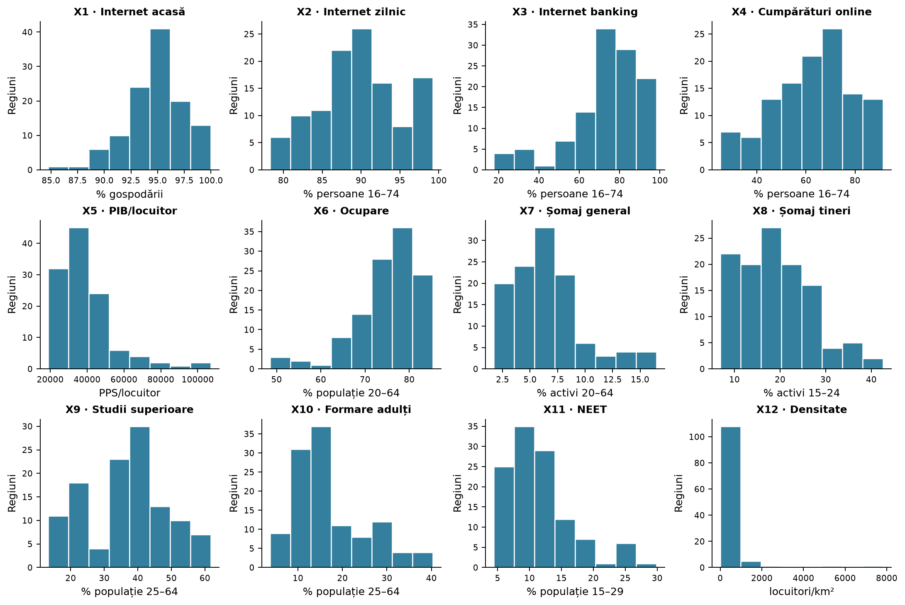

## Boxplot în unități originale

**Urmărești:** mediana, cutia și punctele separate.

**Spui:** „Punctele separate semnalează valori potențial atipice. Densitatea prezintă valori extreme ridicate; acestea pot reflecta particularități regionale reale.”

Mustățile nu sunt obligatoriu minimul și maximul tuturor observațiilor.

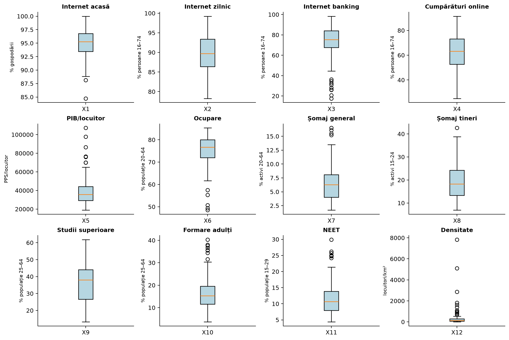

## Boxplot standardizat

**Urmărești:** aceleași elemente, acum pe scară comună.

**Spui:** „După standardizare, putem compara pozițiile relative și extremele indicatorilor. Densitatea păstrează extreme pozitive puternice, deci standardizarea nu le elimină.”

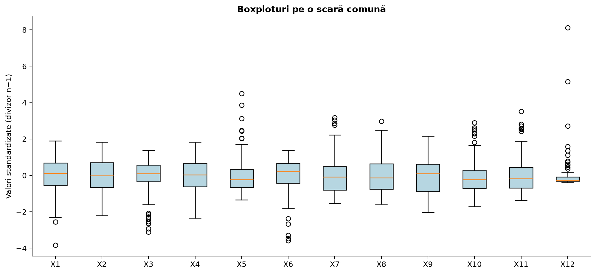

## Matricea observațiilor: plot(X)

**Urmărești:** relația dintre variabilele indicate de rând și coloană.

**Spui:** „Fiecare nor de puncte descrie o pereche de indicatori. Norii înclinați în sus sugerează asociere pozitivă, iar cei înclinați în jos asociere negativă.”

Nu toate celulele descriu aceleași două variabile.

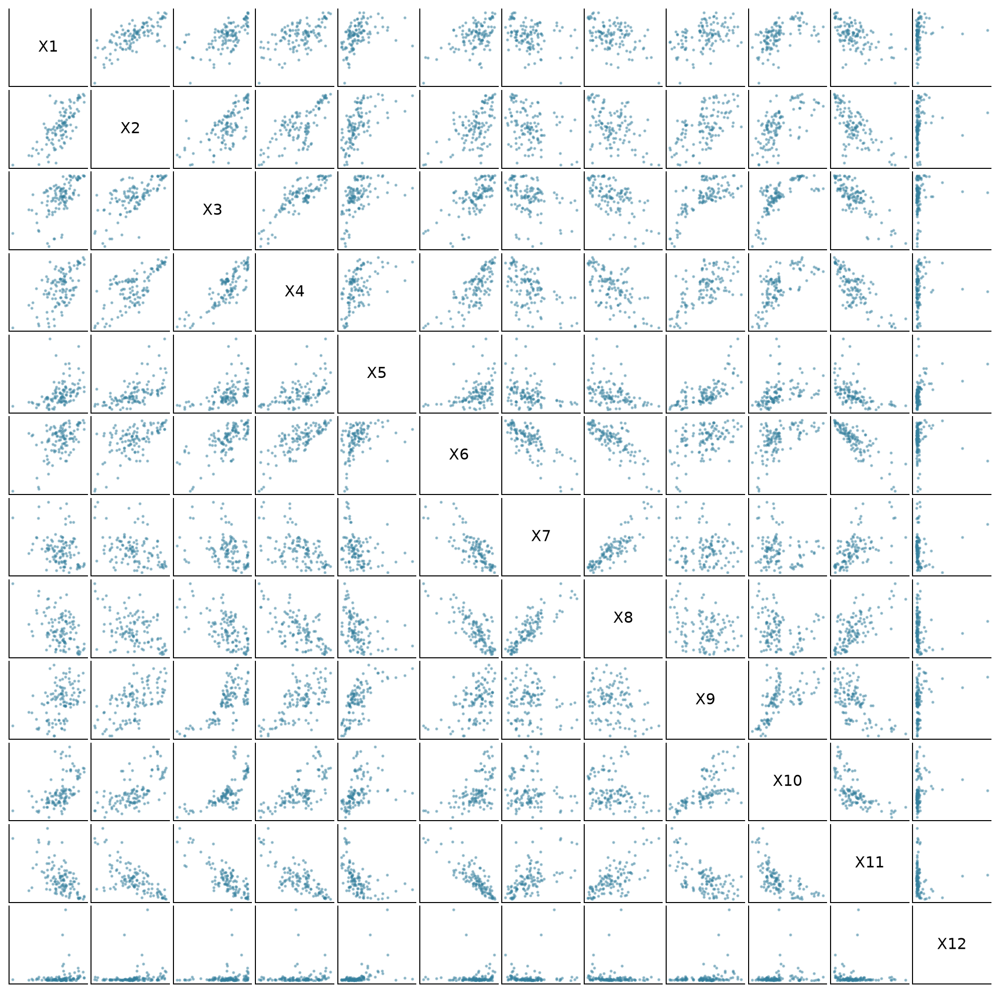

## Scatterplot cu două variabile

**Spui:** „Fiecare punct este o regiune. Tendința ascendentă sugerează că utilizarea zilnică mai mare a internetului coexistă cu PIB/locuitor mai ridicat. Asocierea nu dovedește cauzalitate.”

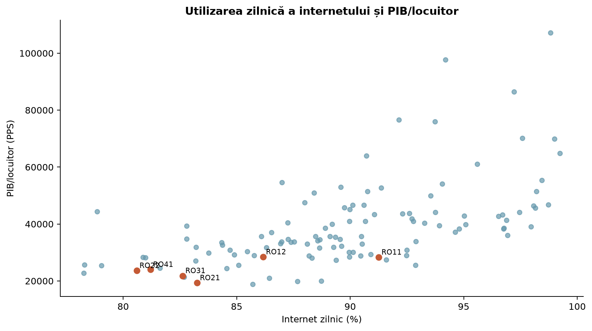

## Corrplot: matricea colorată

**Spui:** „Culorile și coeficienții indică sensul și intensitatea corelațiilor. Ocuparea și NEET au asociere negativă puternică, aproximativ −0,839.”

Citești legenda înainte să atribui sens culorilor.

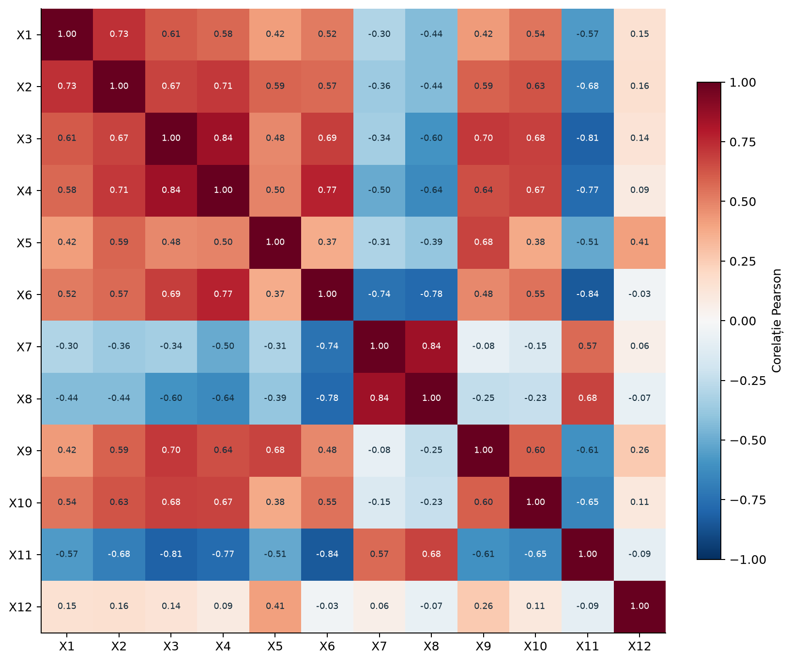

## Grafic cu trei variabile

**Spui:** „Poziția arată internetul zilnic și PIB-ul, iar culoarea arată ocuparea. Pot identifica regiuni cu poziții apropiate, dar niveluri de ocupare diferite.”

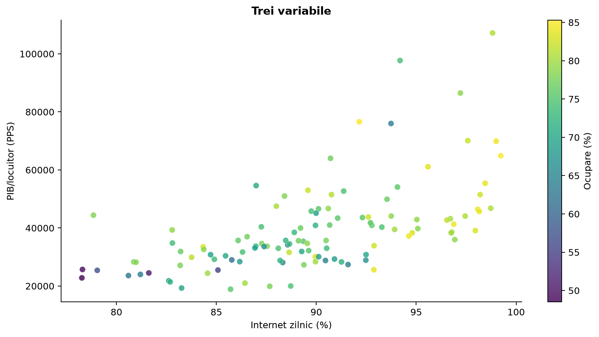

## Grafic cu patru variabile

**Spui:** „Pe lângă internet, PIB și ocupare, aria punctului reprezintă studiile superioare. Un punct mai mare înseamnă o pondere mai mare a studiilor superioare, nu o populație mai mare.”

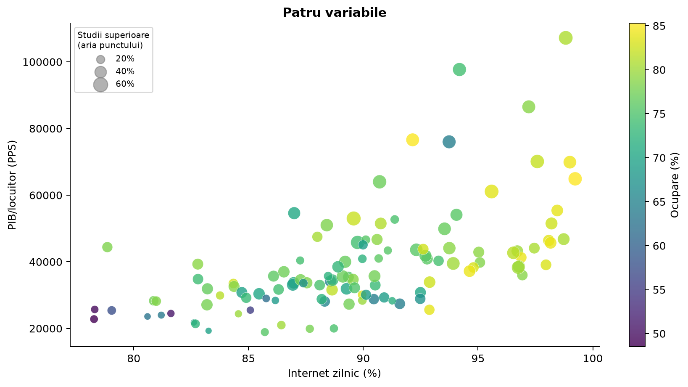

## Scree plot și fviz_eig

**Spui:** „Prima axă explică 55,95%, iar primele patru 85,06%. Pentru minimum 80% păstrez patru componente. Criteriul Kaiser recomandă trei, care explică numai 79,47%.”

În scree plot urmărești și aplatizarea scăderii. Verifici dacă înălțimea reprezintă lambda sau procentul explicat.

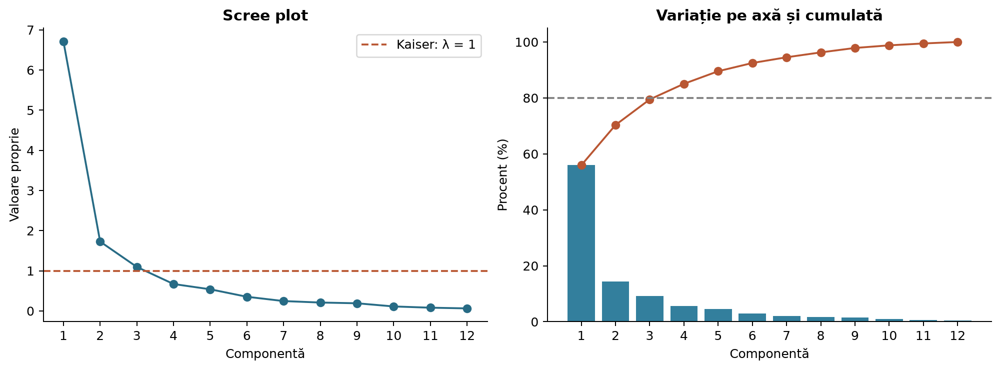

## Cercul corelațiilor PC1–PC2: fviz_pca_var

**Spui:** „Planul explică 70,34%. PC1 opune digitalizarea și integrarea economică și socială șomajului și NEET. Săgețile indicatorilor digitali au direcții apropiate, sugerând asociere pozitivă.”

Săgeți lungi = reprezentare bună în plan. Direcții opuse sugerează asociere negativă dacă reprezentarea este bună. Pentru o săgeată scurtă, concluziile din unghiuri sunt fragile.

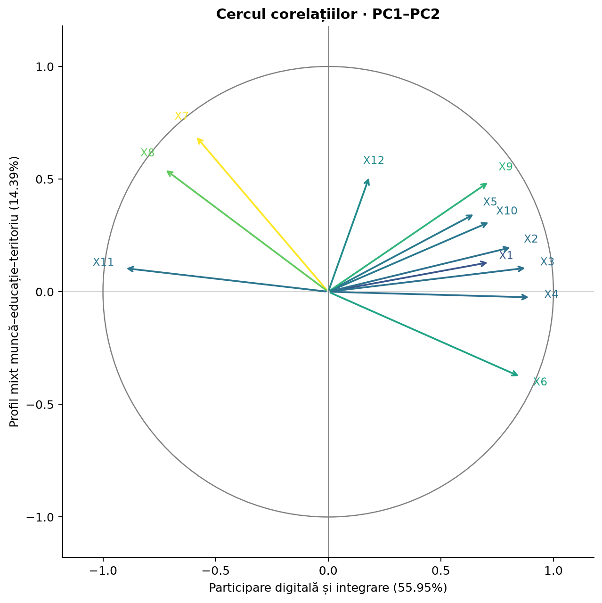

## Cercul corelațiilor PC3–PC4

**Spui:** „Acest plan explică încă 14,72% din variație. PC3 opune densitatea și PIB-ul formării adulților; PC4 opune accesul la internet studiilor superioare.”

Dreapta reprezintă acum PC3; nu transferi automat semnificația digitalizării de pe PC1.

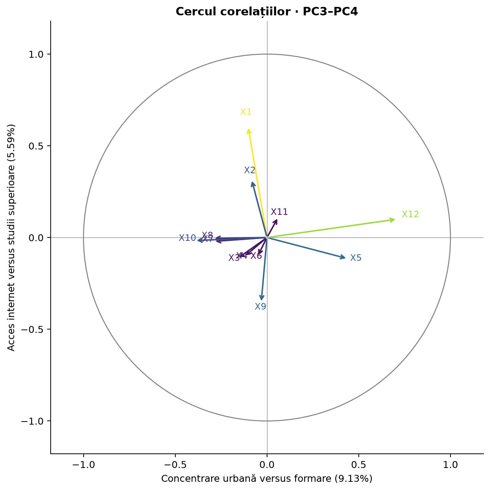

**Pentru ambele cercuri:** `col.var="contrib"` colorează contribuția, iar `col.var="cos2"` calitatea reprezentării în plan. Culoarea nu înseamnă performanță; lungimea și culoarea pot descrie lucruri diferite.

## Regiunile pe PC1–PC2: fviz_pca_ind

**Spui:** „Regiunile românești incluse au PC1 negativ, deci sunt în sensul opus profilului digital și economic favorabil al acestei axe. BE10 se distinge prin scor PC2 ridicat. Planul descrie 70,34% din variație.”

Apropierea în plan sugerează scoruri asemănătoare aici; cos² arată cât de bine justifică planul citirea fiecărei regiuni. Cos² mare nu înseamnă regiune mai dezvoltată.

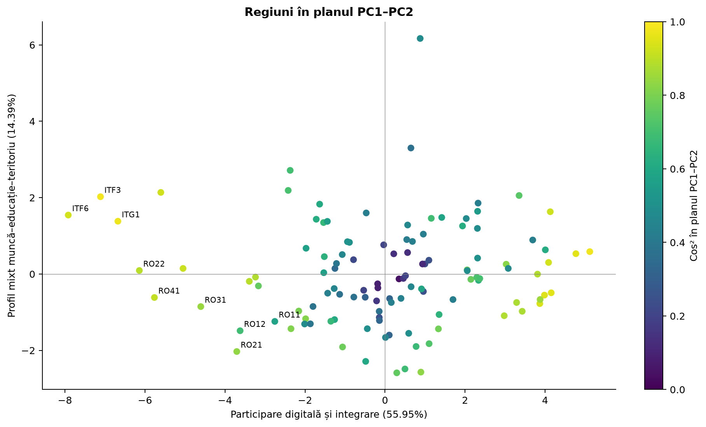

## Regiunile pe PC3–PC4

**Spui:** „Graficul evidențiază diferențe suplimentare privind concentrarea urbană, formarea și accesul la internet. Regiuni apropiate în primul plan se pot diferenția în acesta.”

Culoarea dată de `col.ind="cos2"` se referă la calitatea în planul afișat, aici PC3–PC4.

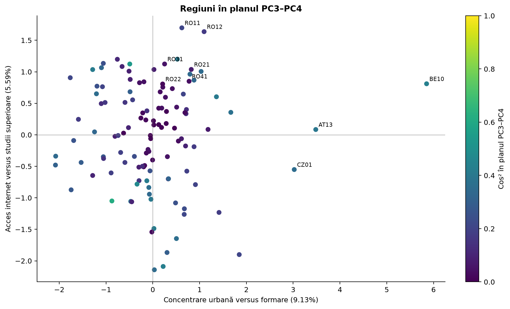

## Biplot cu PC1 pe orizontală

**Spui:** „Codurile sunt regiuni, iar săgețile sunt indicatori. Dreapta corespunde scorurilor PC1 mai ridicate, asociate participării digitale și integrării. Regiunile românești incluse se află în sensul negativ al acestei axe.”

Pentru legătura regiune–indicator contează proiecția pe direcția săgeții, în scalarea biplotului, nu apropierea de vârful ei. Punctele și săgețile pot avea scări diferite.

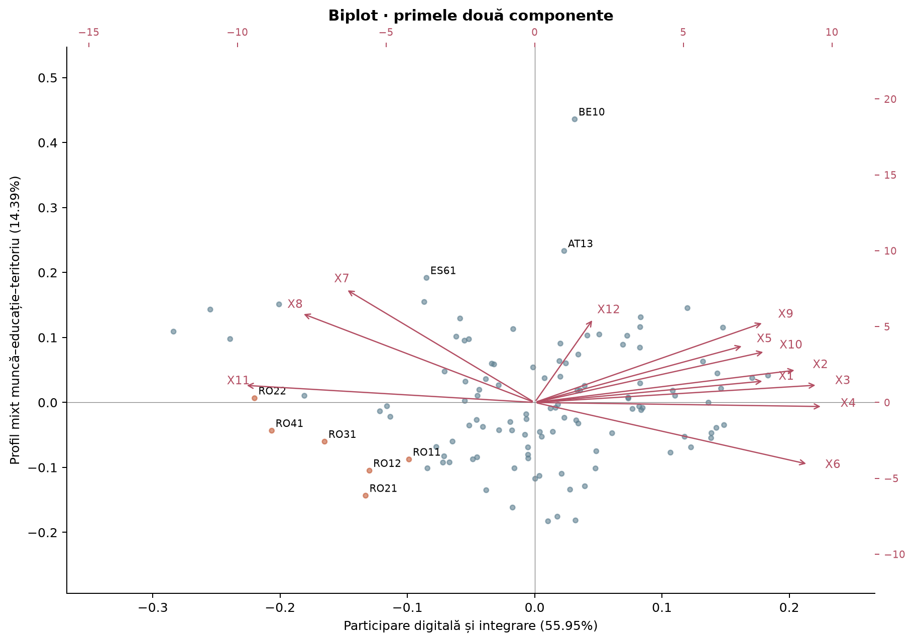

## Biplot vertical

**Spui:** „PC1 este pe verticală, deci profilul digital și economic mai favorabil este acum în sus. PC2 este pe orizontală. Inversarea poziției axelor schimbă desenul, nu rezultatele analizei.”

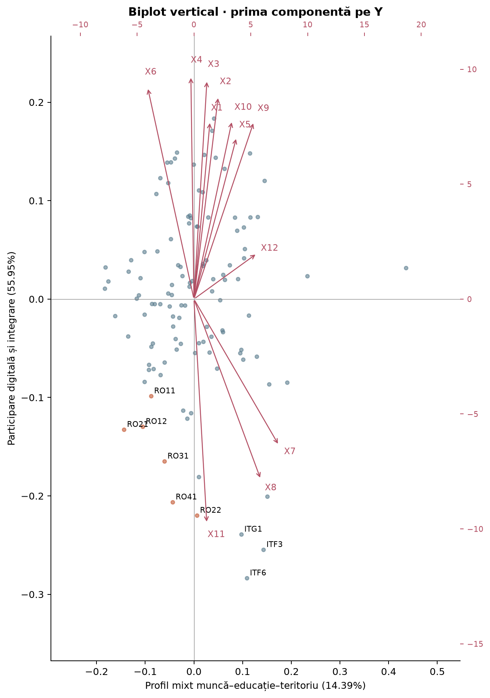

## Primele patru componente într-un grafic

**Spui:** „X și Y arată PC1 și PC2, culoarea PC3, iar mărimea crescătoare PC4. Sunt reprezentate patru scoruri, care explică împreună 85,06%, dar numai pozițiile punctelor corespund celor 70,34% din primul plan.”

Un punct mai mare are PC4 mai mare, nu automat performanță mai bună. Distanța dintre puncte pe ecran nu este distanța completă în patru dimensiuni.

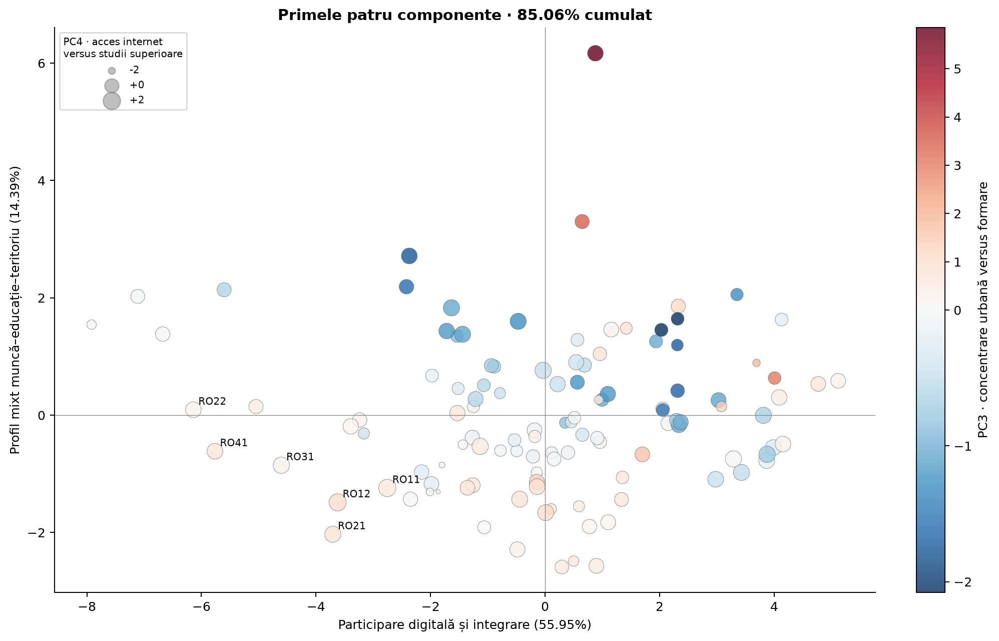

[Înapoi la început](00_INCEPE_AICI.md) · [Urmează: recapitularea](05_RECAPITULARE_RAPIDA.md)
