  # Cum interpretez outputurile R la parțial

Material pentru seminariile 1–2, 4–5 și 5–6. Bazat pe PDF-urile locale, cursul de ACP și outputurile existente în `Rezolvare Seminar/rezultate_R`. Nu presupune că profesorul va folosi aceleași variabile sau aceleași valori. Nu au fost executate analize R pentru pregătirea acestei fișe.

## 1. Structura unui răspuns complet

Pentru fiecare output scrie, în această ordine:

1. **Identificare:** ce obiect / grafic este și ce reprezintă rândurile și coloanele.
2. **Citire:** citează două-trei valori concrete, cu semn și unitate corectă.
3. **Interpretare:** explică relația sau profilul economic rezultat.
4. **Acoperire:** spune ce axe, populație și procent de variație sunt reprezentate, dacă este cazul.
5. **Limită:** spune ce nu poți deduce legitim: cauzalitate, independență, performanță sau similaritate completă.

Model: „Acesta este tabelul coordonatelor variabilelor într-o ACP standardizată. X6 se corelează pozitiv cu prima axă (0,856), iar X11 negativ (−0,907). Axa opune ocuparea indicatorului NEET. Interpretarea descrie asocieri regionale, nu o relație cauzală.”

Dacă outputul nu conține informația necesară, scrie explicit acest lucru. Nu inventa numele indicatorilor sau unitățile dacă lipsesc din enunț.

## 2. Recunoaștere rapidă

| Ce vezi | Ce înseamnă | Ce urmărești |
|---|---|---|
| `dim(X)` | Dimensiunile datelor | Prima valoare = observații, a doua = variabile |
| `mean`, `sd`, `quantile` | Statistici descriptive | Nivel, dispersie, cuantile și unități |
| Histogramă | Distribuția unei variabile | Asimetrie, moduri, dispersie, valori rare |
| Boxplot | Mediană, balamale, mustăți, valori extreme | Comparații și outlieri |
| `cor(X)` / `corrplot` | Matrice de corelație | Semn, intensitate, perechi de variabile |
| `eigen(R)$values` | Valori proprii | Varianțele componentelor în ACP pe R |
| `eigen(R)$vectors` | Vectori proprii | Coeficienții unitari ai componentelor |
| `summary(princomp(...))` | SD, proporție și proporție cumulată | `sdev² = lambda`; câte axe păstrezi |
| `acp$loadings` | Coeficienții combinațiilor liniare | Nu sunt automat corelații |
| `acp$scores` / `PCA$ind$coord` | Scorurile observațiilor | Poziții față de centrul datelor |
| `cor(X,scores)` | Matricea factor | Corelațiile variabilă–componentă |
| `PCA$eig` | Lambda, procent, procent cumulat | Diferența procent / proporție |
| `Variables: Dim, ctr, cos2` | Output pentru variabile | Coordonată, contribuție, calitate |
| `Individuals: Dist, Dim, ctr, cos2` | Output pentru observații | Distanță, scor, contribuție, calitate |
| Cercul corelațiilor | Variabilele în plan | Direcții, lungimi și legenda culorilor |
| Graficul indivizilor | Observațiile în plan | Scoruri, cos², profiluri în proiecție |
| Biplot | Variabile + observații | Două tipuri de obiecte, uneori două scări |

Într-o ACP standardizată, `PCA$var$coord` coincide cu matricea factor. Pentru ACP fără standardizare, nu transfera automat această regulă: verifică `var$cor` și convenția outputului.

## 3. Date și statistici descriptive

**Tipul datelor:** profil = mai multe entități la același moment; serie de timp = aceeași mărime în momente diferite; panel = mai multe entități urmărite în timp. Proiectul are date de profil, observaționale, numerice, pentru 116 regiuni și 12 indicatori din 2024. Codul, anul și numele regiunii sunt identificatori.

**Medie:** nivel mediu; sensibilă la extreme. **Mediană:** valoarea centrală în datele ordonate; mai puțin sensibilă la extreme. **SD:** dispersie în unitatea variabilei, nu procent automat. Pentru rate procentuale, SD este în puncte procentuale.

Exemplu: media șomajului = 6,54%, mediana = 6,30%, SD = 3,13 puncte procentuale. NU spune „șomajul crește cu 3,13%”.

**Q1 și Q3:** delimitează jumătatea centrală a distribuției. **IQR = Q3 − Q1.** Pentru cuantilele descriptive R folosește implicit `type=7`. În boxplot, R folosește balamalele Tukey; evită să amesteci pragurile din convenții diferite.

**CV = 100 × SD / medie:** dispersie relativă, dacă media este pozitivă, departe de zero și scala permite interpretarea raportului. Nu folosi CV pentru date centrate, unde media este aproximativ zero.

**Valori precum 2e−16:** de regulă zero la precizia numerică în calculele de centrare. Nu le interpreta drept o medie economic semnificativă.

## 4. Histograma și boxplotul

La histogramă: identifică variabila și unitatea; descrie unde se concentrează valorile și încotro este coada. Coada spre dreapta = asimetrie pozitivă; coada spre stânga = negativă. Numărul de intervale influențează forma desenului. Forma aparent simetrică nu demonstrează normalitatea.

La boxplot: linia din cutie = mediană; cutia = jumătatea centrală; mustățile se opresc la observațiile extreme care sunt încă în limitele regulii de 1,5 IQR. Punctele separate sunt valori potențial atipice. Mustățile NU sunt obligatoriu minimul și maximul întregului set.

Limite clasice: H1 − 1,5(H3−H1) și H3 + 1,5(H3−H1). Un outlier nu este automat eroare și nu se elimină automat. Boxploturile standardizate compară profiluri pe scară comună; cele în unități originale trebuie citite cu atenție când scările diferă.

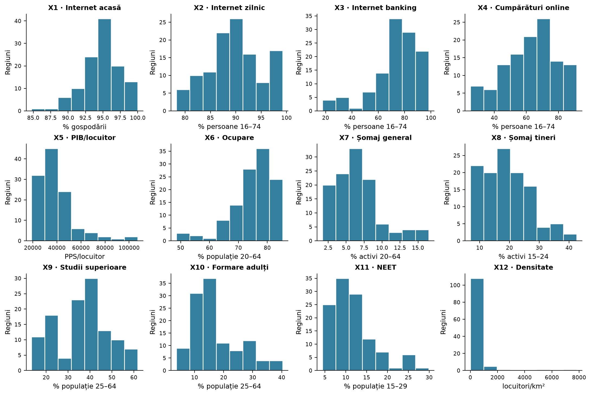

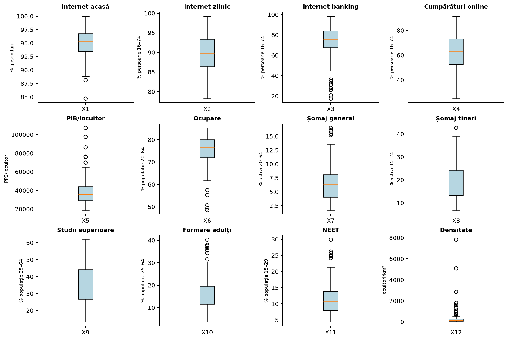

Exercițiu oral: descrie PIB și densitatea fără să folosești expresia „datele sunt rele”. Explică de ce extremele pot fi caracteristici reale ale unor regiuni.

## 5. Corelații

Corelația Pearson este între −1 și 1; semnul arată sensul, modulul intensitatea asocierii liniare. Diagonala matricei este 1, iar matricea este simetrică. Covarianța nu este limitată la acest interval și depinde de unități.

Model: „r(X2,X5)=0,585 indică asociere liniară pozitivă: regiunile cu utilizare zilnică mai mare a internetului tind să aibă PIB/locuitor mai mare.” Intensitatea poate fi numită moderată, dar nu există praguri universale de etichetare; citează întotdeauna valoarea.

r aproape de zero înseamnă asociere liniară slabă, nu dovada absenței oricărei relații. r negativ nu înseamnă că valorile indicatorilor sunt negative. Corelație nu înseamnă cauzalitate. Un coeficient singur nu îți permite să afirmi semnificație statistică; dacă nu ai test, p-value sau interval relevant, nu inventa această concluzie.

Spearman folosește rangurile și caracterizează asocierea monotonă. Nu îl confunda cu Pearson.

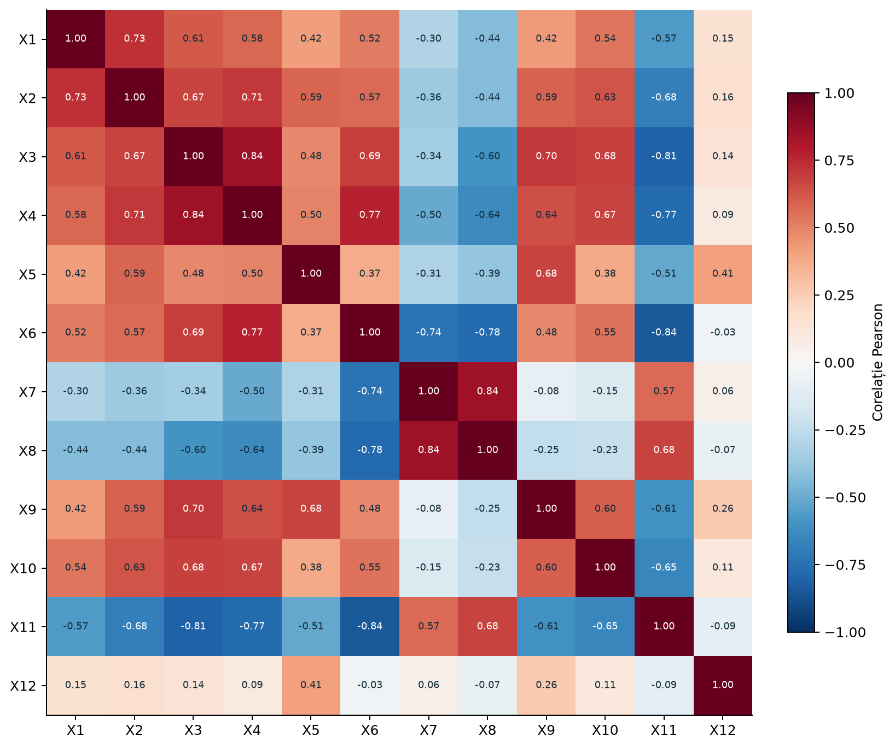

## 6. Standardizare și alegerea matricei

`z_ij = (x_ij − media_j) / sd_j`. Coloanele au medie aproximativ zero și SD unu în convenția utilizată. Standardizarea nu elimină asimetria sau outlierii.

`princomp(X, cor=TRUE)` face ACP pe corelații, potrivită când unitățile și dispersiile diferă. În ACP pe covarianță, variabilele cu dispersie numerică mare pot domina.

**Reguli condiționate:**

- ACP pe corelații cu p variabile: suma lambda = p; Kaiser λ>1 este aplicabil ca regulă de selecție.
- ACP pe covarianță: suma lambda = suma varianțelor originale; nu este obligatoriu p. Nu aplica mecanic Kaiser λ>1 pe unități arbitrare.
- Pentru variabile standardizate, covarianța și corelația coincid când sunt calculate cu convenții compatibile.

În proiect: p=12, suma lambda=12. La examen poate fi alt p: citește enunțul.

## 7. Valorile proprii și `summary(princomp)`

În `summary(acp)`:

- `Standard deviation` = sqrt(lambda).
- `Proportion of Variance` = lambda / suma lambda, între 0 și 1.
- `Cumulative Proportion` = suma proporțiilor până la acea axă.

În `PCA$eig`, procentul este de obicei afișat direct pe scara 0–100. Nu confunda 0,5595 cu 0,5595%: înseamnă 55,95%.

```text
                             Comp.1  Comp.2  Comp.3  Comp.4
Standard deviation           2.5911  1.3140  1.0468  0.8188
Proportion of Variance       0.5595  0.1439  0.0913  0.0559
Cumulative Proportion        0.5595  0.7034  0.7947  0.8506
```

Fragment rotunjit, pentru primele patru axe ale proiectului. Ridică la pătrat SD pentru a obține lambda. Nu pătra procentul și nu lua rădăcina din proporția cumulată pentru a obține SD.

**Selecție:** Kaiser dă 3 axe; pragul de minimum 80% dă 4. Pragul de 80% este alegerea proiectului, nu o lege universală. Dacă problema cere 75%, 90% sau 95%, recalculezi după coloana cumulată. Scree plot: cauți punctul de schimbare a pantei; nu inventezi o concluzie unică dacă graficul este ambiguu.

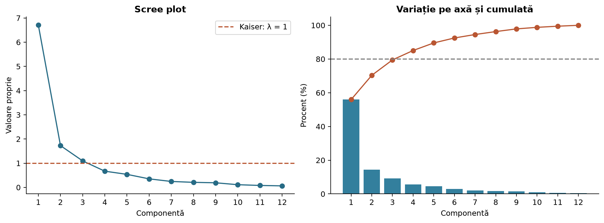

## 8. Loadings, matrice factor și scoruri: nu le confunda

`loadings` din princomp = coeficienții vectorilor proprii unitari. `scores` = coordonatele observațiilor. `MF=cor(X,scores)` = corelațiile indicatorilor cu componentele.

Pentru ACP standardizată: `MF_jk = loading_jk × sqrt(lambda_k)`. De aceea loading și corelație nu au aceeași valoare.

| Variabilă | princomp$loadings PC1 | PCA$var$coord Dim.1 |
| --- | --- | --- |
| X6 | 0.3303 | 0.8558 |
| X7 | -0.2281 | -0.5910 |
| X11 | -0.3500 | -0.9069 |

Un loading X6=0,3303 NU înseamnă o corelație de 0,3303 cu PC1; corelația este aproximativ 0,8558. De asemenea, 0,3303 nu este „pondere de 33,03%”: coeficienții pot fi negativi și nu însumează obligatoriu 1.

Ecuația unei componente: `PC1_i = v_11 z_i1 + ... + v_p1 z_ip`. Coeficienții se aplică variabilelor standardizate atunci când ACP este pe corelații. Vectorii proprii au normă unu și sunt ortogonali pentru matricea simetrică.

La afișarea `loadings`, R poate ascunde coeficienții mici. Un spațiu gol nu dovedește că valoarea este exact zero.

Semnul unei axe este arbitrar. Dacă îl inversezi, inversezi împreună coeficienții și scorurile; lambda, cos² și contribuțiile rămân aceleași. Dacă la test o axă are semne opuse proiectului, interpretează axa primită, nu orientarea memorată.

## 9. Cum denumesc o componentă necunoscută

1. Găsesc corelațiile mari în modul în coloana matricei factor.
2. Separ indicatorii cu semn pozitiv de cei cu semn negativ.
3. Descriu sensul comun sau contrastul economic.
4. Aleg o denumire care acoperă indicatorii dominanți, fără a sugera cauzalitate.

Exemplu: ocupare +0,86, digitalizare +0,90, NEET −0,91 → „participare digitală și integrare economică și socială”. Nu este o axă exclusiv digitală.

Exemplu: șomaj +0,69, studii superioare +0,49, ocupare −0,38 → profil mixt, nu „dezvoltare pozitivă”. Coexistența regională a studiilor și șomajului nu dovedește că absolvenții sunt șomerii.

Dacă nu ai dicționarul variabilelor, poți descrie matematic „axa opune X1 și X2 lui X3”; nu inventa conținutul economic.

## 10. Outputul `Variables`: Dim, ctr, cos2

Valabil pentru ACP standardizată:

- **Dim.k** = corelația variabilei cu componenta k; semnul dă sensul.
- **cos2** = Dim.k²; cât din variația variabilei este reprezentată pe axă.
- **ctr (%)** = 100 × cos2 / lambda_k; aportul variabilei la construirea axei.

| Variabilă | Dim.1 | ctr 1 (%) | cos2 1 | Dim.2 | ctr 2 (%) | cos2 2 |
| --- | --- | --- | --- | --- | --- | --- |
| X1 | 0.719 | 7.69 | 0.516 | 0.131 | 1.00 | 0.017 |
| X7 | -0.591 | 5.20 | 0.349 | 0.694 | 27.91 | 0.482 |
| X12 | 0.184 | 0.51 | 0.034 | 0.515 | 15.38 | 0.266 |

X1 pe PC1: corelație 0,719; cos² ≈0,516, deci 51,6% din variația X1 este reprezentată pe PC1; contribuție ≈7,69% la varianța PC1. Nu spune „X1 explică 51,6% din PC1”: inversezi sensul cos².

X12 în planul 1–2: 0,034 + 0,266 ≈0,300. Numai circa 30% din variația sa este descrisă de acest plan. În PC3–PC4 calitatea este circa 0,516; primele patru axe ajung la circa 0,816.

Contribuție variabile de referință: 100/p. În proiect: 8,33% pe axă. Aceasta este o referință descriptivă, nu un prag de semnificație statistică.

**Sume de știut:**

| Sumă | Rezultat |
|---|---|
| cos² pe toate axele pentru aceeași variabilă | 1 |
| cos² pe o axă pentru toate variabilele standardizate | lambda axei |
| contribuții pe o axă pentru toate variabilele | 100% |
| contribuțiile unei variabile adunate pe axe | Nu au o regulă generală de 100% |

## 11. Outputul `Individuals`: Dist, Dim, ctr, cos2

- `Dim.k` = scorul observației; nu este o corelație și poate depăși 1 în modul.
- `Dist` = distanța față de centrul datelor în spațiul complet al variabilelor standardizate. **Dist nu este Dist².**
- `cos2_ik = scor_ik² / Dist_i²` = calitatea reprezentării observației pe axa k.
- `ctr_ik (%) = 100 × w_i × scor_ik² / lambda_k`, unde w_i este masa observației. Pentru mase egale, w_i=1/n.

| Regiune | Dist | Dim.1 | Dim.2 | cos2 plan 1–2 | cos2 primele 4 |
| --- | --- | --- | --- | --- | --- |
| RO11 | 3.970 | -2.754 | -1.241 | 0.579 | 0.786 |
| AT13 | 5.540 | 0.647 | 3.301 | 0.369 | 0.764 |
| BE10 | 9.006 | 0.878 | 6.169 | 0.479 | 0.909 |

BE10 are PC2≈6,169: este puternic în sensul pozitiv al acelei axe, nu are „corelație 6,169”. Cos² în primul plan≈0,479: acesta surprinde circa 47,9% din distanța sa pătratică totală față de centru; primele patru axe surprind circa 90,9%.

Referința contribuției egale: 100/n. În proiect: 0,862%. O contribuție mare înseamnă că observația participă mult la construirea axei; nu implică performanță economică bună.

Pentru un plan se adună cos² ale axelor. Suma cos² pe toate axele pentru o observație cu distanță nenulă este 1. La o observație exact în centru, raportul cos² poate fi nedefinit.

Un punct aproape de originea primului plan poate fi departe pe PC3 sau PC4. Nu afirma că are profil mediu pe toate variabilele fără informație suplimentară.

## 12. Cercul corelațiilor

Citește întâi numele axelor, procentele și legenda culorilor. Într-o ACP standardizată, coordonatele săgeții sunt corelațiile cu cele două axe. Pătratul lungimii săgeții = suma cos² pe cele două axe; cercul unitate delimitează reprezentarea.

- Săgeată lungă: variabilă bine reprezentată în plan. Nu înseamnă neapărat contribuție mare la fiecare axă.
- Aceeași direcție: asociere pozitivă sugerată; direcții opuse: negativă; aproximativ perpendiculare: asociere liniară slabă sugerată în proiecție.
- Interpretarea unghiurilor este aproximativă în plan redus și trebuie susținută de calitatea reprezentării. Nu deduce corelația exactă dintr-o poză.
- `col.var="contrib"`: culoarea codifică contribuția la axele afișate.
- `col.var="cos2"`: culoarea codifică reprezentarea în plan. Citește legenda; nu presupune că roșu înseamnă bun sau că aceeași culoare are același sens în alte grafice.
- `repel=TRUE`: aranjează etichetele; nu schimbă datele sau rezultatele.

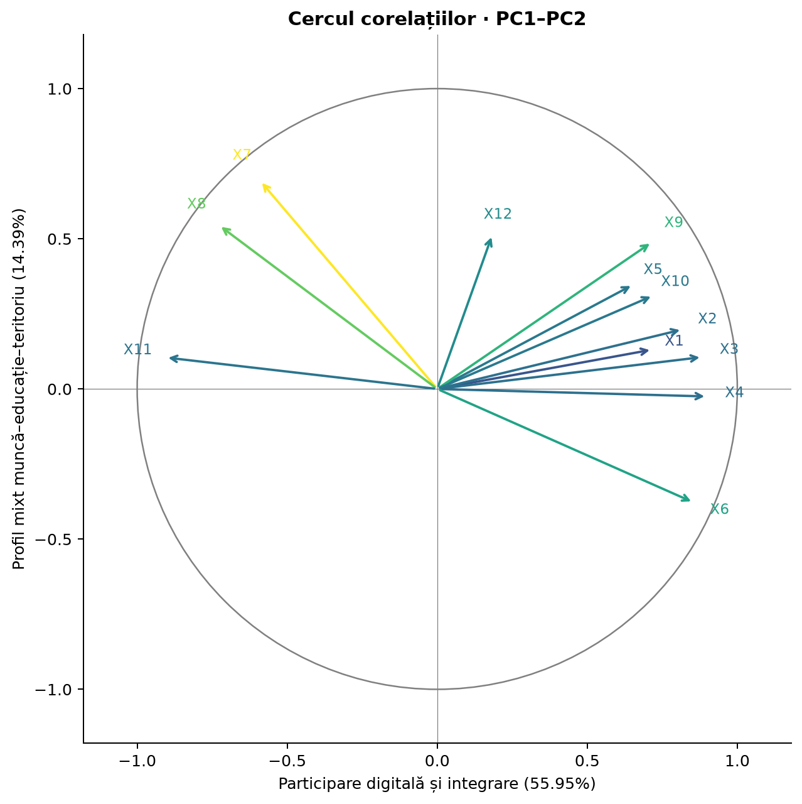

Model: „Planul PC1–PC2 explică 70,34%. Indicatorii digitali sunt orientați apropiat, iar NEET în sens opus. X12 are săgeată mai scurtă și este reprezentat mai slab aici; nu concluzionez că este neimportant în întreaga analiză.”

## 13. Graficul observațiilor

Punctele sunt observații, coordonatele sunt scoruri. Apropiere = scoruri apropiate pe axele afișate; depărtare = diferențe în proiecție. Interpretarea completă cere cos² și componentele suplimentare. Proximitatea în 2D poate ascunde diferențe mari în dimensiunile omise.

`col.ind="cos2"` colorează calitatea reprezentării în plan. Cos² mare nu înseamnă bogăție, bunăstare sau contribuție mare obligatoriu. Originea reprezintă centrul pe axele afișate.

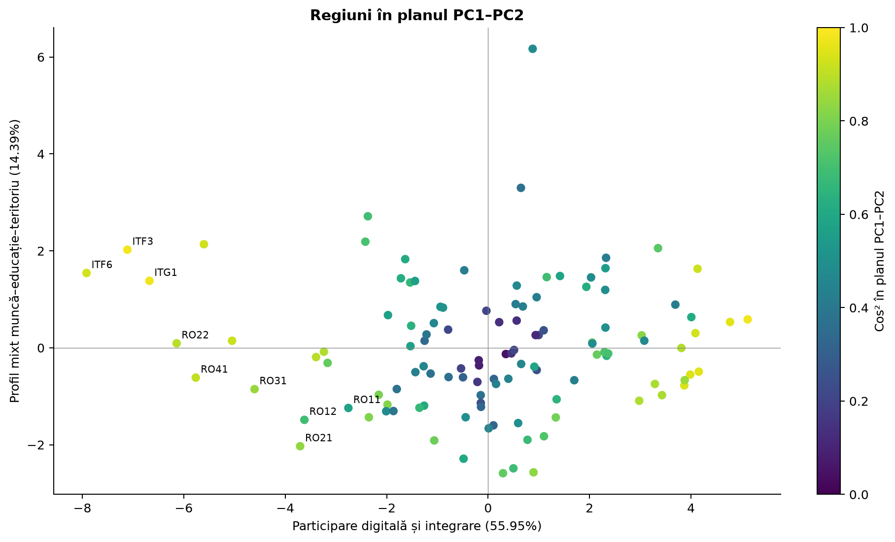

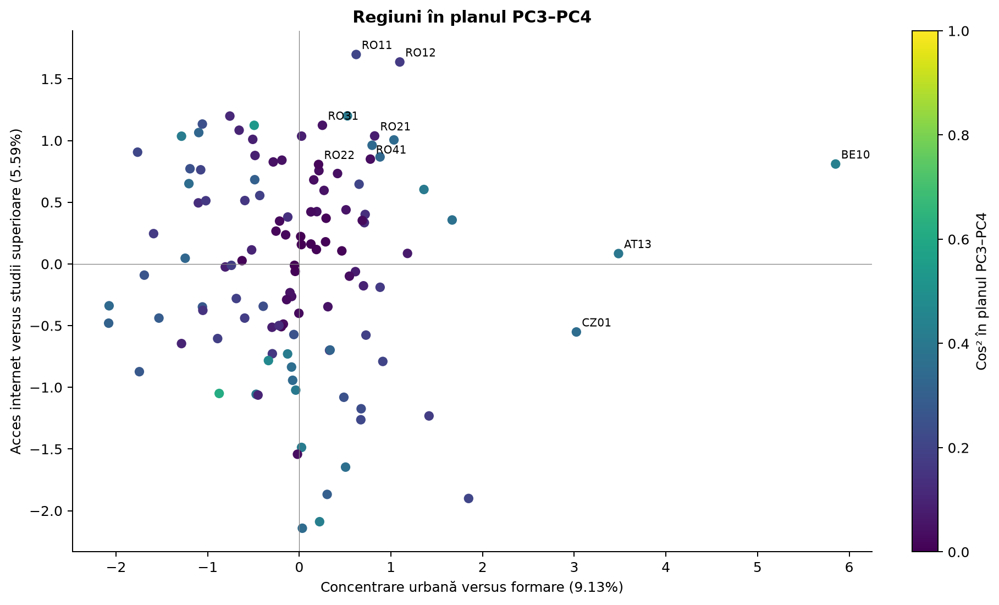

Dacă axes=c(3,4), citești PC3 și PC4, cu circa 14,72% din variație în proiect. Nu mai aplici semnificația „dreapta = digitalizare”, care era pentru PC1.

## 14. Biplotul

Arată simultan observațiile și variabilele. Identifică separat codurile observațiilor și săgețile. Verifică numele axelor și scările. În biplotul princomp implicit, punctele și săgețile au scări diferite; lungimea săgeții nu se interpretează automat la fel ca în cercul corelațiilor.

Pentru asocierea unei regiuni cu o variabilă contează proiecția sa pe direcția săgeții, în convenția de scalare a biplotului; nu distanța de la punct la vârful săgeții. Nu citi valori originale exacte fără transformări și scara corespunzătoare.

În proiect, PC1 opune digitalizarea, PIB, ocuparea și educația șomajului și NEET. PC2 este mixt: pozitiv nu înseamnă automat mai bine.

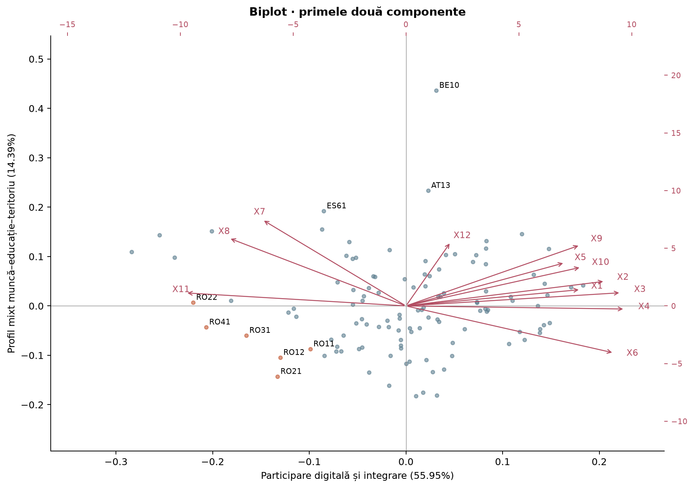

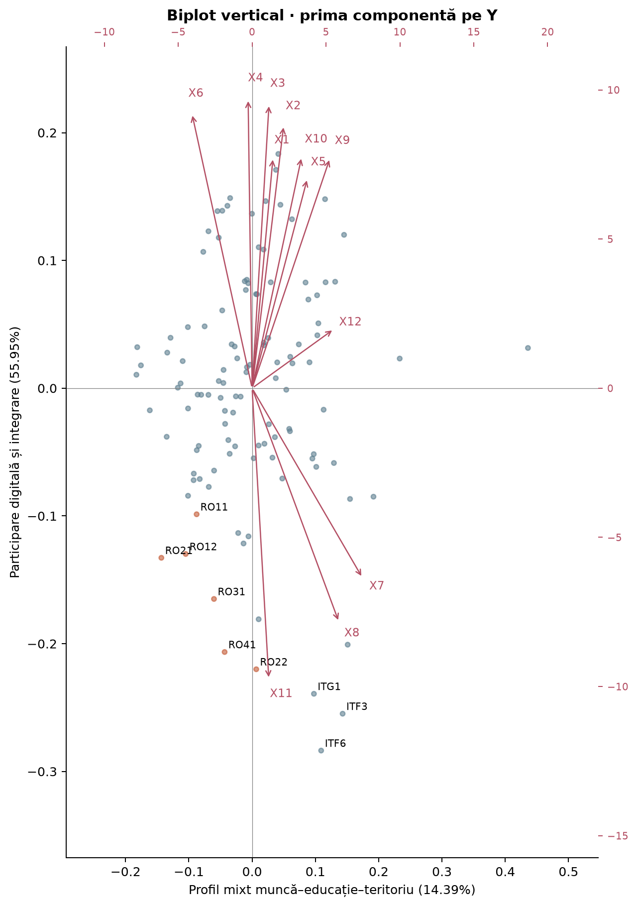

În varianta verticală, PC1 este pe Y și PC2 pe X. Schimbarea axelor schimbă orientarea interpretării în desen, nu analiza. Nu confunda această schimbare cu inversarea semnului unei componente.

## 15. Grafice cu trei/patru variabile și patru componente

Începe cu maparea: ce înseamnă X, Y, culoarea și mărimea. Nu presupune că mărimea reprezintă populația. Pentru un grafic cu variabile originale, indică unitățile; pentru scoruri, explică semnificația axelor.

În proiect, graficul original: X=internet zilnic, Y=PIB, culoare=ocupare, aria=studii superioare.

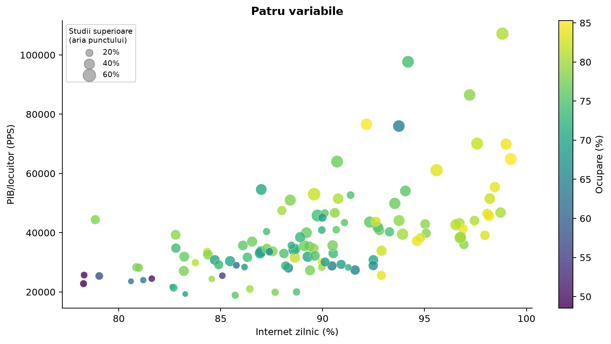

Graficul ACP: X=PC1, Y=PC2, culoare=PC3, mărime crescătoare=PC4. Un punct mare înseamnă scor PC4 mai mare, nu modul mai mare și nu automat performanță mai bună. Primele patru axe explică 85,06%, dar poziția punctelor explică numai 70,34%; distanțele vizuale nu sunt distanțe fidele în 4D.

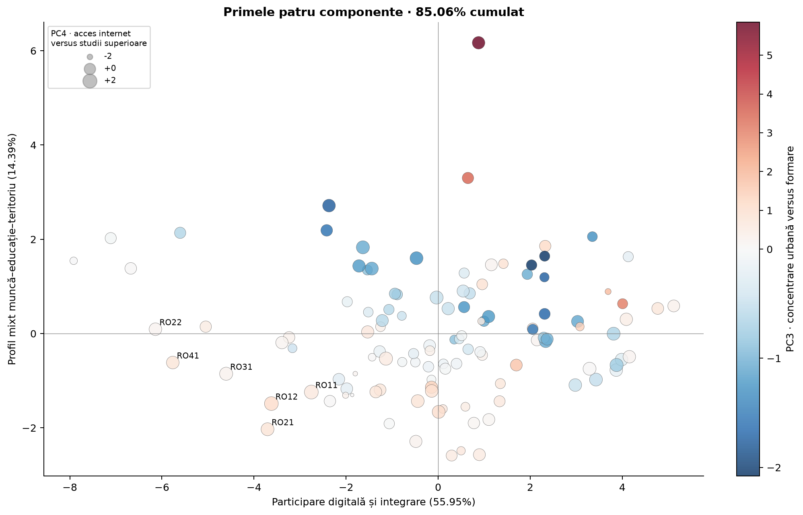

## 16. Proprietăți teoretice și comparații numerice

`R v = lambda v`; vectorii proprii unitari dau coeficienții. Prima axă maximizează varianța sub restricția normei unu; următoarele maximizează variația rămasă, cu ortogonalitate. Lambda sunt necreșătoare (pot exista egalități).

Cu toate componentele: suma lambda conservă varianța totală; produsul lambda conservă determinantul matricei analizate, adică varianța generalizată. Componentele sunt necorelate; nu afirmi automat independență.

Dacă există valori proprii egale sau aproape egale, axele pot fi reorientate în subspațiul respectiv, nu doar schimbate la semn. Pentru exemplele proiectului sunt distincte; alinierea semnelor este suficientă.

`princomp(cor=TRUE)` și `PCA(scale.unit=TRUE)` trebuie comparate pe aceleași observații și variabile, cu aceleași ponderi și tratament al lipsurilor. După aliniere, valorile proprii, scorurile și matricea factor coincid în limita preciziei numerice. Nu compari loadings direct cu var$coord: primul este coeficient, al doilea este corelație în cazul standardizat.

`scale(X)` folosește divizor n−1; standardizarea din scorurile princomp folosește n. Corecția este:

```r
sqrt(n / (n - 1)) * scale(X) %*% acp$loadings
```

NCP controlează câte coordonate sunt stocate; `ncp=12` nu justifică păstrarea tuturor axelor pentru interpretare. Alegerea analitică se justifică separat.

## 17. Greșeli care costă puncte

- „Scorul 2,5 este o corelație.” → Este coordonată de observație, dacă apare la Individuals.
- „Loading 0,4 înseamnă corelație 0,4.” → Verifică obiectul și factorul sqrt(lambda).
- „cos² 0,64 înseamnă că variabila contribuie cu 64% la axă.” → Este calitatea variabilei; contribuția are alt numitor.
- „Contribuție mare înseamnă regiune dezvoltată.” → Nu; înseamnă aport la axă.
- „Săgeată scurtă = variabilă inutilă.” → Poate fi importantă pe alte axe.
- „Punct aproape de origine = toate valorile sunt medii.” → Numai scorurile din plan sunt mici.
- „Două puncte apropiate în 2D sunt identice.” → Pot diferi pe axele omise.
- „Orice PC pozitiv este favorabil.” → Depinde de indicatorii și semnele axei.
- „Kaiser se aplică mecanic oricărei matrice.” → Pragul 1 are sens în ACP standardizată.
- „Suma lambda este întotdeauna numărul variabilelor.” → Numai pe corelații / variabile standardizate.
- „Componentele necorelate sunt independente.” → Nu în general.
- „Semne opuse între două programe = rezultat greșit.” → Axele au orientare arbitrară.
- „80% este obligatoriu pentru orice ACP.” → Este pragul ales / cerut în problemă.
- „0,70 din cumulative înseamnă 0,70%.” → Înseamnă 70%.
- „Mustățile sunt minimul și maximul.” → Nu obligatoriu dacă există outlieri.
- „Din r pot afirma efectul cauzal sau semnificația statistică.” → Nu fără informația necesară.

## 18. Cum exersez activ

Pentru fiecare figură, formulează cinci propoziții fără să citești fișa. Apoi verifică axele, legenda, numerele și limitele. Pentru un tabel, explică o celulă, un rând și o coloană.

Treci apoi la `02_SIMULARE.md`, fără barem, cu 60 minute pe cronometru. Corectează cu `03_BAREM.md`. Repetă doar tipurile greșite, cu alte numere. Ținta antrenamentului: cel puțin 9/10 de două ori, cu justificări complete; punctajul real depinde de subiect și baremul profesorului.

Materialele acoperă outputurile efectiv rezolvate până acum. Cursul de corespondențe privește variabile calitative și tabele de contingență; este o metodă separată. Dacă profesorul îl include explicit în parțial, trebuie adăugat un modul distinct, nu confundat cu ACP.
