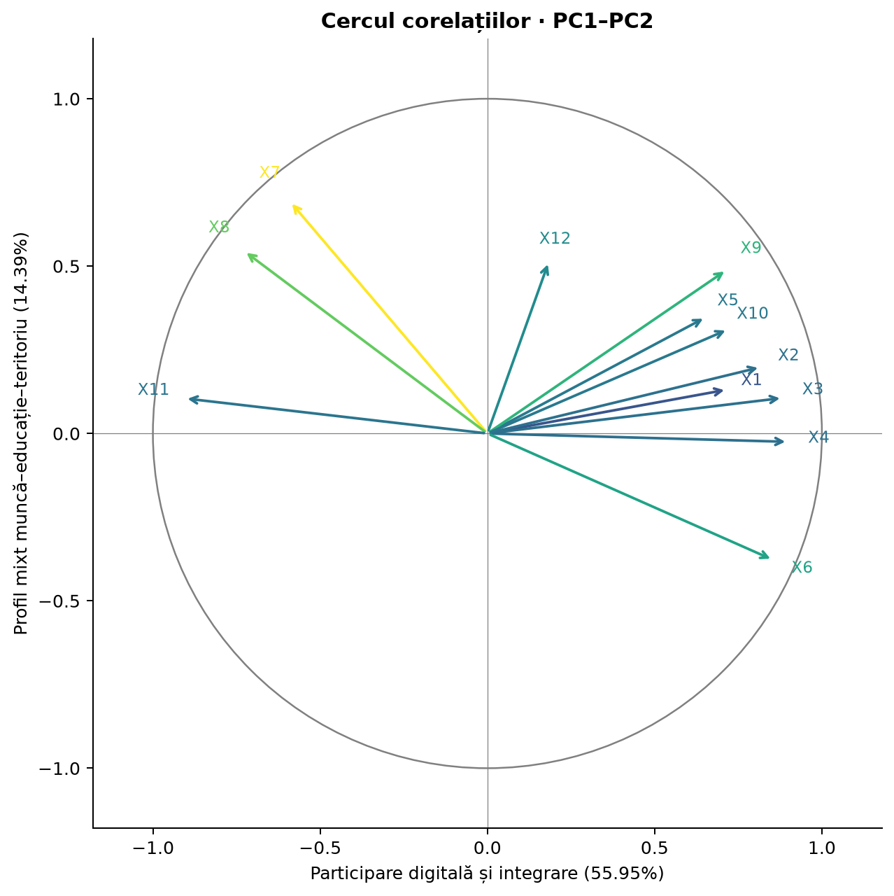
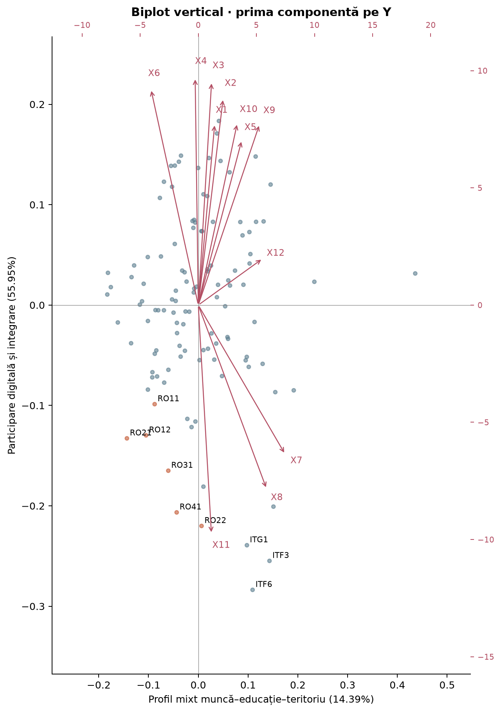
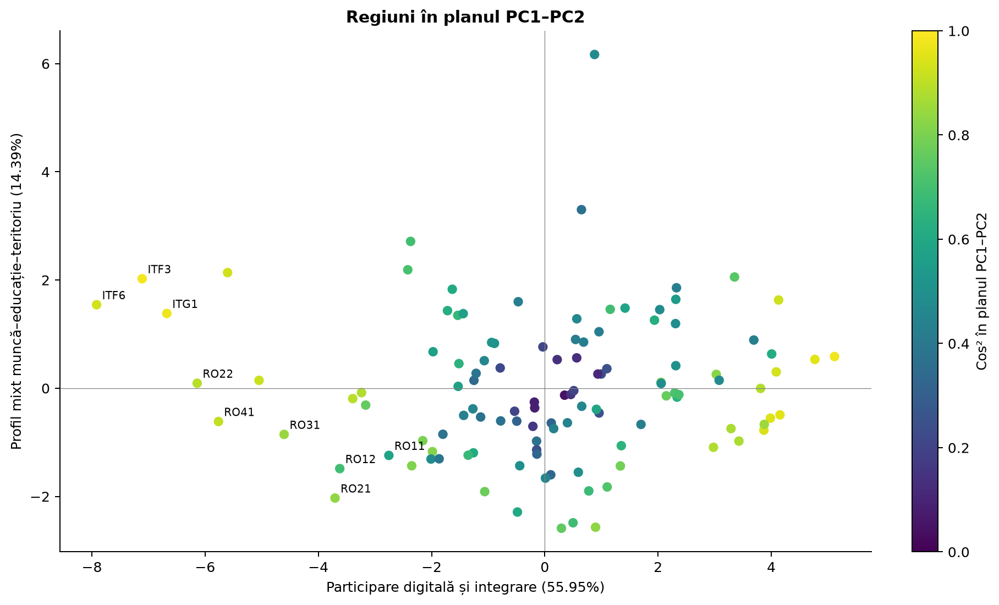

# Simulare — interpretarea outputurilor R

Durată propusă: 60 minute. Barem de antrenament: 1 punct din oficiu + 9 exerciții × 1 punct = 10 puncte. Nu este baremul oficial al profesorului. Scrie răspunsuri în propoziții, cu dovezi numerice și limite. Nu consulta `03_BAREM.md` până nu termini.

## Exercițiul 1 — descriptive și outlieri (1p)

Pentru o variabilă exprimată în procente:

```text
Mean    SD     Min    Q1    Median   Q3    Max
 6.54   3.13    1.70  4.00   6.30   8.05  16.50
```

1. Interpretează media, SD și jumătatea centrală a distribuției.
2. Pentru calculul acestui exercițiu, enunțul precizează că H1=4,00 și H3=8,05 sunt și balamalele folosite la boxplot. Calculează limita superioară și verifică dacă 16,50 este outlier superior.
3. Spune dacă trebuie eliminată automat acea observație.

## Exercițiul 2 — corelație și standardizare (1p)

```text
         X2      X5      X6
X2     1.000   0.585   0.569
X5     0.585   1.000   0.374
X6     0.569   0.374   1.000
```

X2=internet zilnic (%), X5=PIB/locuitor (PPS), X6=ocupare (%).

1. Interpretează r(X2,X5), fără a atribui cauzalitate.
2. Poți afirma din acest output că relația este semnificativă statistic?
3. De ce este indicată standardizarea înainte de ACP?
4. După scale(X), media unei coloane este 2e−16 și SD=1. Este o problemă?

## Exercițiul 3 — summary ACP pe un ALT set de date (1p)

Sunt 80 observații și 8 variabile. S-a folosit cor=TRUE. Output complet pentru cele opt axe:

```text
                         PC1     PC2     PC3     PC4     PC5     PC6     PC7     PC8
Standard deviation      2.0396  1.1314  0.9381  0.7483  0.6325  0.5657  0.4899  0.4000
Proportion of Variance  0.5200  0.1600  0.1100  0.0700  0.0500  0.0400  0.0300  0.0200
Cumulative Proportion   0.5200  0.6800  0.7900  0.8600  0.9100  0.9500  0.9800  1.0000
```

1. Calculează lambda1 și suma valorilor proprii.
2. Câte axe recomandă Kaiser? Câte sunt necesare pentru minimum 80%?
3. Pentru minimum 90%, câte axe sunt necesare?
4. Care sunt dimensiunile scorurilor complete și ale scorurilor soluției de 80%?

## Exercițiul 4 — loadings versus matricea factor (1p)

În proiectul standardizat, lambda1=6,71396:

| Variabilă | princomp$loadings PC1 | PCA$var$coord Dim.1 |
| --- | --- | --- |
| X6 | 0.3303 | 0.8558 |
| X7 | -0.2281 | -0.5910 |
| X11 | -0.3500 | -0.9069 |

X6=ocupare, X7=șomaj general, X11=NEET.

1. Care coloană conține corelații? Verifică relația pentru X6.
2. Propune o interpretare a sensului pozitiv al PC1 folosind aceste trei variabile.
3. Dacă semnele tuturor coeficienților și scorurilor PC1 se inversează, se schimbă lambda1?

## Exercițiul 5 — output Variables (1p)

Sunt 12 variabile standardizate, lambda1=6,71396:

| Variabilă | Dim.1 | ctr 1 (%) | cos2 1 | Dim.2 | ctr 2 (%) | cos2 2 |
| --- | --- | --- | --- | --- | --- | --- |
| X1 | 0.719 | 7.69 | 0.516 | 0.131 | 1.00 | 0.017 |
| X7 | -0.591 | 5.20 | 0.349 | 0.694 | 27.91 | 0.482 |
| X12 | 0.184 | 0.51 | 0.034 | 0.515 | 15.38 | 0.266 |

1. Explică cele trei valori ale X1 pe Dim.1: Dim, ctr și cos2.
2. Calculează cos² pentru X12 în planul PC1–PC2. Este bine justificată citirea sa doar în acest plan?
3. Care este referința unei contribuții egale? Este contribuția X7 la PC1 peste ea?
4. Precizează suma contribuțiilor tuturor variabilelor pe o axă și suma cos² a unei variabile pe toate axele.

## Exercițiul 6 — output Individuals (1p)

Sunt 116 observații cu mase egale:

| Regiune | Dist | Dim.1 | Dim.2 | cos2 plan 1–2 | cos2 primele 4 |
| --- | --- | --- | --- | --- | --- |
| RO11 | 3.970 | -2.754 | -1.241 | 0.579 | 0.786 |
| AT13 | 5.540 | 0.647 | 3.301 | 0.369 | 0.764 |
| BE10 | 9.006 | 0.878 | 6.169 | 0.479 | 0.909 |

1. Explică de ce scorul PC2=6,169 pentru BE10 nu este o corelație invalidă.
2. De ce BE10 poate fi distinct în primul plan, dar totuși cos² în plan să fie sub 0,50?
3. Calculează aproximativ cos² al BE10 pe PC2 din scor și Dist.
4. Care este referința contribuției egale a unei observații la o axă? Poți deduce contribuția exactă doar din cos², fără celelalte informații necesare?

## Exercițiul 7 — cercul corelațiilor (1p)



Denumiri: X1–X4=indicatori digitali; X5=PIB; X6=ocupare; X7–X8=șomaj; X9=studii superioare; X10=formare; X11=NEET; X12=densitate.

1. Identifică planul și procentul de variație explicată.
2. Interpretează sensul PC1 și opoziția dintre ocupare și șomaj.
3. Ce poți spune despre X12 în acest plan și ce nu poți spune despre importanța sa globală?
4. Dacă apelul ar fi col.var="cos2", ce ar însemna culorile? Dar pentru col.var="contrib"?

## Exercițiul 8 — biplot și graficul observațiilor (1p)





1. Pe ce axă este PC1 în primul desen? În ce sens se află scorurile PC1 ridicate?
2. Ce reprezintă codurile și săgețile în biplot? Se citesc obligatoriu pe aceeași scară?
3. Pentru asocierea unui punct cu un indicator, contează apropierea de vârful săgeții sau proiecția pe direcția ei?
4. Două regiuni apropiate în grafic sunt neapărat similare pe toate cele 12 variabile? Explică rolul cos².

## Exercițiul 9 — cod, compararea metodelor și limite (1p)

```r
acp <- princomp(X, cor = TRUE, scores = TRUE)
acp2 <- PCA(X, scale.unit = TRUE, ncp = 12, graph = FALSE)
fviz_pca_var(acp2, axes = c(3, 4), col.var = "cos2")
fviz_pca_ind(acp2, axes = c(3, 4), col.ind = "cos2")
```

1. Ce reprezintă primul grafic și ce reprezintă al doilea? Ce axe și ce informație codifică fiecare culoare?
2. În proiect, cât explică împreună PC3 și PC4? Se mai aplică aici „dreapta = digitalizare”?
3. Ce obiecte compari între princomp și PCA pentru scoruri și pentru matricea factor? Ce faci cu semnele?
4. ncp=12 înseamnă că trebuie interpretate toate cele 12 componente? De ce?

## După cele 60 minute

Corectează cu baremul. Pentru fiecare greșeală scrie: „Am confundat ___ cu ___; regula corectă este ___.” O greșeală de interpretare se corectează reformulând răspunsul, nu doar recitind formula.
