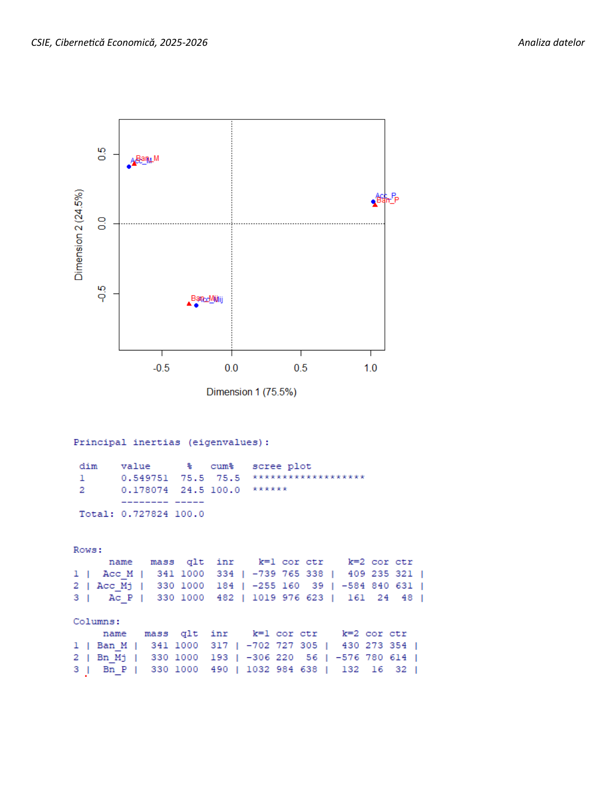

# Seminarul 7 — analiza corespondențelor, explicată simplu

Sursa: `Seminarii/Seminar 7.pdf` și `Cursuri/cap2 - ACoresp.pdf`. Textul profesorului confirmă interpretările scrise de mână pentru materia lucrată. PDF-ul nou trebuie pregătit și el, fără să presupunem că știm exact subiectele de vineri.

**Important:** acesta este exemplul profesorului, cu **179 de observații**, nu o analiză nouă a celor 116 regiuni din proiect. Codurile diferă: internet banking este X8 în exemplul PDF, dar X3 în proiectul nostru. Citești întotdeauna denumirile din subiect.

## 1. Ce este nou față de ACP?

La ACP aveai indicatori numerici: de exemplu, procentul utilizării internetului.

Aici împarți valorile în categorii. De exemplu: nivel ridicat, mediu, redus. Analizezi apoi dacă nivelul unui indicator este asociat cu nivelul celuilalt.

**La test:** „Analiza corespondențelor studiază asocierea dintre două variabile categoriale, pornind de la un tabel de contingență.”

**Reține:** ACP = indicatori numerici. Analiza corespondențelor = categorii și număr de observații în combinațiile lor.

## 2. Tabelul de contingență — câte observații sunt în fiecare combinație?

Tabelul profesorului:

| | Ban_M | Ban_Mij | Ban_P | Total linie |
|---|---:|---:|---:|---:|
| Acc_M | 44 | 15 | 2 | 61 |
| Acc_Mij | 13 | 37 | 9 | 59 |
| Acc_P | 4 | 7 | 48 | 59 |
| Total coloană | 61 | 59 | 59 | 179 |

**37** înseamnă 37 de observații care au simultan categoria `Acc_Mij` și categoria `Ban_Mij`. Nu este procent și nu este corelație.

Etichetele M, Mij, P sunt categoriile folosite de autor; sensul și pragurile se citesc din enunț.

**La test:** „Cele 37 de observații din celula centrală aparțin simultan categoriilor Acc_Mij și Ban_Mij.”

## 3. Observat versus așteptat — apare combinația mai des decât ne-am aștepta?

- **Observat:** ce ai numărat în date: 37.
- **Așteptat la independență:** cât ar rezulta dacă cele două clasificări nu ar fi asociate.

Pentru celula centrală, totalul liniei este 59, totalul coloanei este 59, iar totalul general este 179. Valoarea așteptată este `59 × 59 / 179 ≈ 19,45`.

PDF-ul afișează 19,44; calculul cu precizie completă este 19,4469. Diferența ultimelor zecimale nu schimbă interpretarea.

**La test:** „Combinația Acc_Mij–Ban_Mij apare de 37 de ori, peste valoarea așteptată de aproximativ 19,45 în condiții de independență. Combinația este supra-reprezentată.”

**Reține:** observat > așteptat = combinație mai frecventă decât la independență. Observat < așteptat = combinație mai rară. Nu numești automat orice abatere mică semnificativă statistic.

## 4. Există legătură între variabile?

Dacă primești un test chi-pătrat:

```text
p-value < 0.05
```

**La test:** „La pragul de 5%, respingem ipoteza independenței; există dovezi de asociere între cele două variabile categoriale.”

Dacă p-value > 0,05: „Nu avem suficiente dovezi pentru a respinge independența la pragul de 5%.” Nu spui că independența este demonstrată.

Pentru tabelul profesorului, calculul din cele nouă frecvențe dă chi-pătrat ≈130,281, cu 4 grade de libertate și p≈3,39e−27. Rezultă o abatere puternică de la independență. Acest calcul a fost verificat aritmetic, fără executarea unei analize R noi.

**Reține:** asociere nu înseamnă cauzalitate. Inerția pozitivă singură nu ține locul unui test de semnificație.

## 5. Principal inertias — cât explică axele?

Outputul din PDF:

```text
Principal inertias (eigenvalues)
       value       %     cum%
1      0.549751    75.5    75.5
2      0.178074    24.5   100.0
Total  0.727824   100.0
```

**Cum citești:** prima axă preia 75,5% din inerția totală; a doua adaugă 24,5%. Împreună, cele două axe descriu 100% din inerția acestui tabel 3×3.

**La test:** „Prima axă explică 75,5% din inerția totală, iar primele două axe explică împreună 100%.”

**Capcană:** nu spui că lambda trebuie să fie peste 1 pentru a păstra axa. Criteriul Kaiser din ACP standardizată nu se aplică mecanic aici. Inerția totală nu trebuie să fie 12 sau numărul categoriilor.

## 6. Rows și Columns — aici sunt categorii

- **Rows:** categoriile variabilei de pe linii: Acc_M, Acc_Mij, Acc_P.
- **Columns:** categoriile variabilei de pe coloane: Ban_M, Ban_Mij, Ban_P.

Nu sunt regiuni individuale și nu sunt loadings de ACP.

**În această afișare a summary(ca), multe numere sunt multiplicate cu 1000.** De aceea trebuie traduse înainte să le interpretezi.

Pentru Acc_M, PDF-ul arată:

```text
mass 341   qlt 1000   inr 334 | k=1 -739   cor 765   ctr 338
```

| Ce vezi | Cum citești | Ce înseamnă |
|---|---|---|
| mass 341 | aproximativ 0,341 = 34,1% | Categoria cuprinde circa 34,1% dintre observații |
| qlt 1000 | 1 = 100% | Axele afișate descriu complet categoria |
| inr 334 | aproximativ 33,4% | Aportul categoriei la inerția totală |
| k=1 −739 | coordonata aproximativ −0,739 | Categoria este în sensul negativ al primei axe |
| cor 765 | cos²=0,765 = 76,5% | Prima axă reprezintă 76,5% din distanța pătratică a categoriei față de centru |
| ctr 338 | aproximativ 33,8% | Contribuția categoriei la inerția primei axe |

**La test:** „Acc_M reprezintă aproximativ 34,1% dintre observații și contribuie cu 33,4% la inerția totală. Are coordonată negativă pe prima axă, care o reprezintă în proporție de 76,5%, și contribuie cu 33,8% la inerția acelei axe.”

**Reține:** `cor` din acest output este cos², nu coeficient Pearson cu semn. `inr` privește inerția totală; `ctr` privește axa. `qlt` privește calitatea în ansamblul axelor afișate. Nu presupui că orice alt pachet afișează aceiași factori de scalare.

## 7. Cine contribuie cel mai mult?

Din `inr`:

- Pe linii: Acc_P are 482 → circa **48,2% din inerția totală**.
- Pe coloane: Ban_P are 490 → circa **49,0% din inerția totală**.

**La test:** „Categoriile Acc_P și Ban_P au cele mai mari contribuții la inerția totală în seturile lor de categorii.”

Din `ctr` pentru axa 1: Acc_P are 623 → **62,3%**; Ban_P are 638 → **63,8%**.

Din `ctr` pentru axa 2: Acc_Mij are 631 → **63,1%**; Ban_Mij are 614 → **61,4%**.

**Reține:** dacă se cere „totală”, citești inr. Dacă se cere „prima axă”, citești ctr pentru k=1. Verifici separat liniile și coloanele; nu aduni ambele grupuri ca și cum ar forma o singură listă de contribuții.

## 8. Graficul — ce categorii sunt asociate?

În desen, punctele albastre reprezintă categoriile de pe linii, iar cele roșii categoriile de pe coloane.

Graficul sugerează asocierile Acc_M–Ban_M, Acc_Mij–Ban_Mij și Acc_P–Ban_P. Tabelul le susține: celulele corespunzătoare au 44, 37 și 48 de observații, peste frecvențele așteptate.

**La test:** „Se observă asocierea categoriilor omoloage ale celor două variabile, susținută de supra-reprezentarea celulelor corespunzătoare în tabel. Prima axă separă mai ales categoriile P de celelalte; axa a doua distinge categoriile M de Mij.”

**Capcană:** apropierea dintre un punct de linie și unul de coloană nu este, singură, o măsură exactă a asocierii. Verifici frecvențele/profilurile și calitatea reprezentării; nu aplici mecanic regula distanței dintre două regiuni din ACP.



## 9. Contribuția celulei centrale la inerție

PDF-ul cere și acest calcul. Pentru celula cu 37, contribuția la inerție este aproximativ **0,08851**.

Se calculează din abaterea pătratică observat–așteptat, împărțită la așteptat și apoi la 179. Cu valoarea așteptată calculată fără rotunjire, rezultatul este aproximativ 0,088512.

**La test:** „Celula Acc_Mij–Ban_Mij contribuie cu aproximativ 0,08851 la inerția totală de 0,727824.”

Aceasta este o contribuție absolută. Nu spui automat 8,851% din inerția totală. Pentru pondere în total ai raporta 0,08851 la 0,727824, ceea ce înseamnă aproximativ 12,16%.

## Ce reții prima dată

1. Tabelul conține **numere de observații** în combinații de categorii.
2. Observat peste așteptat înseamnă **supra-reprezentare**.
3. Prima axă explică **75,5%** în exemplul profesorului.
4. În acest print, **765 la cor = cos² 0,765**.
5. **inr = total; ctr = axă**.
6. Kaiser cu lambda>1 nu se transferă aici din ACP.
