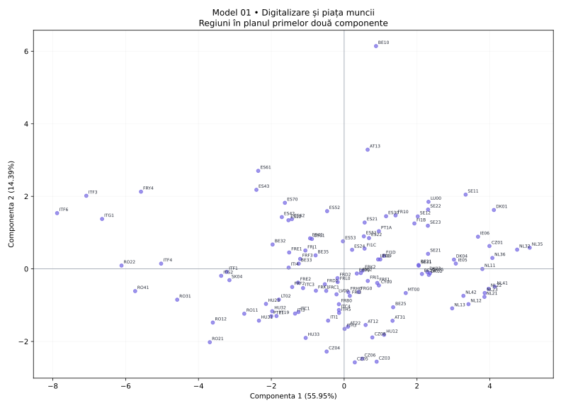

# Model 01 — Digitalizare și piața muncii

Cerințe transcrise din fotografia profesorului; outputuri calculate pe datele proiectului (116 regiuni, 12 indicatori).

40 minute · 9 puncte + 1 punct din oficiu. Barem orientativ de pregătire.

- X1: Internet acasă
- X2: Internet zilnic
- X3: Internet banking
- X4: Cumpărături online
- X5: PIB pe locuitor (PPS)
- X6: Ocupare 20–64 ani
- X7: Șomaj 20–64 ani
- X8: Șomaj tineri
- X9: Studii superioare
- X10: Formare adulți
- X11: NEET
- X12: Densitatea populației

## 1. (1p) Analizați matricea de corelație pentru datele numerice inițiale. Formulați o concluzie privind aplicarea analizei componentelor principale.

```text
cor()  X1      X2      X3      X4      X5      X6      X7      X8      X9      X10     X11     X12
X1     1.000   0.732   0.611   0.577   0.420   0.519   -0.297  -0.436  0.422   0.537   -0.567  0.154
X2     0.732   1.000   0.673   0.705   0.585   0.569   -0.360  -0.435  0.587   0.631   -0.683  0.158
X3     0.611   0.673   1.000   0.845   0.483   0.695   -0.343  -0.597  0.704   0.682   -0.810  0.138
X4     0.577   0.705   0.845   1.000   0.497   0.771   -0.501  -0.637  0.644   0.672   -0.771  0.091
X5     0.420   0.585   0.483   0.497   1.000   0.374   -0.305  -0.388  0.679   0.376   -0.513  0.412
X6     0.519   0.569   0.695   0.771   0.374   1.000   -0.739  -0.780  0.477   0.545   -0.839  -0.034
X7     -0.297  -0.360  -0.343  -0.501  -0.305  -0.739  1.000   0.844   -0.080  -0.148  0.566   0.059
X8     -0.436  -0.435  -0.597  -0.637  -0.388  -0.780  0.844   1.000   -0.245  -0.232  0.677   -0.072
X9     0.422   0.587   0.704   0.644   0.679   0.477   -0.080  -0.245  1.000   0.599   -0.607  0.264
X10    0.537   0.631   0.682   0.672   0.376   0.545   -0.148  -0.232  0.599   1.000   -0.652  0.107
X11    -0.567  -0.683  -0.810  -0.771  -0.513  -0.839  0.566   0.677   -0.607  -0.652  1.000   -0.094
X12    0.154   0.158   0.138   0.091   0.412   -0.034  0.059   -0.072  0.264   0.107   -0.094  1.000
```

**Răspuns-model:** Există asocieri între variabile: X3–X4: r = 0.845; X7–X8: r = 0.844. Sunt 37 perechi cu |r| ≥ 0,50 din 66. Indicatorii conțin informație comună, deci ACP este justificată ca metodă de reducere a dimensionalității; nu deducem cauzalitate din corelații.

**Pe înțelesul tău:** Ignoră diagonala de 1. Caută valori apropiate de +1 sau −1. Semnul spune direcția; modulul spune cât de puternică este asocierea. Mai multe corelații consistente sugerează informație repetată pe care ACP o poate sintetiza. Aceasta este o justificare exploratorie, nu un test formal de adecvare.

- 0.5p: Citezi două corelații și sensul lor.
- 0.5p: Legi informația comună de utilitatea ACP.

## 2. (2p) Folosiți două criterii pentru a decide numărul de componente păstrate în analiză.

```text
Componentă  Valoare proprie  % variație  % cumulat
1           6.714            55.950      55.950
2           1.727            14.389      70.339
3           1.096            9.132       79.471
4           0.670            5.587       85.058
5           0.539            4.492       89.550
6           0.353            2.940       92.490
7           0.246            2.048       94.538
8           0.209            1.743       96.281
9           0.191            1.589       97.870
10          0.112            0.930       98.800
11          0.081            0.673       99.473
12          0.063            0.527       100.000
```

**Răspuns-model:** Prin Kaiser, pentru ACP pe variabile standardizate, păstrez 3 componente cu λ > 1, care explică 79.47% din variație. Prin criteriul variației cumulate, aleg un prag explicit de 80% și păstrez 4 componente (85.06%). Criteriile dau rezultate diferite. Dacă urmăresc minimum 80% informație, aleg 4; dacă aplic strict Kaiser, aleg 3. Pragul de 80% este o alegere de lucru, nu o regulă universală.

**Pe înțelesul tău:** Kaiser: numeri valorile proprii strict peste 1. Cumulat: citești de sus în jos până ajungi pentru prima dată la pragul ales. Nu confunda procentul unei componente cu procentul cumulat. Nu forța criteriile să dea același număr.

- 1p: Aplici Kaiser și indici numărul corect.
- 1p: Precizezi pragul și primul număr care îl atinge; justifici alegerea.

## 3. (2p) Folosiți matricea factor pentru a interpreta a doua componentă principală.

```text
Matricea factor  Dim1    Dim2
X1               0.719   0.131
X2               0.819   0.199
X3               0.885   0.106
X4               0.901   -0.025
X5               0.654   0.348
X6               0.856   -0.378
X7               -0.591  0.694
X8               -0.729  0.546
X9               0.717   0.490
X10              0.721   0.312
X11              -0.907  0.105
X12              0.184   0.515
```

**Răspuns-model:** Componenta 2 opune valorile ridicate pentru Șomaj 20–64 ani (X7, r = 0.694), Șomaj tineri (X8, r = 0.546) valorilor ridicate pentru Ocupare 20–64 ani (X6, r = -0.378), Cumpărături online (X4, r = -0.025). Ea explică 14.39% din variația totală. O numesc „contrastul dintre Șomaj 20–64 ani / Șomaj tineri și Ocupare 20–64 ani / Cumpărături online”. Denumirea este descriptivă; nu presupune că axa măsoară exclusiv un singur fenomen.

**Pe înțelesul tău:** Te uiți doar la coloana a doua. Alegi coeficienții cei mai mari în valoare absolută, inclusiv pe cei negativi. Plus înseamnă variație în același sens cu axa, minus în sens opus. Numele componentei trebuie să reflecte indicatorii dominanți, chiar dacă rezultă un profil mixt.

- 1p: Identifici indicatorii dominanți și coeficienții lor pe PC2.
- 1p: Explici sensurile, propui un nume susținut și precizezi variația explicată.

## 4. (2p) Din outputul numeric privind variabilele interpretați coloanele Dim1, Dim2 (corelații) și ctr (contribuții) pentru primele două componente principale.

```text
Variabilă  Dim1    Dim2    ctr1 (%)  ctr2 (%)
X1         0.719   0.131   7.691     0.999
X2         0.819   0.199   9.992     2.283
X3         0.885   0.106   11.665    0.655
X4         0.901   -0.025  12.094    0.036
X5         0.654   0.348   6.374     7.009
X6         0.856   -0.378  10.907    8.293
X7         -0.591  0.694   5.202     27.906
X8         -0.729  0.546   7.909     17.276
X9         0.717   0.490   7.657     13.896
X10        0.721   0.312   7.752     5.628
X11        -0.907  0.105   12.250    0.638
X12        0.184   0.515   0.506     15.381
```

**Răspuns-model:** Dim1 și Dim2 sunt corelațiile indicatorilor cu componentele, cu valori între −1 și 1. De exemplu, X11 (NEET) are r = -0.907 cu PC1 și r = 0.105 cu PC2. Semnul indică sensul, iar |r| intensitatea. ctr1 și ctr2 arată procentul cu care variabila participă la construirea fiecărei axe. X11 are ctr1 = 12.25%, iar X7 are ctr2 = 27.91%, peste reperul mediu de 8.33% = 100/12. Contribuțiile se adună la 100% separat pe fiecare componentă, înainte de rotunjire.

**Pe înțelesul tău:** Dim = cât de strâns și în ce sens se leagă variabila de axă. ctr = cât ajută variabila la construirea axei. O corelație negativă poate avea o contribuție mare: contribuția nu are semn. ctr NU este procentul din variabilă explicat de axă; pentru acesta folosești cos², adică aici pătratul corelației.

- 1p: Interpretezi numeric Dim1 și Dim2, cu semn și intensitate.
- 1p: Interpretezi contribuțiile pentru ambele axe, reperul mediu și diferența față de cos².

## 5. (2p) Reprezentați grafic regiunile într-un spațiu definit de primele două componente principale. Extrageți 2 concluzii.

```text
Regiune  Scor PC1  Scor PC2  cos2 plan
NL35     5.095     0.584     0.977
ITF6     -7.882    1.537     0.931
BE10     0.875     6.142     0.479
CZ05     0.292     -2.576    0.756
```

**Răspuns-model:** Graficul are PC1 pe orizontală și PC2 pe verticală; planul păstrează 70.34% din variație. Concluzia 1: NL35 este la extrema pozitivă a PC1 (5.095), iar ITF6 la extrema negativă (-7.882); au profiluri opuse pe această axă. Capătul pozitiv este asociat mai ales cu Cumpărături online (X4, r = 0.901), Internet banking (X3, r = 0.885), iar cel negativ cu NEET (X11, r = -0.907), Șomaj tineri (X8, r = -0.729). Concluzia 2: BE10 are scorul PC2 maxim (6.142), iar CZ05 minim (-2.576); diferența se interpretează prin contrastul PC2 de la cerința 3. cos² în plan pentru aceste două regiuni este 0.479, respectiv 0.756; interpretarea este cu atât mai sigură cu cât cos² este mai mare. Nu afirm că două regiuni sunt identice în toate variabilele doar fiindcă par apropiate în acest plan.

**Pe înțelesul tău:** Punct = regiune. Dreapta/stânga = scor pozitiv/negativ pe PC1. Sus/jos = scor pozitiv/negativ pe PC2. Tradu direcția prin indicatorii care definesc axa. Dă două concluzii despre regiuni numite concret. Apropierea sugerează profiluri asemănătoare în plan; verifică reprezentarea înainte de a generaliza.

- 0.5p: Reprezinți regiunile pe cele două axe etichetate și menționezi informația păstrată.
- 0.75p: Formulezi prima concluzie concretă, legată de PC1.
- 0.75p: Formulezi a doua concluzie concretă, legată de PC2; respecți limitele planului.


