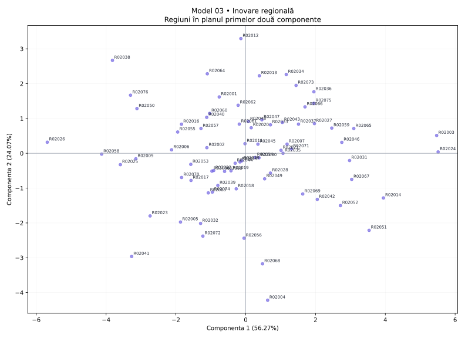

# Model 03 — Inovare regională

Variantă de antrenament creată după modelul profesorului. Date sintetice, fără semnificație statistică oficială.

40 minute · 9 puncte + 1 punct din oficiu. Barem orientativ de pregătire.

- X1: Cercetători
- X2: Cheltuieli cercetare
- X3: Brevete
- X4: Firme inovatoare
- X5: Productivitate
- X6: Șomaj
- X7: Ocupare
- X8: Formare adulți

## 1. (1p) Analizați matricea de corelație pentru datele numerice inițiale. Formulați o concluzie privind aplicarea analizei componentelor principale.

```text
cor()  X1      X2      X3      X4      X5      X6      X7      X8
X1     1.000   -0.225  0.442   0.308   0.157   0.698   -0.446  -0.651
X2     -0.225  1.000   0.421   0.614   0.606   0.032   -0.384  0.070
X3     0.442   0.421   1.000   0.781   0.727   0.653   -0.754  -0.465
X4     0.308   0.614   0.781   1.000   0.735   0.582   -0.651  -0.376
X5     0.157   0.606   0.727   0.735   1.000   0.361   -0.547  -0.173
X6     0.698   0.032   0.653   0.582   0.361   1.000   -0.714  -0.741
X7     -0.446  -0.384  -0.754  -0.651  -0.547  -0.714  1.000   0.605
X8     -0.651  0.070   -0.465  -0.376  -0.173  -0.741  0.605   1.000
```

**Răspuns-model:** Există asocieri între variabile: X3–X4: r = 0.781; X3–X7: r = -0.754. Sunt 15 perechi cu |r| ≥ 0,50 din 28. Indicatorii conțin informație comună, deci ACP este justificată ca metodă de reducere a dimensionalității; nu deducem cauzalitate din corelații.

**Pe înțelesul tău:** Ignoră diagonala de 1. Caută valori apropiate de +1 sau −1. Semnul spune direcția; modulul spune cât de puternică este asocierea. Mai multe corelații consistente sugerează informație repetată pe care ACP o poate sintetiza. Aceasta este o justificare exploratorie, nu un test formal de adecvare.

- 0.5p: Citezi două corelații și sensul lor.
- 0.5p: Legi informația comună de utilitatea ACP.

## 2. (2p) Folosiți două criterii pentru a decide numărul de componente păstrate în analiză.

```text
Componentă  Valoare proprie  % variație  % cumulat
1           4.502            56.275      56.275
2           1.926            24.071      80.346
3           0.465            5.813       86.159
4           0.309            3.865       90.024
5           0.254            3.174       93.198
6           0.245            3.059       96.257
7           0.176            2.205       98.462
8           0.123            1.538       100.000
```

**Răspuns-model:** Prin Kaiser, pentru ACP pe variabile standardizate, păstrez 2 componente cu λ > 1, care explică 80.35% din variație. Prin criteriul variației cumulate, aleg un prag explicit de 80% și păstrez 2 componente (80.35%). Cele două criterii coincid.

**Pe înțelesul tău:** Kaiser: numeri valorile proprii strict peste 1. Cumulat: citești de sus în jos până ajungi pentru prima dată la pragul ales. Nu confunda procentul unei componente cu procentul cumulat. Nu forța criteriile să dea același număr.

- 1p: Aplici Kaiser și indici numărul corect.
- 1p: Precizezi pragul și primul număr care îl atinge; justifici alegerea.

## 3. (2p) Folosiți matricea factor pentru a interpreta a doua componentă principală.

```text
Matricea factor  Dim1    Dim2
X1               0.594   -0.646
X2               0.435   0.795
X3               0.899   0.142
X4               0.853   0.333
X5               0.723   0.508
X6               0.827   -0.417
X7               -0.873  0.019
X8               -0.674  0.560
```

**Răspuns-model:** Componenta 2 opune valorile ridicate pentru Cheltuieli cercetare (X2, r = 0.795), Formare adulți (X8, r = 0.560) valorilor ridicate pentru Cercetători (X1, r = -0.646), Șomaj (X6, r = -0.417). Ea explică 24.07% din variația totală. O numesc „contrastul dintre Cheltuieli cercetare / Formare adulți și Cercetători / Șomaj”. Denumirea este descriptivă; nu presupune că axa măsoară exclusiv un singur fenomen.

**Pe înțelesul tău:** Te uiți doar la coloana a doua. Alegi coeficienții cei mai mari în valoare absolută, inclusiv pe cei negativi. Plus înseamnă variație în același sens cu axa, minus în sens opus. Numele componentei trebuie să reflecte indicatorii dominanți, chiar dacă rezultă un profil mixt.

- 1p: Identifici indicatorii dominanți și coeficienții lor pe PC2.
- 1p: Explici sensurile, propui un nume susținut și precizezi variația explicată.

## 4. (2p) Din outputul numeric privind variabilele interpretați coloanele Dim1, Dim2 (corelații) și ctr (contribuții) pentru primele două componente principale.

```text
Variabilă  Dim1    Dim2    ctr1 (%)  ctr2 (%)
X1         0.594   -0.646  7.842     21.688
X2         0.435   0.795   4.196     32.791
X3         0.899   0.142   17.968    1.042
X4         0.853   0.333   16.162    5.749
X5         0.723   0.508   11.596    13.384
X6         0.827   -0.417  15.192    9.015
X7         -0.873  0.019   16.948    0.020
X8         -0.674  0.560   10.095    16.312
```

**Răspuns-model:** Dim1 și Dim2 sunt corelațiile indicatorilor cu componentele, cu valori între −1 și 1. De exemplu, X3 (Brevete) are r = 0.899 cu PC1 și r = 0.142 cu PC2. Semnul indică sensul, iar |r| intensitatea. ctr1 și ctr2 arată procentul cu care variabila participă la construirea fiecărei axe. X3 are ctr1 = 17.97%, iar X2 are ctr2 = 32.79%, peste reperul mediu de 12.50% = 100/8. Contribuțiile se adună la 100% separat pe fiecare componentă, înainte de rotunjire.

**Pe înțelesul tău:** Dim = cât de strâns și în ce sens se leagă variabila de axă. ctr = cât ajută variabila la construirea axei. O corelație negativă poate avea o contribuție mare: contribuția nu are semn. ctr NU este procentul din variabilă explicat de axă; pentru acesta folosești cos², adică aici pătratul corelației.

- 1p: Interpretezi numeric Dim1 și Dim2, cu semn și intensitate.
- 1p: Interpretezi contribuțiile pentru ambele axe, reperul mediu și diferența față de cos².

## 5. (2p) Reprezentați grafic regiunile într-un spațiu definit de primele două componente principale. Extrageți 2 concluzii.

```text
Regiune  Scor PC1  Scor PC2  cos2 plan
R02024   5.512     0.039     0.976
R02026   -5.685    0.319     0.972
R02012   -0.138    3.294     0.954
R02004   0.629     -4.219    0.922
```

**Răspuns-model:** Graficul are PC1 pe orizontală și PC2 pe verticală; planul păstrează 80.35% din variație. Concluzia 1: R02024 este la extrema pozitivă a PC1 (5.512), iar R02026 la extrema negativă (-5.685); au profiluri opuse pe această axă. Capătul pozitiv este asociat mai ales cu Brevete (X3, r = 0.899), Firme inovatoare (X4, r = 0.853), iar cel negativ cu Ocupare (X7, r = -0.873), Formare adulți (X8, r = -0.674). Concluzia 2: R02012 are scorul PC2 maxim (3.294), iar R02004 minim (-4.219); diferența se interpretează prin contrastul PC2 de la cerința 3. cos² în plan pentru aceste două regiuni este 0.954, respectiv 0.922; interpretarea este cu atât mai sigură cu cât cos² este mai mare. Nu afirm că două regiuni sunt identice în toate variabilele doar fiindcă par apropiate în acest plan.

**Pe înțelesul tău:** Punct = regiune. Dreapta/stânga = scor pozitiv/negativ pe PC1. Sus/jos = scor pozitiv/negativ pe PC2. Tradu direcția prin indicatorii care definesc axa. Dă două concluzii despre regiuni numite concret. Apropierea sugerează profiluri asemănătoare în plan; verifică reprezentarea înainte de a generaliza.

- 0.5p: Reprezinți regiunile pe cele două axe etichetate și menționezi informația păstrată.
- 0.75p: Formulezi prima concluzie concretă, legată de PC1.
- 0.75p: Formulezi a doua concluzie concretă, legată de PC2; respecți limitele planului.


