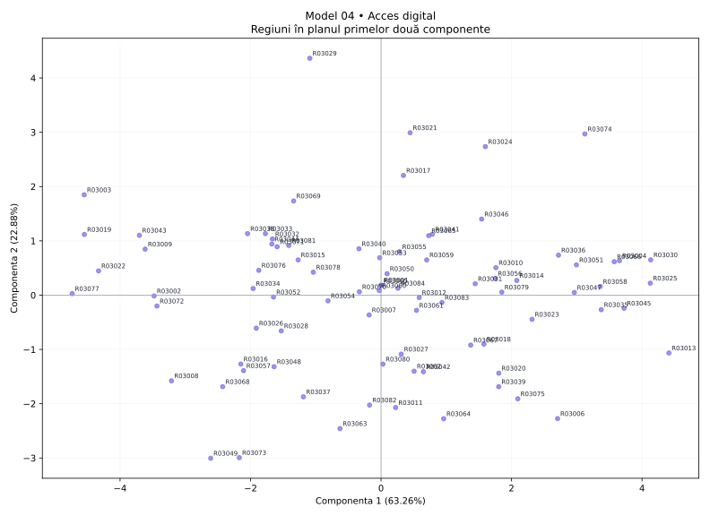

# Model 04 — Acces digital

Variantă de antrenament creată după modelul profesorului. Date sintetice, fără semnificație statistică oficială.

40 minute · 9 puncte + 1 punct din oficiu. Barem orientativ de pregătire.

- X1: Internet acasă
- X2: Internet zilnic
- X3: Servicii publice online
- X4: Cumpărături online
- X5: Internet banking
- X6: Excludere digitală
- X7: Competențe digitale
- X8: Acces rural

## 1. (1p) Analizați matricea de corelație pentru datele numerice inițiale. Formulați o concluzie privind aplicarea analizei componentelor principale.

```text
cor()  X1      X2      X3      X4      X5      X6      X7      X8    
X1     1.000   -0.729  -0.087  -0.576  -0.489  -0.223  -0.832  0.783 
X2     -0.729  1.000   -0.127  0.518   0.441   0.285   0.760   -0.562
X3     -0.087  -0.127  1.000   0.626   0.697   0.729   0.174   -0.504
X4     -0.576  0.518   0.626   1.000   0.858   0.792   0.643   -0.781
X5     -0.489  0.441   0.697   0.858   1.000   0.834   0.605   -0.715
X6     -0.223  0.285   0.729   0.792   0.834   1.000   0.358   -0.532
X7     -0.832  0.760   0.174   0.643   0.605   0.358   1.000   -0.814
X8     0.783   -0.562  -0.504  -0.781  -0.715  -0.532  -0.814  1.000 
```

**Răspuns-model:** Există asocieri între variabile: X4–X5: r = 0.858; X5–X6: r = 0.834. Sunt 20 perechi cu |r| ≥ 0,50 din 28. Indicatorii conțin informație comună, deci ACP este justificată ca metodă de reducere a dimensionalității; nu deducem cauzalitate din corelații.

**Pe înțelesul tău:** Ignoră diagonala de 1. Caută valori apropiate de +1 sau −1. Semnul spune direcția; modulul spune cât de puternică este asocierea. Mai multe corelații consistente sugerează informație repetată pe care ACP o poate sintetiza. Aceasta este o justificare exploratorie, nu un test formal de adecvare.

- 0.5p: Citezi două corelații și sensul lor.
- 0.5p: Legi informația comună de utilitatea ACP.

## 2. (2p) Folosiți două criterii pentru a decide numărul de componente păstrate în analiză.

```text
Componentă  Valoare proprie  % variație  % cumulat
1           5.061            63.258      63.258   
2           1.831            22.882      86.141   
3           0.501            6.266       92.406   
4           0.170            2.120       94.527   
5           0.137            1.711       96.237   
6           0.118            1.476       97.713   
7           0.103            1.287       99.000   
8           0.080            1.000       100.000  
```

**Răspuns-model:** Prin Kaiser, pentru ACP pe variabile standardizate, păstrez 2 componente cu λ > 1, care explică 86.14% din variație. Prin criteriul variației cumulate, aleg un prag explicit de 80% și păstrez 2 componente (86.14%). Cele două criterii coincid.

**Pe înțelesul tău:** Kaiser: numeri valorile proprii strict peste 1. Cumulat: citești de sus în jos până ajungi pentru prima dată la pragul ales. Nu confunda procentul unei componente cu procentul cumulat. Nu forța criteriile să dea același număr.

- 1p: Aplici Kaiser și indici numărul corect.
- 1p: Precizezi pragul și primul număr care îl atinge; justifici alegerea.

## 3. (2p) Folosiți matricea factor pentru a interpreta a doua componentă principală.

```text
Matricea factor  Dim1    Dim2  
X1               -0.756  0.540 
X2               0.666   -0.601
X3               0.573   0.746 
X4               0.921   0.192 
X5               0.893   0.306 
X6               0.746   0.533 
X7               0.831   -0.442
X8               -0.908  0.110 
```

**Răspuns-model:** Componenta 2 opune valorile ridicate pentru Servicii publice online (X3, r = 0.746), Internet acasă (X1, r = 0.540) valorilor ridicate pentru Internet zilnic (X2, r = -0.601), Competențe digitale (X7, r = -0.442). Ea explică 22.88% din variația totală. O numesc „contrastul dintre Servicii publice online / Internet acasă și Internet zilnic / Competențe digitale”. Denumirea este descriptivă; nu presupune că axa măsoară exclusiv un singur fenomen.

**Pe înțelesul tău:** Te uiți doar la coloana a doua. Alegi coeficienții cei mai mari în valoare absolută, inclusiv pe cei negativi. Plus înseamnă variație în același sens cu axa, minus în sens opus. Numele componentei trebuie să reflecte indicatorii dominanți, chiar dacă rezultă un profil mixt.

- 1p: Identifici indicatorii dominanți și coeficienții lor pe PC2.
- 1p: Explici sensurile, propui un nume susținut și precizezi variația explicată.

## 4. (2p) Din outputul numeric privind variabilele interpretați coloanele Dim1, Dim2 (corelații) și ctr (contribuții) pentru primele două componente principale.

```text
Variabilă  Dim1    Dim2    ctr1 (%)  ctr2 (%)
X1         -0.756  0.540   11.302    15.903  
X2         0.666   -0.601  8.768     19.752  
X3         0.573   0.746   6.485     30.371  
X4         0.921   0.192   16.762    2.011   
X5         0.893   0.306   15.763    5.131   
X6         0.746   0.533   11.002    15.518  
X7         0.831   -0.442  13.639    10.652  
X8         -0.908  0.110   16.278    0.661   
```

**Răspuns-model:** Dim1 și Dim2 sunt corelațiile indicatorilor cu componentele, cu valori între −1 și 1. De exemplu, X4 (Cumpărături online) are r = 0.921 cu PC1 și r = 0.192 cu PC2. Semnul indică sensul, iar |r| intensitatea. ctr1 și ctr2 arată procentul cu care variabila participă la construirea fiecărei axe. X4 are ctr1 = 16.76%, iar X3 are ctr2 = 30.37%, peste reperul mediu de 12.50% = 100/8. Contribuțiile se adună la 100% separat pe fiecare componentă, înainte de rotunjire.

**Pe înțelesul tău:** Dim = cât de strâns și în ce sens se leagă variabila de axă. ctr = cât ajută variabila la construirea axei. O corelație negativă poate avea o contribuție mare: contribuția nu are semn. ctr NU este procentul din variabilă explicat de axă; pentru acesta folosești cos², adică aici pătratul corelației.

- 1p: Interpretezi numeric Dim1 și Dim2, cu semn și intensitate.
- 1p: Interpretezi contribuțiile pentru ambele axe, reperul mediu și diferența față de cos².

## 5. (2p) Reprezentați grafic regiunile într-un spațiu definit de primele două componente principale. Extrageți 2 concluzii.

```text
Regiune  Scor PC1  Scor PC2  cos2 plan
R03013   4.412     -1.066    0.850    
R03077   -4.734    0.028     0.979    
R03029   -1.092    4.364     0.978    
R03049   -2.611    -3.005    0.934    
```

**Răspuns-model:** Graficul are PC1 pe orizontală și PC2 pe verticală; planul păstrează 86.14% din variație. Concluzia 1: R03013 este la extrema pozitivă a PC1 (4.412), iar R03077 la extrema negativă (-4.734); au profiluri opuse pe această axă. Capătul pozitiv este asociat mai ales cu Cumpărături online (X4, r = 0.921), Internet banking (X5, r = 0.893), iar cel negativ cu Acces rural (X8, r = -0.908), Internet acasă (X1, r = -0.756). Concluzia 2: R03029 are scorul PC2 maxim (4.364), iar R03049 minim (-3.005); diferența se interpretează prin contrastul PC2 de la cerința 3. cos² în plan pentru aceste două regiuni este 0.978, respectiv 0.934; interpretarea este cu atât mai sigură cu cât cos² este mai mare. Nu afirm că două regiuni sunt identice în toate variabilele doar fiindcă par apropiate în acest plan.

**Pe înțelesul tău:** Punct = regiune. Dreapta/stânga = scor pozitiv/negativ pe PC1. Sus/jos = scor pozitiv/negativ pe PC2. Tradu direcția prin indicatorii care definesc axa. Dă două concluzii despre regiuni numite concret. Apropierea sugerează profiluri asemănătoare în plan; verifică reprezentarea înainte de a generaliza.

- 0.5p: Reprezinți regiunile pe cele două axe etichetate și menționezi informația păstrată.
- 0.75p: Formulezi prima concluzie concretă, legată de PC1.
- 0.75p: Formulezi a doua concluzie concretă, legată de PC2; respecți limitele planului.


