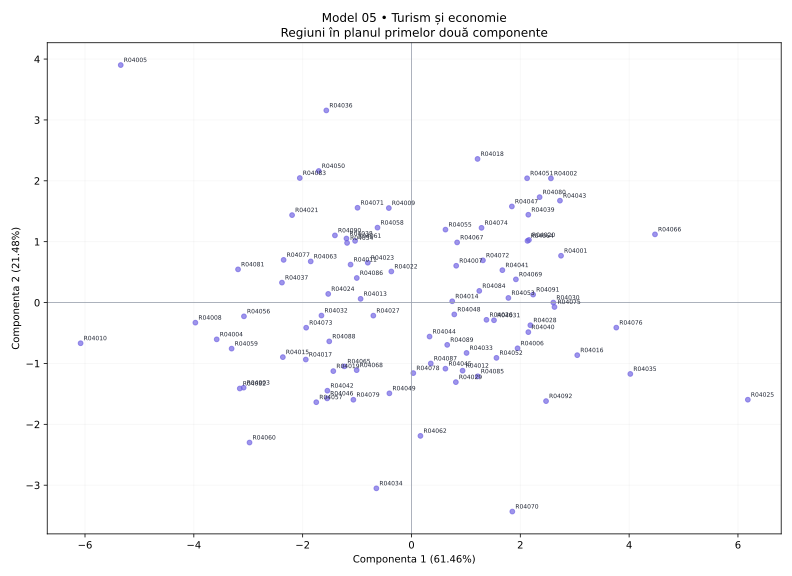

# Model 05 — Turism și economie

Variantă de antrenament creată după modelul profesorului. Date sintetice, fără semnificație statistică oficială.

40 minute · 9 puncte + 1 punct din oficiu. Barem orientativ de pregătire.

- X1: Înnoptări turistice
- X2: Capacitate cazare
- X3: Ocupare în turism
- X4: PIB pe locuitor
- X5: Ocupare totală
- X6: Șomaj
- X7: Accesibilitate
- X8: Densitate

## 1. (1p) Analizați matricea de corelație pentru datele numerice inițiale. Formulați o concluzie privind aplicarea analizei componentelor principale.

```text
cor()  X1      X2      X3      X4      X5      X6      X7      X8    
X1     1.000   0.820   0.742   0.708   -0.764  -0.627  0.552   0.485 
X2     0.820   1.000   0.791   0.593   -0.718  -0.456  0.359   0.656 
X3     0.742   0.791   1.000   0.468   -0.521  -0.305  0.327   0.617 
X4     0.708   0.593   0.468   1.000   -0.779  -0.779  0.728   0.092 
X5     -0.764  -0.718  -0.521  -0.779  1.000   0.745   -0.547  -0.388
X6     -0.627  -0.456  -0.305  -0.779  0.745   1.000   -0.641  -0.018
X7     0.552   0.359   0.327   0.728   -0.547  -0.641  1.000   -0.153
X8     0.485   0.656   0.617   0.092   -0.388  -0.018  -0.153  1.000 
```

**Răspuns-model:** Există asocieri între variabile: X1–X2: r = 0.820; X2–X3: r = 0.791. Sunt 18 perechi cu |r| ≥ 0,50 din 28. Indicatorii conțin informație comună, deci ACP este justificată ca metodă de reducere a dimensionalității; nu deducem cauzalitate din corelații.

**Pe înțelesul tău:** Ignoră diagonala de 1. Caută valori apropiate de +1 sau −1. Semnul spune direcția; modulul spune cât de puternică este asocierea. Mai multe corelații consistente sugerează informație repetată pe care ACP o poate sintetiza. Aceasta este o justificare exploratorie, nu un test formal de adecvare.

- 0.5p: Citezi două corelații și sensul lor.
- 0.5p: Legi informația comună de utilitatea ACP.

## 2. (2p) Folosiți două criterii pentru a decide numărul de componente păstrate în analiză.

```text
Componentă  Valoare proprie  % variație  % cumulat
1           4.917            61.458      61.458   
2           1.718            21.476      82.934   
3           0.501            6.265       89.199   
4           0.232            2.894       92.093   
5           0.200            2.497       94.591   
6           0.166            2.073       96.664   
7           0.137            1.710       98.374   
8           0.130            1.626       100.000  
```

**Răspuns-model:** Prin Kaiser, pentru ACP pe variabile standardizate, păstrez 2 componente cu λ > 1, care explică 82.93% din variație. Prin criteriul variației cumulate, aleg un prag explicit de 80% și păstrez 2 componente (82.93%). Cele două criterii coincid.

**Pe înțelesul tău:** Kaiser: numeri valorile proprii strict peste 1. Cumulat: citești de sus în jos până ajungi pentru prima dată la pragul ales. Nu confunda procentul unei componente cu procentul cumulat. Nu forța criteriile să dea același număr.

- 1p: Aplici Kaiser și indici numărul corect.
- 1p: Precizezi pragul și primul număr care îl atinge; justifici alegerea.

## 3. (2p) Folosiți matricea factor pentru a interpreta a doua componentă principală.

```text
Matricea factor  Dim1    Dim2  
X1               0.924   0.111 
X2               0.865   0.371 
X3               0.757   0.447 
X4               0.850   -0.380
X5               -0.891  0.089 
X6               -0.757  0.474 
X7               0.661   -0.575
X8               0.465   0.813 
```

**Răspuns-model:** Componenta 2 opune valorile ridicate pentru Densitate (X8, r = 0.813), Șomaj (X6, r = 0.474) valorilor ridicate pentru Accesibilitate (X7, r = -0.575), PIB pe locuitor (X4, r = -0.380). Ea explică 21.48% din variația totală. O numesc „contrastul dintre Densitate / Șomaj și Accesibilitate / PIB pe locuitor”. Denumirea este descriptivă; nu presupune că axa măsoară exclusiv un singur fenomen.

**Pe înțelesul tău:** Te uiți doar la coloana a doua. Alegi coeficienții cei mai mari în valoare absolută, inclusiv pe cei negativi. Plus înseamnă variație în același sens cu axa, minus în sens opus. Numele componentei trebuie să reflecte indicatorii dominanți, chiar dacă rezultă un profil mixt.

- 1p: Identifici indicatorii dominanți și coeficienții lor pe PC2.
- 1p: Explici sensurile, propui un nume susținut și precizezi variația explicată.

## 4. (2p) Din outputul numeric privind variabilele interpretați coloanele Dim1, Dim2 (corelații) și ctr (contribuții) pentru primele două componente principale.

```text
Variabilă  Dim1    Dim2    ctr1 (%)  ctr2 (%)
X1         0.924   0.111   17.360    0.719   
X2         0.865   0.371   15.221    8.029   
X3         0.757   0.447   11.662    11.640  
X4         0.850   -0.380  14.700    8.404   
X5         -0.891  0.089   16.142    0.457   
X6         -0.757  0.474   11.643    13.072  
X7         0.661   -0.575  8.883     19.215  
X8         0.465   0.813   4.389     38.465  
```

**Răspuns-model:** Dim1 și Dim2 sunt corelațiile indicatorilor cu componentele, cu valori între −1 și 1. De exemplu, X1 (Înnoptări turistice) are r = 0.924 cu PC1 și r = 0.111 cu PC2. Semnul indică sensul, iar |r| intensitatea. ctr1 și ctr2 arată procentul cu care variabila participă la construirea fiecărei axe. X1 are ctr1 = 17.36%, iar X8 are ctr2 = 38.46%, peste reperul mediu de 12.50% = 100/8. Contribuțiile se adună la 100% separat pe fiecare componentă, înainte de rotunjire.

**Pe înțelesul tău:** Dim = cât de strâns și în ce sens se leagă variabila de axă. ctr = cât ajută variabila la construirea axei. O corelație negativă poate avea o contribuție mare: contribuția nu are semn. ctr NU este procentul din variabilă explicat de axă; pentru acesta folosești cos², adică aici pătratul corelației.

- 1p: Interpretezi numeric Dim1 și Dim2, cu semn și intensitate.
- 1p: Interpretezi contribuțiile pentru ambele axe, reperul mediu și diferența față de cos².

## 5. (2p) Reprezentați grafic regiunile într-un spațiu definit de primele două componente principale. Extrageți 2 concluzii.

```text
Regiune  Scor PC1  Scor PC2  cos2 plan
R04025   6.182     -1.596    0.990    
R04010   -6.081    -0.668    0.948    
R04005   -5.343    3.902     0.975    
R04070   1.853     -3.433    0.873    
```

**Răspuns-model:** Graficul are PC1 pe orizontală și PC2 pe verticală; planul păstrează 82.93% din variație. Concluzia 1: R04025 este la extrema pozitivă a PC1 (6.182), iar R04010 la extrema negativă (-6.081); au profiluri opuse pe această axă. Capătul pozitiv este asociat mai ales cu Înnoptări turistice (X1, r = 0.924), Capacitate cazare (X2, r = 0.865), iar cel negativ cu Ocupare totală (X5, r = -0.891), Șomaj (X6, r = -0.757). Concluzia 2: R04005 are scorul PC2 maxim (3.902), iar R04070 minim (-3.433); diferența se interpretează prin contrastul PC2 de la cerința 3. cos² în plan pentru aceste două regiuni este 0.975, respectiv 0.873; interpretarea este cu atât mai sigură cu cât cos² este mai mare. Nu afirm că două regiuni sunt identice în toate variabilele doar fiindcă par apropiate în acest plan.

**Pe înțelesul tău:** Punct = regiune. Dreapta/stânga = scor pozitiv/negativ pe PC1. Sus/jos = scor pozitiv/negativ pe PC2. Tradu direcția prin indicatorii care definesc axa. Dă două concluzii despre regiuni numite concret. Apropierea sugerează profiluri asemănătoare în plan; verifică reprezentarea înainte de a generaliza.

- 0.5p: Reprezinți regiunile pe cele două axe etichetate și menționezi informația păstrată.
- 0.75p: Formulezi prima concluzie concretă, legată de PC1.
- 0.75p: Formulezi a doua concluzie concretă, legată de PC2; respecți limitele planului.


