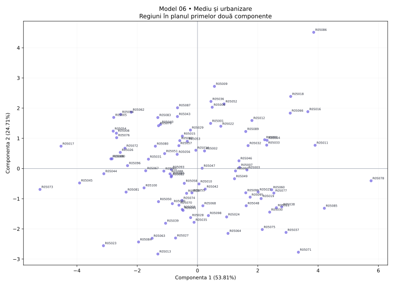

# Model 06 — Mediu și urbanizare

Variantă de antrenament creată după modelul profesorului. Date sintetice, fără semnificație statistică oficială.

40 minute · 9 puncte + 1 punct din oficiu. Barem orientativ de pregătire.

- X1: Transport public
- X2: Spații verzi
- X3: Reciclare
- X4: Energie regenerabilă
- X5: Poluare
- X6: Trafic auto
- X7: Densitate
- X8: Consum de energie

## 1. (1p) Analizați matricea de corelație pentru datele numerice inițiale. Formulați o concluzie privind aplicarea analizei componentelor principale.

```text
cor()  X1      X2      X3      X4      X5      X6      X7      X8    
X1     1.000   0.321   0.498   0.571   -0.130  -0.452  -0.037  -0.360
X2     0.321   1.000   0.759   0.615   0.651   -0.624  -0.563  0.566 
X3     0.498   0.759   1.000   0.695   0.484   -0.642  -0.436  0.384 
X4     0.571   0.615   0.695   1.000   0.253   -0.392  -0.124  0.153 
X5     -0.130  0.651   0.484   0.253   1.000   -0.597  -0.760  0.793 
X6     -0.452  -0.624  -0.642  -0.392  -0.597  1.000   0.630   -0.363
X7     -0.037  -0.563  -0.436  -0.124  -0.760  0.630   1.000   -0.591
X8     -0.360  0.566   0.384   0.153   0.793   -0.363  -0.591  1.000 
```

**Răspuns-model:** Există asocieri între variabile: X5–X8: r = 0.793; X5–X7: r = -0.760. Sunt 14 perechi cu |r| ≥ 0,50 din 28. Indicatorii conțin informație comună, deci ACP este justificată ca metodă de reducere a dimensionalității; nu deducem cauzalitate din corelații.

**Pe înțelesul tău:** Ignoră diagonala de 1. Caută valori apropiate de +1 sau −1. Semnul spune direcția; modulul spune cât de puternică este asocierea. Mai multe corelații consistente sugerează informație repetată pe care ACP o poate sintetiza. Aceasta este o justificare exploratorie, nu un test formal de adecvare.

- 0.5p: Citezi două corelații și sensul lor.
- 0.5p: Legi informația comună de utilitatea ACP.

## 2. (2p) Folosiți două criterii pentru a decide numărul de componente păstrate în analiză.

```text
Componentă  Valoare proprie  % variație  % cumulat
1           4.305            53.810      53.810   
2           1.977            24.711      78.521   
3           0.745            9.307       87.829   
4           0.266            3.331       91.160   
5           0.243            3.032       94.192   
6           0.205            2.561       96.752   
7           0.140            1.752       98.505   
8           0.120            1.495       100.000  
```

**Răspuns-model:** Prin Kaiser, pentru ACP pe variabile standardizate, păstrez 2 componente cu λ > 1, care explică 78.52% din variație. Prin criteriul variației cumulate, aleg un prag explicit de 80% și păstrez 3 componente (87.83%). Criteriile dau rezultate diferite. Dacă urmăresc minimum 80% informație, aleg 3; dacă aplic strict Kaiser, aleg 2. Pragul de 80% este o alegere de lucru, nu o regulă universală.

**Pe înțelesul tău:** Kaiser: numeri valorile proprii strict peste 1. Cumulat: citești de sus în jos până ajungi pentru prima dată la pragul ales. Nu confunda procentul unei componente cu procentul cumulat. Nu forța criteriile să dea același număr.

- 1p: Aplici Kaiser și indici numărul corect.
- 1p: Precizezi pragul și primul număr care îl atinge; justifici alegerea.

## 3. (2p) Folosiți matricea factor pentru a interpreta a doua componentă principală.

```text
Matricea factor  Dim1    Dim2  
X1               0.336   0.866 
X2               0.893   0.076 
X3               0.838   0.332 
X4               0.618   0.569 
X5               0.810   -0.482
X6               -0.812  -0.124
X7               -0.749  0.378 
X8               0.660   -0.629
```

**Răspuns-model:** Componenta 2 opune valorile ridicate pentru Transport public (X1, r = 0.866), Energie regenerabilă (X4, r = 0.569) valorilor ridicate pentru Consum de energie (X8, r = -0.629), Poluare (X5, r = -0.482). Ea explică 24.71% din variația totală. O numesc „contrastul dintre Transport public / Energie regenerabilă și Consum de energie / Poluare”. Denumirea este descriptivă; nu presupune că axa măsoară exclusiv un singur fenomen.

**Pe înțelesul tău:** Te uiți doar la coloana a doua. Alegi coeficienții cei mai mari în valoare absolută, inclusiv pe cei negativi. Plus înseamnă variație în același sens cu axa, minus în sens opus. Numele componentei trebuie să reflecte indicatorii dominanți, chiar dacă rezultă un profil mixt.

- 1p: Identifici indicatorii dominanți și coeficienții lor pe PC2.
- 1p: Explici sensurile, propui un nume susținut și precizezi variația explicată.

## 4. (2p) Din outputul numeric privind variabilele interpretați coloanele Dim1, Dim2 (corelații) și ctr (contribuții) pentru primele două componente principale.

```text
Variabilă  Dim1    Dim2    ctr1 (%)  ctr2 (%)
X1         0.336   0.866   2.616     37.943  
X2         0.893   0.076   18.530    0.294   
X3         0.838   0.332   16.298    5.576   
X4         0.618   0.569   8.859     16.378  
X5         0.810   -0.482  15.241    11.752  
X6         -0.812  -0.124  15.329    0.777   
X7         -0.749  0.378   13.023    7.246   
X8         0.660   -0.629  10.106    20.034  
```

**Răspuns-model:** Dim1 și Dim2 sunt corelațiile indicatorilor cu componentele, cu valori între −1 și 1. De exemplu, X2 (Spații verzi) are r = 0.893 cu PC1 și r = 0.076 cu PC2. Semnul indică sensul, iar |r| intensitatea. ctr1 și ctr2 arată procentul cu care variabila participă la construirea fiecărei axe. X2 are ctr1 = 18.53%, iar X1 are ctr2 = 37.94%, peste reperul mediu de 12.50% = 100/8. Contribuțiile se adună la 100% separat pe fiecare componentă, înainte de rotunjire.

**Pe înțelesul tău:** Dim = cât de strâns și în ce sens se leagă variabila de axă. ctr = cât ajută variabila la construirea axei. O corelație negativă poate avea o contribuție mare: contribuția nu are semn. ctr NU este procentul din variabilă explicat de axă; pentru acesta folosești cos², adică aici pătratul corelației.

- 1p: Interpretezi numeric Dim1 și Dim2, cu semn și intensitate.
- 1p: Interpretezi contribuțiile pentru ambele axe, reperul mediu și diferența față de cos².

## 5. (2p) Reprezentați grafic regiunile într-un spațiu definit de primele două componente principale. Extrageți 2 concluzii.

```text
Regiune  Scor PC1  Scor PC2  cos2 plan
R05078   5.758     -0.407    0.955    
R05073   -5.224    -0.693    0.935    
R05086   3.855     4.513     0.978    
R05013   -1.314    -2.832    0.942    
```

**Răspuns-model:** Graficul are PC1 pe orizontală și PC2 pe verticală; planul păstrează 78.52% din variație. Concluzia 1: R05078 este la extrema pozitivă a PC1 (5.758), iar R05073 la extrema negativă (-5.224); au profiluri opuse pe această axă. Capătul pozitiv este asociat mai ales cu Spații verzi (X2, r = 0.893), Reciclare (X3, r = 0.838), iar cel negativ cu Trafic auto (X6, r = -0.812), Densitate (X7, r = -0.749). Concluzia 2: R05086 are scorul PC2 maxim (4.513), iar R05013 minim (-2.832); diferența se interpretează prin contrastul PC2 de la cerința 3. cos² în plan pentru aceste două regiuni este 0.978, respectiv 0.942; interpretarea este cu atât mai sigură cu cât cos² este mai mare. Nu afirm că două regiuni sunt identice în toate variabilele doar fiindcă par apropiate în acest plan.

**Pe înțelesul tău:** Punct = regiune. Dreapta/stânga = scor pozitiv/negativ pe PC1. Sus/jos = scor pozitiv/negativ pe PC2. Tradu direcția prin indicatorii care definesc axa. Dă două concluzii despre regiuni numite concret. Apropierea sugerează profiluri asemănătoare în plan; verifică reprezentarea înainte de a generaliza.

- 0.5p: Reprezinți regiunile pe cele două axe etichetate și menționezi informația păstrată.
- 0.75p: Formulezi prima concluzie concretă, legată de PC1.
- 0.75p: Formulezi a doua concluzie concretă, legată de PC2; respecți limitele planului.


