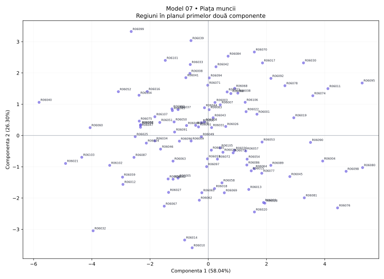

# Model 07 — Piața muncii

Variantă de antrenament creată după modelul profesorului. Date sintetice, fără semnificație statistică oficială.

40 minute · 9 puncte + 1 punct din oficiu. Barem orientativ de pregătire.

- X1: Ocupare totală
- X2: Ocuparea femeilor
- X3: Ocuparea tinerilor
- X4: Salariu mediu
- X5: Șomaj
- X6: Șomaj tineri
- X7: NEET
- X8: Formare adulți

## 1. (1p) Analizați matricea de corelație pentru datele numerice inițiale. Formulați o concluzie privind aplicarea analizei componentelor principale.

```text
cor()  X1      X2      X3      X4      X5      X6      X7      X8    
X1     1.000   -0.338  0.510   0.324   0.203   0.783   -0.539  -0.669
X2     -0.338  1.000   0.487   0.616   0.628   -0.066  -0.381  0.013 
X3     0.510   0.487   1.000   0.823   0.816   0.615   -0.740  -0.525
X4     0.324   0.616   0.823   1.000   0.833   0.434   -0.665  -0.401
X5     0.203   0.628   0.816   0.833   1.000   0.300   -0.526  -0.192
X6     0.783   -0.066  0.615   0.434   0.300   1.000   -0.680  -0.825
X7     -0.539  -0.381  -0.740  -0.665  -0.526  -0.680  1.000   0.776 
X8     -0.669  0.013   -0.525  -0.401  -0.192  -0.825  0.776   1.000 
```

**Răspuns-model:** Există asocieri între variabile: X4–X5: r = 0.833; X6–X8: r = -0.825. Sunt 17 perechi cu |r| ≥ 0,50 din 28. Indicatorii conțin informație comună, deci ACP este justificată ca metodă de reducere a dimensionalității; nu deducem cauzalitate din corelații.

**Pe înțelesul tău:** Ignoră diagonala de 1. Caută valori apropiate de +1 sau −1. Semnul spune direcția; modulul spune cât de puternică este asocierea. Mai multe corelații consistente sugerează informație repetată pe care ACP o poate sintetiza. Aceasta este o justificare exploratorie, nu un test formal de adecvare.

- 0.5p: Citezi două corelații și sensul lor.
- 0.5p: Legi informația comună de utilitatea ACP.

## 2. (2p) Folosiți două criterii pentru a decide numărul de componente păstrate în analiză.

```text
Componentă  Valoare proprie  % variație  % cumulat
1           4.643            58.039      58.039   
2           2.104            26.296      84.335   
3           0.580            7.248       91.582   
4           0.201            2.512       94.094   
5           0.165            2.063       96.157   
6           0.132            1.651       97.808   
7           0.101            1.265       99.072   
8           0.074            0.928       100.000  
```

**Răspuns-model:** Prin Kaiser, pentru ACP pe variabile standardizate, păstrez 2 componente cu λ > 1, care explică 84.33% din variație. Prin criteriul variației cumulate, aleg un prag explicit de 80% și păstrez 2 componente (84.33%). Cele două criterii coincid.

**Pe înțelesul tău:** Kaiser: numeri valorile proprii strict peste 1. Cumulat: citești de sus în jos până ajungi pentru prima dată la pragul ales. Nu confunda procentul unei componente cu procentul cumulat. Nu forța criteriile să dea același număr.

- 1p: Aplici Kaiser și indici numărul corect.
- 1p: Precizezi pragul și primul număr care îl atinge; justifici alegerea.

## 3. (2p) Folosiți matricea factor pentru a interpreta a doua componentă principală.

```text
Matricea factor  Dim1    Dim2  
X1               0.644   -0.646
X2               0.409   0.826 
X3               0.921   0.195 
X4               0.841   0.400 
X5               0.737   0.539 
X6               0.783   -0.511
X7               -0.890  0.068 
X8               -0.747  0.500 
```

**Răspuns-model:** Componenta 2 opune valorile ridicate pentru Ocuparea femeilor (X2, r = 0.826), Șomaj (X5, r = 0.539) valorilor ridicate pentru Ocupare totală (X1, r = -0.646), Șomaj tineri (X6, r = -0.511). Ea explică 26.30% din variația totală. O numesc „contrastul dintre Ocuparea femeilor / Șomaj și Ocupare totală / Șomaj tineri”. Denumirea este descriptivă; nu presupune că axa măsoară exclusiv un singur fenomen.

**Pe înțelesul tău:** Te uiți doar la coloana a doua. Alegi coeficienții cei mai mari în valoare absolută, inclusiv pe cei negativi. Plus înseamnă variație în același sens cu axa, minus în sens opus. Numele componentei trebuie să reflecte indicatorii dominanți, chiar dacă rezultă un profil mixt.

- 1p: Identifici indicatorii dominanți și coeficienții lor pe PC2.
- 1p: Explici sensurile, propui un nume susținut și precizezi variația explicată.

## 4. (2p) Din outputul numeric privind variabilele interpretați coloanele Dim1, Dim2 (corelații) și ctr (contribuții) pentru primele două componente principale.

```text
Variabilă  Dim1    Dim2    ctr1 (%)  ctr2 (%)
X1         0.644   -0.646  8.927     19.825  
X2         0.409   0.826   3.601     32.454  
X3         0.921   0.195   18.249    1.799   
X4         0.841   0.400   15.230    7.609   
X5         0.737   0.539   11.705    13.788  
X6         0.783   -0.511  13.190    12.427  
X7         -0.890  0.068   17.065    0.222   
X8         -0.747  0.500   12.032    11.877  
```

**Răspuns-model:** Dim1 și Dim2 sunt corelațiile indicatorilor cu componentele, cu valori între −1 și 1. De exemplu, X3 (Ocuparea tinerilor) are r = 0.921 cu PC1 și r = 0.195 cu PC2. Semnul indică sensul, iar |r| intensitatea. ctr1 și ctr2 arată procentul cu care variabila participă la construirea fiecărei axe. X3 are ctr1 = 18.25%, iar X2 are ctr2 = 32.45%, peste reperul mediu de 12.50% = 100/8. Contribuțiile se adună la 100% separat pe fiecare componentă, înainte de rotunjire.

**Pe înțelesul tău:** Dim = cât de strâns și în ce sens se leagă variabila de axă. ctr = cât ajută variabila la construirea axei. O corelație negativă poate avea o contribuție mare: contribuția nu are semn. ctr NU este procentul din variabilă explicat de axă; pentru acesta folosești cos², adică aici pătratul corelației.

- 1p: Interpretezi numeric Dim1 și Dim2, cu semn și intensitate.
- 1p: Interpretezi contribuțiile pentru ambele axe, reperul mediu și diferența față de cos².

## 5. (2p) Reprezentați grafic regiunile într-un spațiu definit de primele două componente principale. Extrageți 2 concluzii.

```text
Regiune  Scor PC1  Scor PC2  cos2 plan
R06080   5.300     -1.026    0.955    
R06040   -5.811    1.061     0.978    
R06099   -2.647    3.325     0.944    
R06010   -0.553    -3.590    0.961    
```

**Răspuns-model:** Graficul are PC1 pe orizontală și PC2 pe verticală; planul păstrează 84.33% din variație. Concluzia 1: R06080 este la extrema pozitivă a PC1 (5.300), iar R06040 la extrema negativă (-5.811); au profiluri opuse pe această axă. Capătul pozitiv este asociat mai ales cu Ocuparea tinerilor (X3, r = 0.921), Salariu mediu (X4, r = 0.841), iar cel negativ cu NEET (X7, r = -0.890), Formare adulți (X8, r = -0.747). Concluzia 2: R06099 are scorul PC2 maxim (3.325), iar R06010 minim (-3.590); diferența se interpretează prin contrastul PC2 de la cerința 3. cos² în plan pentru aceste două regiuni este 0.944, respectiv 0.961; interpretarea este cu atât mai sigură cu cât cos² este mai mare. Nu afirm că două regiuni sunt identice în toate variabilele doar fiindcă par apropiate în acest plan.

**Pe înțelesul tău:** Punct = regiune. Dreapta/stânga = scor pozitiv/negativ pe PC1. Sus/jos = scor pozitiv/negativ pe PC2. Tradu direcția prin indicatorii care definesc axa. Dă două concluzii despre regiuni numite concret. Apropierea sugerează profiluri asemănătoare în plan; verifică reprezentarea înainte de a generaliza.

- 0.5p: Reprezinți regiunile pe cele două axe etichetate și menționezi informația păstrată.
- 0.75p: Formulezi prima concluzie concretă, legată de PC1.
- 0.75p: Formulezi a doua concluzie concretă, legată de PC2; respecți limitele planului.


