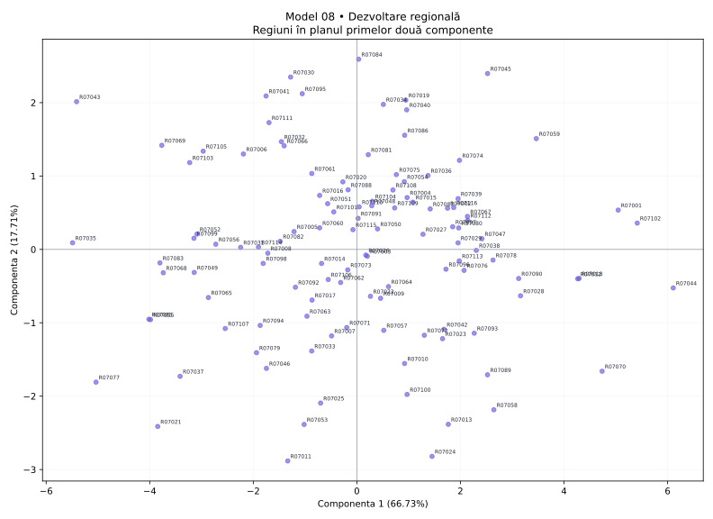

# Model 08 — Dezvoltare regională

Variantă de antrenament creată după modelul profesorului. Date sintetice, fără semnificație statistică oficială.

40 minute · 9 puncte + 1 punct din oficiu. Barem orientativ de pregătire.

- X1: PIB pe locuitor
- X2: Productivitate
- X3: Investiții
- X4: Ocupare
- X5: Sărăcie
- X6: Șomaj
- X7: Studii superioare
- X8: Acces la internet

## 1. (1p) Analizați matricea de corelație pentru datele numerice inițiale. Formulați o concluzie privind aplicarea analizei componentelor principale.

```text
cor()  X1      X2      X3      X4      X5      X6      X7      X8    
X1     1.000   -0.693  -0.219  -0.583  -0.572  -0.362  -0.809  0.720 
X2     -0.693  1.000   0.055   0.643   0.577   0.435   0.801   -0.559
X3     -0.219  0.055   1.000   0.601   0.659   0.682   0.248   -0.621
X4     -0.583  0.643   0.601   1.000   0.864   0.812   0.655   -0.774
X5     -0.572  0.577   0.659   0.864   1.000   0.806   0.650   -0.778
X6     -0.362  0.435   0.682   0.812   0.806   1.000   0.475   -0.687
X7     -0.809  0.801   0.248   0.655   0.650   0.475   1.000   -0.724
X8     0.720   -0.559  -0.621  -0.774  -0.778  -0.687  -0.724  1.000 
```

**Răspuns-model:** Există asocieri între variabile: X4–X5: r = 0.864; X4–X6: r = 0.812. Sunt 22 perechi cu |r| ≥ 0,50 din 28. Indicatorii conțin informație comună, deci ACP este justificată ca metodă de reducere a dimensionalității; nu deducem cauzalitate din corelații.

**Pe înțelesul tău:** Ignoră diagonala de 1. Caută valori apropiate de +1 sau −1. Semnul spune direcția; modulul spune cât de puternică este asocierea. Mai multe corelații consistente sugerează informație repetată pe care ACP o poate sintetiza. Aceasta este o justificare exploratorie, nu un test formal de adecvare.

- 0.5p: Citezi două corelații și sensul lor.
- 0.5p: Legi informația comună de utilitatea ACP.

## 2. (2p) Folosiți două criterii pentru a decide numărul de componente păstrate în analiză.

```text
Componentă  Valoare proprie  % variație  % cumulat
1           5.338            66.727      66.727   
2           1.417            17.707      84.434   
3           0.490            6.130       90.563   
4           0.185            2.313       92.877   
5           0.176            2.200       95.077   
6           0.148            1.850       96.928   
7           0.132            1.652       98.580   
8           0.114            1.420       100.000  
```

**Răspuns-model:** Prin Kaiser, pentru ACP pe variabile standardizate, păstrez 2 componente cu λ > 1, care explică 84.43% din variație. Prin criteriul variației cumulate, aleg un prag explicit de 80% și păstrez 2 componente (84.43%). Cele două criterii coincid.

**Pe înțelesul tău:** Kaiser: numeri valorile proprii strict peste 1. Cumulat: citești de sus în jos până ajungi pentru prima dată la pragul ales. Nu confunda procentul unei componente cu procentul cumulat. Nu forța criteriile să dea același număr.

- 1p: Aplici Kaiser și indici numărul corect.
- 1p: Precizezi pragul și primul număr care îl atinge; justifici alegerea.

## 3. (2p) Folosiți matricea factor pentru a interpreta a doua componentă principală.

```text
Matricea factor  Dim1    Dim2  
X1               -0.764  0.468 
X2               0.737   -0.539
X3               0.617   0.693 
X4               0.917   0.139 
X5               0.912   0.202 
X6               0.809   0.412 
X7               0.828   -0.440
X8               -0.904  -0.051
```

**Răspuns-model:** Componenta 2 opune valorile ridicate pentru Investiții (X3, r = 0.693), PIB pe locuitor (X1, r = 0.468) valorilor ridicate pentru Productivitate (X2, r = -0.539), Studii superioare (X7, r = -0.440). Ea explică 17.71% din variația totală. O numesc „contrastul dintre Investiții / PIB pe locuitor și Productivitate / Studii superioare”. Denumirea este descriptivă; nu presupune că axa măsoară exclusiv un singur fenomen.

**Pe înțelesul tău:** Te uiți doar la coloana a doua. Alegi coeficienții cei mai mari în valoare absolută, inclusiv pe cei negativi. Plus înseamnă variație în același sens cu axa, minus în sens opus. Numele componentei trebuie să reflecte indicatorii dominanți, chiar dacă rezultă un profil mixt.

- 1p: Identifici indicatorii dominanți și coeficienții lor pe PC2.
- 1p: Explici sensurile, propui un nume susținut și precizezi variația explicată.

## 4. (2p) Din outputul numeric privind variabilele interpretați coloanele Dim1, Dim2 (corelații) și ctr (contribuții) pentru primele două componente principale.

```text
Variabilă  Dim1    Dim2    ctr1 (%)  ctr2 (%)
X1         -0.764  0.468   10.943    15.457  
X2         0.737   -0.539  10.183    20.525  
X3         0.617   0.693   7.138     33.930  
X4         0.917   0.139   15.745    1.364   
X5         0.912   0.202   15.571    2.893   
X6         0.809   0.412   12.268    11.982  
X7         0.828   -0.440  12.850    13.664  
X8         -0.904  -0.051  15.302    0.185   
```

**Răspuns-model:** Dim1 și Dim2 sunt corelațiile indicatorilor cu componentele, cu valori între −1 și 1. De exemplu, X4 (Ocupare) are r = 0.917 cu PC1 și r = 0.139 cu PC2. Semnul indică sensul, iar |r| intensitatea. ctr1 și ctr2 arată procentul cu care variabila participă la construirea fiecărei axe. X4 are ctr1 = 15.75%, iar X3 are ctr2 = 33.93%, peste reperul mediu de 12.50% = 100/8. Contribuțiile se adună la 100% separat pe fiecare componentă, înainte de rotunjire.

**Pe înțelesul tău:** Dim = cât de strâns și în ce sens se leagă variabila de axă. ctr = cât ajută variabila la construirea axei. O corelație negativă poate avea o contribuție mare: contribuția nu are semn. ctr NU este procentul din variabilă explicat de axă; pentru acesta folosești cos², adică aici pătratul corelației.

- 1p: Interpretezi numeric Dim1 și Dim2, cu semn și intensitate.
- 1p: Interpretezi contribuțiile pentru ambele axe, reperul mediu și diferența față de cos².

## 5. (2p) Reprezentați grafic regiunile într-un spațiu definit de primele două componente principale. Extrageți 2 concluzii.

```text
Regiune  Scor PC1  Scor PC2  cos2 plan
R07044   6.110     -0.525    0.972    
R07035   -5.490    0.090     0.973    
R07084   0.034     2.591     0.805    
R07011   -1.335    -2.883    0.941    
```

**Răspuns-model:** Graficul are PC1 pe orizontală și PC2 pe verticală; planul păstrează 84.43% din variație. Concluzia 1: R07044 este la extrema pozitivă a PC1 (6.110), iar R07035 la extrema negativă (-5.490); au profiluri opuse pe această axă. Capătul pozitiv este asociat mai ales cu Ocupare (X4, r = 0.917), Sărăcie (X5, r = 0.912), iar cel negativ cu Acces la internet (X8, r = -0.904), PIB pe locuitor (X1, r = -0.764). Concluzia 2: R07084 are scorul PC2 maxim (2.591), iar R07011 minim (-2.883); diferența se interpretează prin contrastul PC2 de la cerința 3. cos² în plan pentru aceste două regiuni este 0.805, respectiv 0.941; interpretarea este cu atât mai sigură cu cât cos² este mai mare. Nu afirm că două regiuni sunt identice în toate variabilele doar fiindcă par apropiate în acest plan.

**Pe înțelesul tău:** Punct = regiune. Dreapta/stânga = scor pozitiv/negativ pe PC1. Sus/jos = scor pozitiv/negativ pe PC2. Tradu direcția prin indicatorii care definesc axa. Dă două concluzii despre regiuni numite concret. Apropierea sugerează profiluri asemănătoare în plan; verifică reprezentarea înainte de a generaliza.

- 0.5p: Reprezinți regiunile pe cele două axe etichetate și menționezi informația păstrată.
- 0.75p: Formulezi prima concluzie concretă, legată de PC1.
- 0.75p: Formulezi a doua concluzie concretă, legată de PC2; respecți limitele planului.


