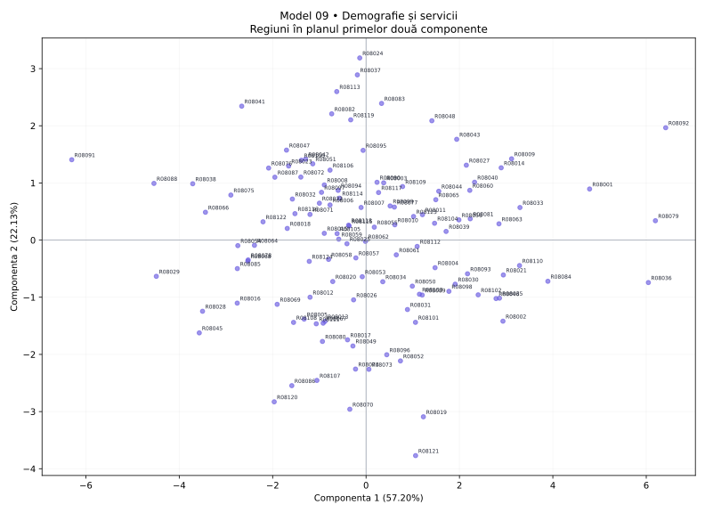

# Model 09 — Demografie și servicii

Variantă de antrenament creată după modelul profesorului. Date sintetice, fără semnificație statistică oficială.

40 minute · 9 puncte + 1 punct din oficiu. Barem orientativ de pregătire.

- X1: Populație tânără
- X2: Natalitate
- X3: Migrație netă
- X4: Populație vârstnică
- X5: Medici
- X6: Paturi spital
- X7: Densitate
- X8: Ocupare

## 1. (1p) Analizați matricea de corelație pentru datele numerice inițiale. Formulați o concluzie privind aplicarea analizei componentelor principale.

```text
cor()  X1      X2      X3      X4      X5      X6      X7      X8
X1     1.000   0.800   0.726   0.586   -0.695  -0.609  0.368   0.555
X2     0.800   1.000   0.700   0.450   -0.620  -0.505  0.237   0.600
X3     0.726   0.700   1.000   0.312   -0.553  -0.327  0.109   0.632
X4     0.586   0.450   0.312   1.000   -0.673  -0.797  0.651   0.113
X5     -0.695  -0.620  -0.553  -0.673  1.000   0.739   -0.295  -0.490
X6     -0.609  -0.505  -0.327  -0.797  0.739   1.000   -0.579  -0.247
X7     0.368   0.237   0.109   0.651   -0.295  -0.579  1.000   -0.235
X8     0.555   0.600   0.632   0.113   -0.490  -0.247  -0.235  1.000
```

**Răspuns-model:** Există asocieri între variabile: X1–X2: r = 0.800; X4–X6: r = -0.797. Sunt 17 perechi cu |r| ≥ 0,50 din 28. Indicatorii conțin informație comună, deci ACP este justificată ca metodă de reducere a dimensionalității; nu deducem cauzalitate din corelații.

**Pe înțelesul tău:** Ignoră diagonala de 1. Caută valori apropiate de +1 sau −1. Semnul spune direcția; modulul spune cât de puternică este asocierea. Mai multe corelații consistente sugerează informație repetată pe care ACP o poate sintetiza. Aceasta este o justificare exploratorie, nu un test formal de adecvare.

- 0.5p: Citezi două corelații și sensul lor.
- 0.5p: Legi informația comună de utilitatea ACP.

## 2. (2p) Folosiți două criterii pentru a decide numărul de componente păstrate în analiză.

```text
Componentă  Valoare proprie  % variație  % cumulat
1           4.576            57.205      57.205
2           1.770            22.126      79.331
3           0.583            7.291       86.621
4           0.299            3.733       90.354
5           0.250            3.130       93.484
6           0.194            2.426       95.910
7           0.169            2.109       98.019
8           0.158            1.981       100.000
```

**Răspuns-model:** Prin Kaiser, pentru ACP pe variabile standardizate, păstrez 2 componente cu λ > 1, care explică 79.33% din variație. Prin criteriul variației cumulate, aleg un prag explicit de 80% și păstrez 3 componente (86.62%). Criteriile dau rezultate diferite. Dacă urmăresc minimum 80% informație, aleg 3; dacă aplic strict Kaiser, aleg 2. Pragul de 80% este o alegere de lucru, nu o regulă universală.

**Pe înțelesul tău:** Kaiser: numeri valorile proprii strict peste 1. Cumulat: citești de sus în jos până ajungi pentru prima dată la pragul ales. Nu confunda procentul unei componente cu procentul cumulat. Nu forța criteriile să dea același număr.

- 1p: Aplici Kaiser și indici numărul corect.
- 1p: Precizezi pragul și primul număr care îl atinge; justifici alegerea.

## 3. (2p) Folosiți matricea factor pentru a interpreta a doua componentă principală.

```text
Matricea factor  Dim1    Dim2
X1               0.903   -0.132
X2               0.833   -0.280
X3               0.736   -0.451
X4               0.763   0.516
X5               -0.861  -0.015
X6               -0.803  -0.406
X7               0.473   0.746
X8               0.577   -0.695
```

**Răspuns-model:** Componenta 2 opune valorile ridicate pentru Densitate (X7, r = 0.746), Populație vârstnică (X4, r = 0.516) valorilor ridicate pentru Ocupare (X8, r = -0.695), Migrație netă (X3, r = -0.451). Ea explică 22.13% din variația totală. O numesc „contrastul dintre Densitate / Populație vârstnică și Ocupare / Migrație netă”. Denumirea este descriptivă; nu presupune că axa măsoară exclusiv un singur fenomen.

**Pe înțelesul tău:** Te uiți doar la coloana a doua. Alegi coeficienții cei mai mari în valoare absolută, inclusiv pe cei negativi. Plus înseamnă variație în același sens cu axa, minus în sens opus. Numele componentei trebuie să reflecte indicatorii dominanți, chiar dacă rezultă un profil mixt.

- 1p: Identifici indicatorii dominanți și coeficienții lor pe PC2.
- 1p: Explici sensurile, propui un nume susținut și precizezi variația explicată.

## 4. (2p) Din outputul numeric privind variabilele interpretați coloanele Dim1, Dim2 (corelații) și ctr (contribuții) pentru primele două componente principale.

```text
Variabilă  Dim1    Dim2    ctr1 (%)  ctr2 (%)
X1         0.903   -0.132  17.819    0.991
X2         0.833   -0.280  15.165    4.419
X3         0.736   -0.451  11.838    11.496
X4         0.763   0.516   12.711    15.017
X5         -0.861  -0.015  16.215    0.013
X6         -0.803  -0.406  14.100    9.323
X7         0.473   0.746   4.887     31.424
X8         0.577   -0.695  7.264     27.317
```

**Răspuns-model:** Dim1 și Dim2 sunt corelațiile indicatorilor cu componentele, cu valori între −1 și 1. De exemplu, X1 (Populație tânără) are r = 0.903 cu PC1 și r = -0.132 cu PC2. Semnul indică sensul, iar |r| intensitatea. ctr1 și ctr2 arată procentul cu care variabila participă la construirea fiecărei axe. X1 are ctr1 = 17.82%, iar X7 are ctr2 = 31.42%, peste reperul mediu de 12.50% = 100/8. Contribuțiile se adună la 100% separat pe fiecare componentă, înainte de rotunjire.

**Pe înțelesul tău:** Dim = cât de strâns și în ce sens se leagă variabila de axă. ctr = cât ajută variabila la construirea axei. O corelație negativă poate avea o contribuție mare: contribuția nu are semn. ctr NU este procentul din variabilă explicat de axă; pentru acesta folosești cos², adică aici pătratul corelației.

- 1p: Interpretezi numeric Dim1 și Dim2, cu semn și intensitate.
- 1p: Interpretezi contribuțiile pentru ambele axe, reperul mediu și diferența față de cos².

## 5. (2p) Reprezentați grafic regiunile într-un spațiu definit de primele două componente principale. Extrageți 2 concluzii.

```text
Regiune  Scor PC1  Scor PC2  cos2 plan
R08092   6.416     1.966     0.971
R08091   -6.302    1.406     0.988
R08024   -0.135    3.187     0.839
R08121   1.061     -3.771    0.918
```

**Răspuns-model:** Graficul are PC1 pe orizontală și PC2 pe verticală; planul păstrează 79.33% din variație. Concluzia 1: R08092 este la extrema pozitivă a PC1 (6.416), iar R08091 la extrema negativă (-6.302); au profiluri opuse pe această axă. Capătul pozitiv este asociat mai ales cu Populație tânără (X1, r = 0.903), Natalitate (X2, r = 0.833), iar cel negativ cu Medici (X5, r = -0.861), Paturi spital (X6, r = -0.803). Concluzia 2: R08024 are scorul PC2 maxim (3.187), iar R08121 minim (-3.771); diferența se interpretează prin contrastul PC2 de la cerința 3. cos² în plan pentru aceste două regiuni este 0.839, respectiv 0.918; interpretarea este cu atât mai sigură cu cât cos² este mai mare. Nu afirm că două regiuni sunt identice în toate variabilele doar fiindcă par apropiate în acest plan.

**Pe înțelesul tău:** Punct = regiune. Dreapta/stânga = scor pozitiv/negativ pe PC1. Sus/jos = scor pozitiv/negativ pe PC2. Tradu direcția prin indicatorii care definesc axa. Dă două concluzii despre regiuni numite concret. Apropierea sugerează profiluri asemănătoare în plan; verifică reprezentarea înainte de a generaliza.

- 0.5p: Reprezinți regiunile pe cele două axe etichetate și menționezi informația păstrată.
- 0.75p: Formulezi prima concluzie concretă, legată de PC1.
- 0.75p: Formulezi a doua concluzie concretă, legată de PC2; respecți limitele planului.


