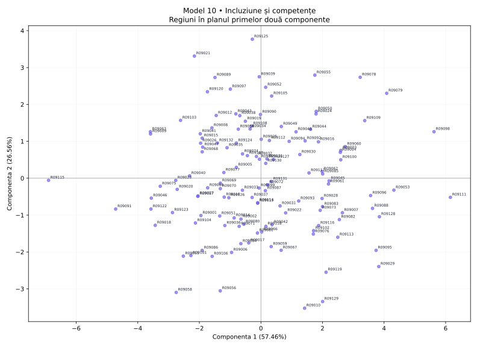

# Model 10 — Incluziune și competențe

Variantă de antrenament creată după modelul profesorului. Date sintetice, fără semnificație statistică oficială.

40 minute · 9 puncte + 1 punct din oficiu. Barem orientativ de pregătire.

- X1: Competențe digitale
- X2: Formare adulți
- X3: Studii superioare
- X4: Ocuparea femeilor
- X5: NEET
- X6: Șomaj
- X7: Sărăcie
- X8: Acces la servicii

## 1. (1p) Analizați matricea de corelație pentru datele numerice inițiale. Formulați o concluzie privind aplicarea analizei componentelor principale.

```text
cor()  X1      X2      X3      X4      X5      X6      X7      X8    
X1     1.000   0.571   0.665   0.706   0.046   -0.422  -0.076  -0.335
X2     0.571   1.000   0.807   0.738   0.596   -0.738  -0.533  0.375 
X3     0.665   0.807   1.000   0.745   0.489   -0.728  -0.439  0.208 
X4     0.706   0.738   0.745   1.000   0.254   -0.498  -0.172  0.084 
X5     0.046   0.596   0.489   0.254   1.000   -0.750  -0.842  0.736 
X6     -0.422  -0.738  -0.728  -0.498  -0.750  1.000   0.767   -0.437
X7     -0.076  -0.533  -0.439  -0.172  -0.842  0.767   1.000   -0.656
X8     -0.335  0.375   0.208   0.084   0.736   -0.437  -0.656  1.000 
```

**Răspuns-model:** Există asocieri între variabile: X5–X7: r = -0.842; X2–X3: r = 0.807. Sunt 15 perechi cu |r| ≥ 0,50 din 28. Indicatorii conțin informație comună, deci ACP este justificată ca metodă de reducere a dimensionalității; nu deducem cauzalitate din corelații.

**Pe înțelesul tău:** Ignoră diagonala de 1. Caută valori apropiate de +1 sau −1. Semnul spune direcția; modulul spune cât de puternică este asocierea. Mai multe corelații consistente sugerează informație repetată pe care ACP o poate sintetiza. Aceasta este o justificare exploratorie, nu un test formal de adecvare.

- 0.5p: Citezi două corelații și sensul lor.
- 0.5p: Legi informația comună de utilitatea ACP.

## 2. (2p) Folosiți două criterii pentru a decide numărul de componente păstrate în analiză.

```text
Componentă  Valoare proprie  % variație  % cumulat
1           4.597            57.459      57.459   
2           2.125            26.558      84.018   
3           0.519            6.485       90.503   
4           0.202            2.531       93.034   
5           0.169            2.116       95.149   
6           0.148            1.848       96.997   
7           0.137            1.715       98.712   
8           0.103            1.288       100.000  
```

**Răspuns-model:** Prin Kaiser, pentru ACP pe variabile standardizate, păstrez 2 componente cu λ > 1, care explică 84.02% din variație. Prin criteriul variației cumulate, aleg un prag explicit de 80% și păstrez 2 componente (84.02%). Cele două criterii coincid.

**Pe înțelesul tău:** Kaiser: numeri valorile proprii strict peste 1. Cumulat: citești de sus în jos până ajungi pentru prima dată la pragul ales. Nu confunda procentul unei componente cu procentul cumulat. Nu forța criteriile să dea același număr.

- 1p: Aplici Kaiser și indici numărul corect.
- 1p: Precizezi pragul și primul număr care îl atinge; justifici alegerea.

## 3. (2p) Folosiți matricea factor pentru a interpreta a doua componentă principală.

```text
Matricea factor  Dim1    Dim2  
X1               -0.522  0.776 
X2               -0.901  0.189 
X3               -0.856  0.346 
X4               -0.694  0.552 
X5               -0.794  -0.512
X6               0.906   0.090 
X7               0.757   0.509 
X8               -0.522  -0.730
```

**Răspuns-model:** Componenta 2 opune valorile ridicate pentru Competențe digitale (X1, r = 0.776), Ocuparea femeilor (X4, r = 0.552) valorilor ridicate pentru Acces la servicii (X8, r = -0.730), NEET (X5, r = -0.512). Ea explică 26.56% din variația totală. O numesc „contrastul dintre Competențe digitale / Ocuparea femeilor și Acces la servicii / NEET”. Denumirea este descriptivă; nu presupune că axa măsoară exclusiv un singur fenomen.

**Pe înțelesul tău:** Te uiți doar la coloana a doua. Alegi coeficienții cei mai mari în valoare absolută, inclusiv pe cei negativi. Plus înseamnă variație în același sens cu axa, minus în sens opus. Numele componentei trebuie să reflecte indicatorii dominanți, chiar dacă rezultă un profil mixt.

- 1p: Identifici indicatorii dominanți și coeficienții lor pe PC2.
- 1p: Explici sensurile, propui un nume susținut și precizezi variația explicată.

## 4. (2p) Din outputul numeric privind variabilele interpretați coloanele Dim1, Dim2 (corelații) și ctr (contribuții) pentru primele două componente principale.

```text
Variabilă  Dim1    Dim2    ctr1 (%)  ctr2 (%)
X1         -0.522  0.776   5.922     28.313  
X2         -0.901  0.189   17.677    1.679   
X3         -0.856  0.346   15.958    5.624   
X4         -0.694  0.552   10.493    14.352  
X5         -0.794  -0.512  13.725    12.339  
X6         0.906   0.090   17.854    0.381   
X7         0.757   0.509   12.452    12.205  
X8         -0.522  -0.730  5.920     25.106  
```

**Răspuns-model:** Dim1 și Dim2 sunt corelațiile indicatorilor cu componentele, cu valori între −1 și 1. De exemplu, X6 (Șomaj) are r = 0.906 cu PC1 și r = 0.090 cu PC2. Semnul indică sensul, iar |r| intensitatea. ctr1 și ctr2 arată procentul cu care variabila participă la construirea fiecărei axe. X6 are ctr1 = 17.85%, iar X1 are ctr2 = 28.31%, peste reperul mediu de 12.50% = 100/8. Contribuțiile se adună la 100% separat pe fiecare componentă, înainte de rotunjire.

**Pe înțelesul tău:** Dim = cât de strâns și în ce sens se leagă variabila de axă. ctr = cât ajută variabila la construirea axei. O corelație negativă poate avea o contribuție mare: contribuția nu are semn. ctr NU este procentul din variabilă explicat de axă; pentru acesta folosești cos², adică aici pătratul corelației.

- 1p: Interpretezi numeric Dim1 și Dim2, cu semn și intensitate.
- 1p: Interpretezi contribuțiile pentru ambele axe, reperul mediu și diferența față de cos².

## 5. (2p) Reprezentați grafic regiunile într-un spațiu definit de primele două componente principale. Extrageți 2 concluzii.

```text
Regiune  Scor PC1  Scor PC2  cos2 plan
R09111   6.154     -0.518    0.954    
R09115   -6.898    -0.057    0.973    
R09125   -0.279    3.769     0.964    
R09010   1.420     -3.524    0.875    
```

**Răspuns-model:** Graficul are PC1 pe orizontală și PC2 pe verticală; planul păstrează 84.02% din variație. Concluzia 1: R09111 este la extrema pozitivă a PC1 (6.154), iar R09115 la extrema negativă (-6.898); au profiluri opuse pe această axă. Capătul pozitiv este asociat mai ales cu Șomaj (X6, r = 0.906), Sărăcie (X7, r = 0.757), iar cel negativ cu Formare adulți (X2, r = -0.901), Studii superioare (X3, r = -0.856). Concluzia 2: R09125 are scorul PC2 maxim (3.769), iar R09010 minim (-3.524); diferența se interpretează prin contrastul PC2 de la cerința 3. cos² în plan pentru aceste două regiuni este 0.964, respectiv 0.875; interpretarea este cu atât mai sigură cu cât cos² este mai mare. Nu afirm că două regiuni sunt identice în toate variabilele doar fiindcă par apropiate în acest plan.

**Pe înțelesul tău:** Punct = regiune. Dreapta/stânga = scor pozitiv/negativ pe PC1. Sus/jos = scor pozitiv/negativ pe PC2. Tradu direcția prin indicatorii care definesc axa. Dă două concluzii despre regiuni numite concret. Apropierea sugerează profiluri asemănătoare în plan; verifică reprezentarea înainte de a generaliza.

- 0.5p: Reprezinți regiunile pe cele două axe etichetate și menționezi informația păstrată.
- 0.75p: Formulezi prima concluzie concretă, legată de PC1.
- 0.75p: Formulezi a doua concluzie concretă, legată de PC2; respecți limitele planului.


