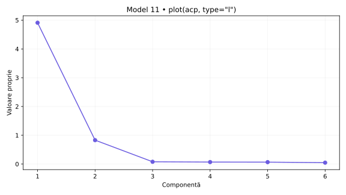
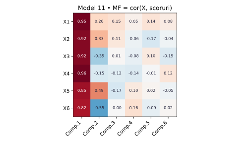
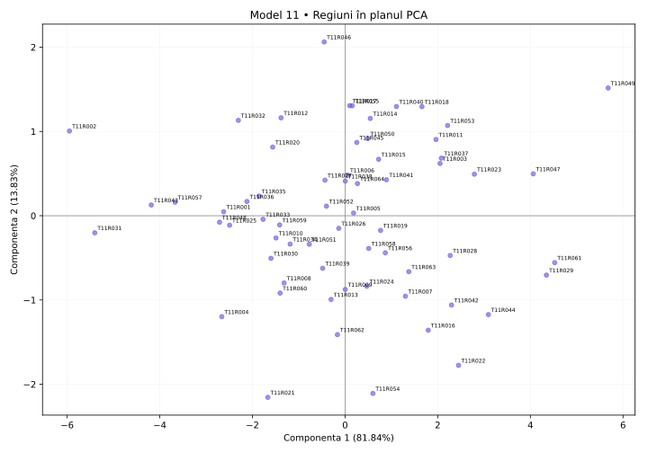

# Model 11 — Citește summary(acp)

Variantă nouă după cerințele din fotografie și comenzile din „Cod test ACP.docx”. Date sintetice; outputuri didactice calculate în Python după definițiile funcțiilor, fără rulare R.

40 minute · 9p + 1p din oficiu. Barem orientativ.

**Capcana de urmărit:** În summary(acp), Standard deviation nu este valoarea proprie: λ = sdev². Proportion of Variance este proporție, nu procent deja înmulțit cu 100.

- X1: Internet acasă
- X2: Internet zilnic
- X3: Internet banking
- X4: Cumpărături online
- X5: PIB pe locuitor (PPS)
- X6: Ocupare 20–64 ani

## 1. (1p) Analizați matricea de corelație pentru datele numerice inițiale. Formulați o concluzie privind aplicarea analizei componentelor principale.

```r
cor(scale(X,center=T,scale=T))
```

```text
    X1     X2     X3     X4     X5     X6
X1  1.000  0.928  0.805  0.871  0.886  0.668
X2  0.928  1.000  0.724  0.827  0.914  0.574
X3  0.805  0.724  1.000  0.928  0.609  0.915
X4  0.871  0.827  0.928  1.000  0.744  0.851
X5  0.886  0.914  0.609  0.744  1.000  0.439
X6  0.668  0.574  0.915  0.851  0.439  1.000
```

**Pe înțelesul tău:** cor(scale(X)) este matricea de corelație a indicatorilor. Standardizarea nu schimbă corelațiile Pearson între coloane. Ignor diagonala de 1, discut semnul și modulul a două valori și abia apoi justific utilitatea ACP. Nu spun că ACP este interzisă când corelațiile sunt mici.

**Răspuns-model:** X1–X2 au r = 0.928, iar X3–X4 au r = 0.928. Sunt 14 perechi cu |r| ≥ 0,50 din 15. Corelațiile indică informație comună și justifică explorarea prin ACP. Semnul arată sensul asocierii, nu cauzalitatea.

- 0.5p: Citezi două corelații și sensul lor.
- 0.5p: Legi informația comună de utilitatea ACP.

## 2. (2p) Folosiți două criterii pentru a decide numărul de componente păstrate în analiză.

```r
summary(acp)
plot(acp,type="l")
summary(acp2)  # secțiunea Eigenvalues
```

```text
                        Comp.1   Comp.2   Comp.3   Comp.4   Comp.5   Comp.6
Standard deviation      2.216    0.911    0.280    0.261    0.257    0.218
Proportion of Variance  0.81839  0.13827  0.01306  0.01136  0.01097  0.00796
Cumulative Proportion   0.81839  0.95666  0.96972  0.98108  0.99204  1.00000

Eigenvalues           Dim.1   Dim.2   Dim.3   Dim.4   Dim.5   Dim.6
Variance              4.910   0.830   0.078   0.068   0.066   0.048
% of var.             81.839  13.827  1.306   1.136   1.097   0.796
Cumulative % of var.  81.839  95.666  96.972  98.108  99.204  100.000
```

**Pe înțelesul tău:** Citește trei lucruri separat: Standard deviation = abaterea componentei; pătratul ei = valoarea proprie; Proportion/Cumulative sunt proporții și se înmulțesc cu 100 pentru procente. Scree plot arată valorile proprii; cotul este un reper grafic, nu un număr impus fără justificare. Graficul plot(acp) afișează implicit cel mult primele 10 axe; tabelul este complet. ncp=5 implicit din PCA() nu înlocuiește criteriile de selecție.

**Răspuns-model:** Ridic la pătrat Standard deviation: pentru PC1, 2.216² ≈ 4.910; valorile nerotunjite dau rezultatul exact. Kaiser păstrează 1 componente cu λ > 1, echivalent sdev > 1 în această ACP standardizată. Acestea explică 81.84%. La un prag ales de 80%, primul număr suficient este 1, cu 81.84%. Criteriile coincid. Proportion of Variance pentru PC1 este 0.81839, adică 81.84%.

- 1p: Aplici Kaiser și indici numărul corect.
- 1p: Precizezi pragul și primul număr care îl atinge; justifici alegerea.



## 3. (2p) Folosiți matricea factor pentru a interpreta a doua componentă principală.

```r
scoruri <- acp$scores
MF=cor(X,scoruri)
corrplot(MF,method="number")
```

```text
MF  Comp.1  Comp.2  Comp.3  Comp.4  Comp.5  Comp.6
X1  0.953   0.200   0.150   0.053   0.138   0.084
X2  0.918   0.331   0.114   -0.061  -0.171  -0.040
X3  0.918   -0.347  0.014   -0.080  0.095   -0.146
X4  0.963   -0.151  -0.120  -0.141  -0.012  0.121
X5  0.848   0.489   -0.168  0.098   0.025   -0.051
X6  0.817   -0.546  -0.002  0.160   -0.088  0.021
```

**Pe înțelesul tău:** Aici matricea factor chiar este cor(X, scoruri), deci numerele sunt corelații. Nu o confunda cu acp$loadings, unde sunt vectorii proprii. Citesc doar Comp.2, aleg coeficienții mari în modul, verific și minusurile și construiesc numele pe indicatorii dominanți. Pentru sensul regiunilor din fviz_pca_ind folosesc coordonatele PCA de la cerința 4: între metode semnul unei axe poate fi inversat.

**Răspuns-model:** Pe Comp.2 sunt asocieri pozitive mai importante pentru PIB pe locuitor (PPS) (X5: 0.489), Internet zilnic (X2: 0.331) și negative pentru Ocupare 20–64 ani (X6: -0.546), Internet banking (X3: -0.347). Componenta explică 13.83% din variația totală. O denumire descriptivă posibilă este „contrast între Ocupare 20–64 ani / PIB pe locuitor (PPS) / Internet banking”, cu sensurile precizate mai sus. Are putere de sinteză modestă: nu exagerez interpretarea unor corelații slabe. Numele descrie asocieri din setul de date; nu demonstrează cauzalitate.

- 1p: Identifici indicatorii dominanți și coeficienții lor pe PC2.
- 1p: Explici sensurile, propui un nume susținut și precizezi variația explicată.



## 4. (2p) Din outputul numeric privind variabilele interpretați coloanele Dim1, Dim2 (corelații) și ctr (contribuții) pentru primele două componente principale.

```r
acp2 <- PCA(X,scale.unit=T,graph=T)
summary(acp2)  # secțiunea Variables
```

```text
Variables
    Dim.1  ctr     cos2   Dim.2   ctr     cos2   Dim.3   ctr     cos2
X1  0.953  18.505  0.909  -0.200  4.807   0.040  -0.150  28.657  0.022
X2  0.918  17.163  0.843  -0.331  13.239  0.110  -0.114  16.583  0.013
X3  0.918  17.163  0.843  0.347   14.475  0.120  -0.014  0.249   0.000
X4  0.963  18.905  0.928  0.151   2.732   0.023  0.120   18.408  0.014
X5  0.848  14.661  0.720  -0.489  28.811  0.239  0.168   36.096  0.028
X6  0.817  13.603  0.668  0.546   35.935  0.298  0.002   0.007   0.000
```

**Pe înțelesul tău:** În fiecare grup de trei coloane citești: Dim = corelație, ctr = procent din construirea componentei, cos2 = cât de bine se vede variabila pe acea axă. Următorul grup este pentru componenta următoare. Nu aduni ctr de pe PC1 cu ctr de pe PC2 și nu tratezi ctr ca procent de reprezentare. Summary afișează implicit doar 10 elemente și 3 axe, deși analiza poate conține mai multe.

**Răspuns-model:** În Variables, Dim.1 și Dim.2 sunt corelații. Pentru X4, r cu PC1 este 0.963, iar cu PC2 este 0.151; semnul indică sensul, modulul intensitatea. ctr este contribuția la construirea axei: X4 are 18.91% pe PC1 și X6 are 35.94% pe PC2. Reperul mediu este 100/6 = 16.67%, calculat cu toate cele 6 variabile active. cos² pentru X4 pe PC1 este 0.928, adică 92.83% din variația sa reprezentată de această axă; în această ACP standardizată cos² = r². Contribuțiile tuturor variabilelor însumează 100% separat pe fiecare axă, înainte de rotunjire. În acest exemplu PC2 are semn invers față de MF din princomp; sensul se inversează împreună cu axa, contribuțiile și cos² rămân aceleași.

- 1p: Interpretezi numeric Dim1 și Dim2, cu semn și intensitate.
- 1p: Interpretezi contribuțiile pentru ambele axe, reperul mediu și diferența față de cos².

## 5. (2p) Reprezentați grafic regiunile într-un spațiu definit de primele două componente principale. Extrageți 2 concluzii.

```r
fviz_pca_ind(acp2)
# Tabelul de mai jos selectează extremele din acp2$ind; nu este lista implicită a primelor 10.
```

```text
Individuals — selecție pentru verificarea concluziilor
         Dist   Dim.1   ctr     cos2   Dim.2   ctr    cos2
T11R049  5.909  5.679   10.262  0.923  1.516   4.329  0.066
T11R002  6.053  -5.951  11.267  0.966  1.005   1.904  0.028
T11R046  2.174  -0.452  0.065   0.043  2.062   8.012  0.900
T11R021  2.737  -1.669  0.886   0.372  -2.156  8.752  0.620
```

**Pe înțelesul tău:** În Individuals, Dim este scorul unei regiuni, nu corelația unei variabile. Poate depăși ±1. ctr arată participarea regiunii la axă; cos² arată calitatea reprezentării, iar cos² pe plan = cos² pe PC1 + cos² pe PC2. Folosesc indicatorii din PCA pentru a numi direcțiile graficului. Două puncte apropiate sugerează profiluri asemănătoare în plan, fără a demonstra identitate în toate variabilele.

**Răspuns-model:** Graficul regiunilor folosește coordonatele din PCA, cu PC1 orizontală și PC2 verticală, și păstrează 95.67% din variație. Concluzia 1: T11R049 (PC1=5.679) și T11R002 (PC1=-5.951) au profiluri opuse pe PC1. Sensul pozitiv este asociat cu Cumpărături online (X4: 0.963), Internet acasă (X1: 0.953), Internet banking (X3: 0.918), iar cel negativ cu valori mici ale indicatorilor corelați pozitiv. Concluzia 2: T11R046 (PC2=2.062) și T11R021 (PC2=-2.156) contrastează pe PC2, al cărei sens pozitiv este asociat cu Ocupare 20–64 ani (X6: 0.546), Internet banking (X3: 0.347), iar cel negativ cu PIB pe locuitor (PPS) (X5: -0.489), Internet zilnic (X2: -0.331). cos² în plan pentru aceste ultime două regiuni este 0.943, respectiv 0.992; țin cont de calitatea reprezentării.

- 0.5p: Reprezinți regiunile pe cele două axe etichetate și menționezi informația păstrată.
- 0.75p: Formulezi prima concluzie concretă, legată de PC1.
- 0.75p: Formulezi a doua concluzie concretă, legată de PC2; respecți limitele planului.



Surse tehnice: [R princomp](https://stat.ethz.ch/R-manual/R-devel/library/stats/html/princomp.html), [summary.PCA](https://github.com/cran/FactoMineR/blob/master/R/summary.PCA.r), [svd.triplet](https://github.com/cran/FactoMineR/blob/master/R/svd.triplet.R).
