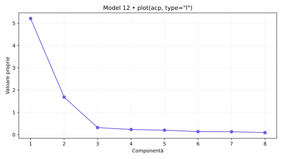
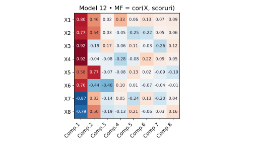
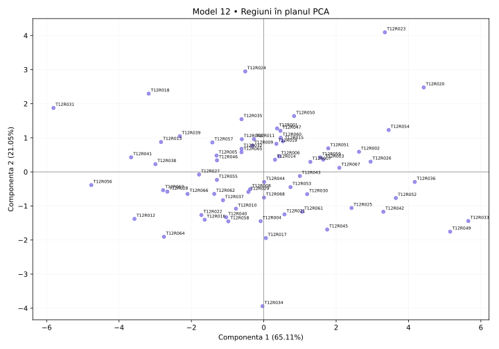

# Model 12 — Kaiser versus variația cumulată

Variantă nouă după cerințele din fotografie și comenzile din „Cod test ACP.docx”. Date sintetice; outputuri didactice calculate în Python după definițiile funcțiilor, fără rulare R.

40 minute · 9p + 1p din oficiu. Barem orientativ.

**Capcana de urmărit:** Precizează pragul ales pentru variația cumulată. Kaiser și pragul de 80% pot conduce la numere diferite de componente.

- X1: Internet acasă
- X2: Internet zilnic
- X3: Internet banking
- X4: Cumpărături online
- X5: PIB pe locuitor (PPS)
- X6: Ocupare 20–64 ani
- X7: Șomaj 20–64 ani
- X8: Șomaj tineri

## 1. (1p) Analizați matricea de corelație pentru datele numerice inițiale. Formulați o concluzie privind aplicarea analizei componentelor principale.

```r
cor(scale(X,center=T,scale=T))
```

```text
    X1      X2      X3      X4      X5      X6      X7      X8
X1  1.000   0.816   0.624   0.654   0.778   0.412   -0.535  -0.427
X2  0.816   1.000   0.586   0.679   0.811   0.346   -0.474  -0.369
X3  0.624   0.586   1.000   0.821   0.389   0.707   -0.860  -0.809
X4  0.654   0.679   0.821   1.000   0.503   0.709   -0.785  -0.712
X5  0.778   0.811   0.389   0.503   1.000   0.134   -0.257  -0.057
X6  0.412   0.346   0.707   0.709   0.134   1.000   -0.737  -0.736
X7  -0.535  -0.474  -0.860  -0.785  -0.257  -0.737  1.000   0.813
X8  -0.427  -0.369  -0.809  -0.712  -0.057  -0.736  0.813   1.000
```

**Pe înțelesul tău:** cor(scale(X)) este matricea de corelație a indicatorilor. Standardizarea nu schimbă corelațiile Pearson între coloane. Ignor diagonala de 1, discut semnul și modulul a două valori și abia apoi justific utilitatea ACP. Nu spun că ACP este interzisă când corelațiile sunt mici.

**Răspuns-model:** X3–X7 au r = -0.860, iar X3–X4 au r = 0.821. Sunt 19 perechi cu |r| ≥ 0,50 din 28. Corelațiile indică informație comună și justifică explorarea prin ACP. Semnul arată sensul asocierii, nu cauzalitatea.

- 0.5p: Citezi două corelații și sensul lor.
- 0.5p: Legi informația comună de utilitatea ACP.

## 2. (2p) Folosiți două criterii pentru a decide numărul de componente păstrate în analiză.

```r
summary(acp)
plot(acp,type="l")
summary(acp2)  # secțiunea Eigenvalues
```

```text
                        Comp.1   Comp.2   Comp.3   Comp.4   Comp.5   Comp.6   Comp.7   Comp.8
Standard deviation      2.282    1.298    0.563    0.482    0.447    0.369    0.362    0.302
Proportion of Variance  0.65106  0.21047  0.03960  0.02903  0.02498  0.01706  0.01642  0.01137
Cumulative Proportion   0.65106  0.86153  0.90113  0.93016  0.95514  0.97220  0.98863  1.00000

Eigenvalues           Dim.1   Dim.2   Dim.3   Dim.4   Dim.5   Dim.6   Dim.7   Dim.8
Variance              5.208   1.684   0.317   0.232   0.200   0.136   0.131   0.091
% of var.             65.106  21.047  3.960   2.903   2.498   1.706   1.642   1.137
Cumulative % of var.  65.106  86.153  90.113  93.016  95.514  97.220  98.863  100.000
```

**Pe înțelesul tău:** Citește trei lucruri separat: Standard deviation = abaterea componentei; pătratul ei = valoarea proprie; Proportion/Cumulative sunt proporții și se înmulțesc cu 100 pentru procente. Scree plot arată valorile proprii; cotul este un reper grafic, nu un număr impus fără justificare. Graficul plot(acp) afișează implicit cel mult primele 10 axe; tabelul este complet. ncp=5 implicit din PCA() nu înlocuiește criteriile de selecție.

**Răspuns-model:** Ridic la pătrat Standard deviation: pentru PC1, 2.282² ≈ 5.208; valorile nerotunjite dau rezultatul exact. Kaiser păstrează 2 componente cu λ > 1, echivalent sdev > 1 în această ACP standardizată. Acestea explică 86.15%. La un prag ales de 80%, primul număr suficient este 2, cu 86.15%. Criteriile coincid. Proportion of Variance pentru PC1 este 0.65106, adică 65.11%.

- 1p: Aplici Kaiser și indici numărul corect.
- 1p: Precizezi pragul și primul număr care îl atinge; justifici alegerea.



## 3. (2p) Folosiți matricea factor pentru a interpreta a doua componentă principală.

```r
scoruri <- acp$scores
MF=cor(X,scoruri)
corrplot(MF,method="number")
```

```text
MF  Comp.1  Comp.2  Comp.3  Comp.4  Comp.5  Comp.6  Comp.7  Comp.8
X1  0.800   0.463   0.025   0.333   0.062   0.129   0.073   0.090
X2  0.772   0.536   0.027   -0.050  -0.246  -0.216  0.046   0.060
X3  0.916   -0.193  0.173   -0.057  0.108   -0.028  -0.255  0.116
X4  0.920   -0.044  -0.085  -0.282  -0.082  0.218   0.087   0.054
X5  0.579   0.770   -0.073  -0.079  0.126   0.018   -0.094  -0.188
X6  0.759   -0.437  -0.465  0.096   0.007   -0.073  -0.043  -0.008
X7  -0.868  0.333   -0.139  0.055   -0.237  0.127   -0.198  0.038
X8  -0.789  0.498   -0.195  -0.132  0.211   -0.056  0.031   0.161
```

**Pe înțelesul tău:** Aici matricea factor chiar este cor(X, scoruri), deci numerele sunt corelații. Nu o confunda cu acp$loadings, unde sunt vectorii proprii. Citesc doar Comp.2, aleg coeficienții mari în modul, verific și minusurile și construiesc numele pe indicatorii dominanți. Pentru sensul regiunilor din fviz_pca_ind folosesc coordonatele PCA de la cerința 4: între metode semnul unei axe poate fi inversat.

**Răspuns-model:** Pe Comp.2 sunt asocieri pozitive mai importante pentru PIB pe locuitor (PPS) (X5: 0.770), Internet zilnic (X2: 0.536), Șomaj tineri (X8: 0.498) și negative pentru Ocupare 20–64 ani (X6: -0.437). Componenta explică 21.05% din variația totală. O denumire descriptivă posibilă este „contrast între PIB pe locuitor (PPS) / Internet zilnic / Șomaj tineri”, cu sensurile precizate mai sus.  Numele descrie asocieri din setul de date; nu demonstrează cauzalitate.

- 1p: Identifici indicatorii dominanți și coeficienții lor pe PC2.
- 1p: Explici sensurile, propui un nume susținut și precizezi variația explicată.



## 4. (2p) Din outputul numeric privind variabilele interpretați coloanele Dim1, Dim2 (corelații) și ctr (contribuții) pentru primele două componente principale.

```r
acp2 <- PCA(X,scale.unit=T,graph=T)
summary(acp2)  # secțiunea Variables
```

```text
Variables
    Dim.1   ctr     cos2   Dim.2   ctr     cos2   Dim.3   ctr     cos2
X1  0.800   12.289  0.640  0.463   12.747  0.215  -0.025  0.191   0.001
X2  0.772   11.442  0.596  0.536   17.088  0.288  -0.027  0.225   0.001
X3  0.916   16.102  0.839  -0.193  2.205   0.037  -0.173  9.432   0.030
X4  0.920   16.254  0.847  -0.044  0.114   0.002  0.085   2.261   0.007
X5  0.579   6.437   0.335  0.770   35.190  0.593  0.073   1.681   0.005
X6  0.759   11.062  0.576  -0.437  11.362  0.191  0.465   68.148  0.216
X7  -0.868  14.467  0.754  0.333   6.586   0.111  0.139   6.100   0.019
X8  -0.789  11.947  0.622  0.498   14.709  0.248  0.195   11.961  0.038
```

**Pe înțelesul tău:** În fiecare grup de trei coloane citești: Dim = corelație, ctr = procent din construirea componentei, cos2 = cât de bine se vede variabila pe acea axă. Următorul grup este pentru componenta următoare. Nu aduni ctr de pe PC1 cu ctr de pe PC2 și nu tratezi ctr ca procent de reprezentare. Summary afișează implicit doar 10 elemente și 3 axe, deși analiza poate conține mai multe.

**Răspuns-model:** În Variables, Dim.1 și Dim.2 sunt corelații. Pentru X4, r cu PC1 este 0.920, iar cu PC2 este -0.044; semnul indică sensul, modulul intensitatea. ctr este contribuția la construirea axei: X4 are 16.25% pe PC1 și X5 are 35.19% pe PC2. Reperul mediu este 100/8 = 12.50%, calculat cu toate cele 8 variabile active. cos² pentru X4 pe PC1 este 0.847, adică 84.66% din variația sa reprezentată de această axă; în această ACP standardizată cos² = r². Contribuțiile tuturor variabilelor însumează 100% separat pe fiecare axă, înainte de rotunjire. Primele două axe au aceeași orientare în cele două outputuri din această variantă.

- 1p: Interpretezi numeric Dim1 și Dim2, cu semn și intensitate.
- 1p: Interpretezi contribuțiile pentru ambele axe, reperul mediu și diferența față de cos².

## 5. (2p) Reprezentați grafic regiunile într-un spațiu definit de primele două componente principale. Extrageți 2 concluzii.

```r
fviz_pca_ind(acp2)
# Tabelul de mai jos selectează extremele din acp2$ind; nu este lista implicită a primelor 10.
```

```text
Individuals — selecție pentru verificarea concluziilor
         Dist   Dim.1   ctr    cos2   Dim.2   ctr     cos2
T12R033  5.962  5.653   9.023  0.899  -1.442  1.816   0.058
T12R031  6.162  -5.811  9.536  0.889  1.876   3.072   0.093
T12R023  5.366  3.347   3.163  0.389  4.094   14.642  0.582
T12R034  4.010  -0.035  0.000  0.000  -3.940  13.557  0.965
```

**Pe înțelesul tău:** În Individuals, Dim este scorul unei regiuni, nu corelația unei variabile. Poate depăși ±1. ctr arată participarea regiunii la axă; cos² arată calitatea reprezentării, iar cos² pe plan = cos² pe PC1 + cos² pe PC2. Folosesc indicatorii din PCA pentru a numi direcțiile graficului. Două puncte apropiate sugerează profiluri asemănătoare în plan, fără a demonstra identitate în toate variabilele.

**Răspuns-model:** Graficul regiunilor folosește coordonatele din PCA, cu PC1 orizontală și PC2 verticală, și păstrează 86.15% din variație. Concluzia 1: T12R033 (PC1=5.653) și T12R031 (PC1=-5.811) au profiluri opuse pe PC1. Sensul pozitiv este asociat cu Cumpărături online (X4: 0.920), Internet banking (X3: 0.916), Internet acasă (X1: 0.800), iar cel negativ cu Șomaj 20–64 ani (X7: -0.868), Șomaj tineri (X8: -0.789). Concluzia 2: T12R023 (PC2=4.094) și T12R034 (PC2=-3.940) contrastează pe PC2, al cărei sens pozitiv este asociat cu PIB pe locuitor (PPS) (X5: 0.770), Internet zilnic (X2: 0.536), Șomaj tineri (X8: 0.498), iar cel negativ cu Ocupare 20–64 ani (X6: -0.437). cos² în plan pentru aceste ultime două regiuni este 0.971, respectiv 0.965; țin cont de calitatea reprezentării.

- 0.5p: Reprezinți regiunile pe cele două axe etichetate și menționezi informația păstrată.
- 0.75p: Formulezi prima concluzie concretă, legată de PC1.
- 0.75p: Formulezi a doua concluzie concretă, legată de PC2; respecți limitele planului.



Surse tehnice: [R princomp](https://stat.ethz.ch/R-manual/R-devel/library/stats/html/princomp.html), [summary.PCA](https://github.com/cran/FactoMineR/blob/master/R/summary.PCA.r), [svd.triplet](https://github.com/cran/FactoMineR/blob/master/R/svd.triplet.R).
