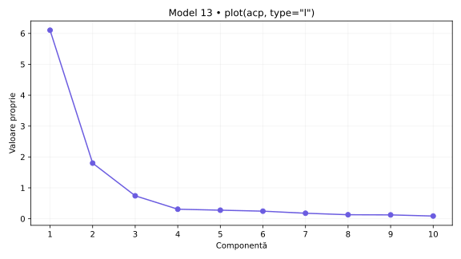
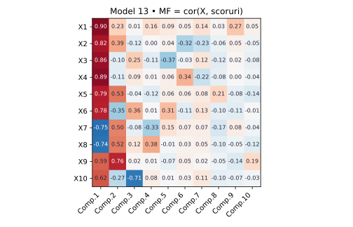
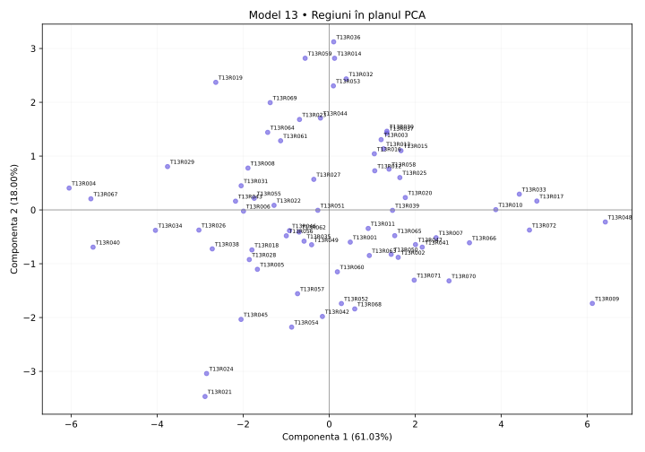

# Model 13 — Dă un nume componentei 2

Variantă nouă după cerințele din fotografie și comenzile din „Cod test ACP.docx”. Date sintetice; outputuri didactice calculate în Python după definițiile funcțiilor, fără rulare R.

40 minute · 9p + 1p din oficiu. Barem orientativ.

**Capcana de urmărit:** MF = cor(X, scoruri) conține corelații, nu simplii vectori proprii din acp$loadings. Interpretează coloana Comp.2.

- X1: Internet acasă
- X2: Internet zilnic
- X3: Internet banking
- X4: Cumpărături online
- X5: PIB pe locuitor (PPS)
- X6: Ocupare 20–64 ani
- X7: Șomaj 20–64 ani
- X8: Șomaj tineri
- X9: Studii superioare
- X10: Formare adulți

## 1. (1p) Analizați matricea de corelație pentru datele numerice inițiale. Formulați o concluzie privind aplicarea analizei componentelor principale.

```r
cor(scale(X,center=T,scale=T))
```

```text
     X1      X2      X3      X4      X5      X6      X7      X8      X9      X10
X1   1.000   0.793   0.721   0.772   0.808   0.637   -0.582  -0.503  0.681   0.500
X2   0.793   1.000   0.618   0.630   0.809   0.476   -0.430  -0.427  0.744   0.460
X3   0.721   0.618   1.000   0.757   0.599   0.706   -0.709  -0.675  0.450   0.401
X4   0.772   0.630   0.757   1.000   0.632   0.727   -0.710  -0.688  0.447   0.516
X5   0.808   0.809   0.599   0.632   1.000   0.421   -0.306  -0.351  0.841   0.367
X6   0.637   0.476   0.706   0.727   0.421   1.000   -0.737  -0.695  0.192   0.352
X7   -0.582  -0.430  -0.709  -0.710  -0.306  -0.737  1.000   0.703   -0.086  -0.544
X8   -0.503  -0.427  -0.675  -0.688  -0.351  -0.695  0.703   1.000   -0.044  -0.631
X9   0.681   0.744   0.450   0.447   0.841   0.192   -0.086  -0.044  1.000   0.165
X10  0.500   0.460   0.401   0.516   0.367   0.352   -0.544  -0.631  0.165   1.000
```

**Pe înțelesul tău:** cor(scale(X)) este matricea de corelație a indicatorilor. Standardizarea nu schimbă corelațiile Pearson între coloane. Ignor diagonala de 1, discut semnul și modulul a două valori și abia apoi justific utilitatea ACP. Nu spun că ACP este interzisă când corelațiile sunt mici.

**Răspuns-model:** X5–X9 au r = 0.841, iar X2–X5 au r = 0.809. Sunt 28 perechi cu |r| ≥ 0,50 din 45. Corelațiile indică informație comună și justifică explorarea prin ACP. Semnul arată sensul asocierii, nu cauzalitatea.

- 0.5p: Citezi două corelații și sensul lor.
- 0.5p: Legi informația comună de utilitatea ACP.

## 2. (2p) Folosiți două criterii pentru a decide numărul de componente păstrate în analiză.

```r
summary(acp)
plot(acp,type="l")
summary(acp2)  # secțiunea Eigenvalues
```

```text
                        Comp.1   Comp.2   Comp.3   Comp.4   Comp.5   Comp.6   Comp.7   Comp.8   Comp.9   Comp.10
Standard deviation      2.470    1.342    0.862    0.556    0.527    0.496    0.423    0.361    0.354    0.296
Proportion of Variance  0.61031  0.18003  0.07426  0.03092  0.02773  0.02457  0.01787  0.01302  0.01250  0.00879
Cumulative Proportion   0.61031  0.79034  0.86460  0.89552  0.92325  0.94783  0.96569  0.97871  0.99121  1.00000

Eigenvalues           Dim.1   Dim.2   Dim.3   Dim.4   Dim.5   Dim.6   Dim.7   Dim.8   Dim.9   Dim.10
Variance              6.103   1.800   0.743   0.309   0.277   0.246   0.179   0.130   0.125   0.088
% of var.             61.031  18.003  7.426   3.092   2.773   2.457   1.787   1.302   1.250   0.879
Cumulative % of var.  61.031  79.034  86.460  89.552  92.325  94.783  96.569  97.871  99.121  100.000
```

**Pe înțelesul tău:** Citește trei lucruri separat: Standard deviation = abaterea componentei; pătratul ei = valoarea proprie; Proportion/Cumulative sunt proporții și se înmulțesc cu 100 pentru procente. Scree plot arată valorile proprii; cotul este un reper grafic, nu un număr impus fără justificare. Graficul plot(acp) afișează implicit cel mult primele 10 axe; tabelul este complet. ncp=5 implicit din PCA() nu înlocuiește criteriile de selecție.

**Răspuns-model:** Ridic la pătrat Standard deviation: pentru PC1, 2.470² ≈ 6.103; valorile nerotunjite dau rezultatul exact. Kaiser păstrează 2 componente cu λ > 1, echivalent sdev > 1 în această ACP standardizată. Acestea explică 79.03%. La un prag ales de 80%, primul număr suficient este 3, cu 86.46%. Dacă vreau minimum 80% din informație, aleg 3; aplicând strict Kaiser, aleg 2. Proportion of Variance pentru PC1 este 0.61031, adică 61.03%.

- 1p: Aplici Kaiser și indici numărul corect.
- 1p: Precizezi pragul și primul număr care îl atinge; justifici alegerea.



## 3. (2p) Folosiți matricea factor pentru a interpreta a doua componentă principală.

```r
scoruri <- acp$scores
MF=cor(X,scoruri)
corrplot(MF,method="number")
```

```text
MF   Comp.1  Comp.2  Comp.3  Comp.4  Comp.5  Comp.6  Comp.7  Comp.8  Comp.9  Comp.10
X1   0.904   0.226   0.014   0.159   0.094   0.048   0.143   0.028   0.266   0.050
X2   0.820   0.388   -0.117  0.005   0.042   -0.316  -0.229  -0.064  0.049   -0.052
X3   0.863   -0.105  0.247   -0.113  -0.368  -0.034  0.119   -0.117  0.021   -0.077
X4   0.893   -0.114  0.091   0.014   0.057   0.345   -0.223  -0.084  0.004   -0.044
X5   0.787   0.528   -0.038  -0.119  0.056   0.060   0.079   0.213   -0.085  -0.142
X6   0.775   -0.353  0.357   0.007   0.312   -0.106  0.126   -0.095  -0.114  -0.006
X7   -0.754  0.499   -0.083  -0.330  0.147   0.066   0.070   -0.167  0.077   -0.042
X8   -0.738  0.519   0.120   0.376   -0.012  0.032   0.047   -0.100  -0.047  -0.124
X9   0.593   0.763   0.018   0.010   -0.071  0.048   0.022   -0.052  -0.136  0.192
X10  0.621   -0.266  -0.713  0.077   0.007   0.028   0.112   -0.098  -0.068  -0.029
```

**Pe înțelesul tău:** Aici matricea factor chiar este cor(X, scoruri), deci numerele sunt corelații. Nu o confunda cu acp$loadings, unde sunt vectorii proprii. Citesc doar Comp.2, aleg coeficienții mari în modul, verific și minusurile și construiesc numele pe indicatorii dominanți. Pentru sensul regiunilor din fviz_pca_ind folosesc coordonatele PCA de la cerința 4: între metode semnul unei axe poate fi inversat.

**Răspuns-model:** Pe Comp.2 sunt asocieri pozitive mai importante pentru Studii superioare (X9: 0.763), PIB pe locuitor (PPS) (X5: 0.528), Șomaj tineri (X8: 0.519) și negative pentru Ocupare 20–64 ani (X6: -0.353). Componenta explică 18.00% din variația totală. O denumire descriptivă posibilă este „contrast între Studii superioare / PIB pe locuitor (PPS) / Șomaj tineri”, cu sensurile precizate mai sus.  Numele descrie asocieri din setul de date; nu demonstrează cauzalitate.

- 1p: Identifici indicatorii dominanți și coeficienții lor pe PC2.
- 1p: Explici sensurile, propui un nume susținut și precizezi variația explicată.



## 4. (2p) Din outputul numeric privind variabilele interpretați coloanele Dim1, Dim2 (corelații) și ctr (contribuții) pentru primele două componente principale.

```r
acp2 <- PCA(X,scale.unit=T,graph=T)
summary(acp2)  # secțiunea Variables
```

```text
Variables
     Dim.1   ctr     cos2   Dim.2   ctr     cos2   Dim.3   ctr     cos2
X1   0.904   13.402  0.818  0.226   2.828   0.051  -0.014  0.027   0.000
X2   0.820   11.016  0.672  0.388   8.366   0.151  0.117   1.844   0.014
X3   0.863   12.194  0.744  -0.105  0.609   0.011  -0.247  8.214   0.061
X4   0.893   13.069  0.798  -0.114  0.722   0.013  -0.091  1.119   0.008
X5   0.787   10.161  0.620  0.528   15.474  0.279  0.038   0.196   0.001
X6   0.775   9.851   0.601  -0.353  6.913   0.124  -0.357  17.180  0.128
X7   -0.754  9.305   0.568  0.499   13.856  0.249  0.083   0.925   0.007
X8   -0.738  8.918   0.544  0.519   14.956  0.269  -0.120  1.935   0.014
X9   0.593   5.758   0.351  0.763   32.343  0.582  -0.018  0.045   0.000
X10  0.621   6.327   0.386  -0.266  3.932   0.071  0.713   68.515  0.509
```

**Pe înțelesul tău:** În fiecare grup de trei coloane citești: Dim = corelație, ctr = procent din construirea componentei, cos2 = cât de bine se vede variabila pe acea axă. Următorul grup este pentru componenta următoare. Nu aduni ctr de pe PC1 cu ctr de pe PC2 și nu tratezi ctr ca procent de reprezentare. Summary afișează implicit doar 10 elemente și 3 axe, deși analiza poate conține mai multe.

**Răspuns-model:** În Variables, Dim.1 și Dim.2 sunt corelații. Pentru X1, r cu PC1 este 0.904, iar cu PC2 este 0.226; semnul indică sensul, modulul intensitatea. ctr este contribuția la construirea axei: X1 are 13.40% pe PC1 și X9 are 32.34% pe PC2. Reperul mediu este 100/10 = 10.00%, calculat cu toate cele 10 variabile active. cos² pentru X1 pe PC1 este 0.818, adică 81.79% din variația sa reprezentată de această axă; în această ACP standardizată cos² = r². Contribuțiile tuturor variabilelor însumează 100% separat pe fiecare axă, înainte de rotunjire. Primele două axe au aceeași orientare în cele două outputuri din această variantă.

- 1p: Interpretezi numeric Dim1 și Dim2, cu semn și intensitate.
- 1p: Interpretezi contribuțiile pentru ambele axe, reperul mediu și diferența față de cos².

## 5. (2p) Reprezentați grafic regiunile într-un spațiu definit de primele două componente principale. Extrageți 2 concluzii.

```r
fviz_pca_ind(acp2)
# Tabelul de mai jos selectează extremele din acp2$ind; nu este lista implicită a primelor 10.
```

```text
Individuals — selecție pentru verificarea concluziilor
         Dist   Dim.1   ctr    cos2   Dim.2   ctr    cos2
T13R048  6.615  6.419   9.377  0.942  -0.225  0.039  0.001
T13R004  6.269  -6.046  8.318  0.930  0.405   0.127  0.004
T13R036  3.348  0.104   0.002  0.001  3.123   7.525  0.870
T13R021  4.681  -2.886  1.896  0.380  -3.468  9.278  0.549
```

**Pe înțelesul tău:** În Individuals, Dim este scorul unei regiuni, nu corelația unei variabile. Poate depăși ±1. ctr arată participarea regiunii la axă; cos² arată calitatea reprezentării, iar cos² pe plan = cos² pe PC1 + cos² pe PC2. Folosesc indicatorii din PCA pentru a numi direcțiile graficului. Două puncte apropiate sugerează profiluri asemănătoare în plan, fără a demonstra identitate în toate variabilele.

**Răspuns-model:** Graficul regiunilor folosește coordonatele din PCA, cu PC1 orizontală și PC2 verticală, și păstrează 79.03% din variație. Concluzia 1: T13R048 (PC1=6.419) și T13R004 (PC1=-6.046) au profiluri opuse pe PC1. Sensul pozitiv este asociat cu Internet acasă (X1: 0.904), Cumpărături online (X4: 0.893), Internet banking (X3: 0.863), iar cel negativ cu Șomaj 20–64 ani (X7: -0.754), Șomaj tineri (X8: -0.738). Concluzia 2: T13R036 (PC2=3.123) și T13R021 (PC2=-3.468) contrastează pe PC2, al cărei sens pozitiv este asociat cu Studii superioare (X9: 0.763), PIB pe locuitor (PPS) (X5: 0.528), Șomaj tineri (X8: 0.519), iar cel negativ cu Ocupare 20–64 ani (X6: -0.353). cos² în plan pentru aceste ultime două regiuni este 0.871, respectiv 0.929; țin cont de calitatea reprezentării.

- 0.5p: Reprezinți regiunile pe cele două axe etichetate și menționezi informația păstrată.
- 0.75p: Formulezi prima concluzie concretă, legată de PC1.
- 0.75p: Formulezi a doua concluzie concretă, legată de PC2; respecți limitele planului.



Surse tehnice: [R princomp](https://stat.ethz.ch/R-manual/R-devel/library/stats/html/princomp.html), [summary.PCA](https://github.com/cran/FactoMineR/blob/master/R/summary.PCA.r), [svd.triplet](https://github.com/cran/FactoMineR/blob/master/R/svd.triplet.R).
