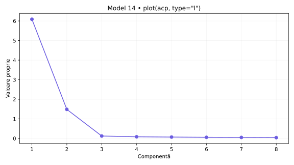
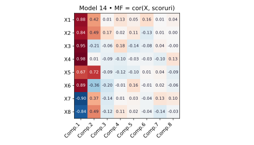
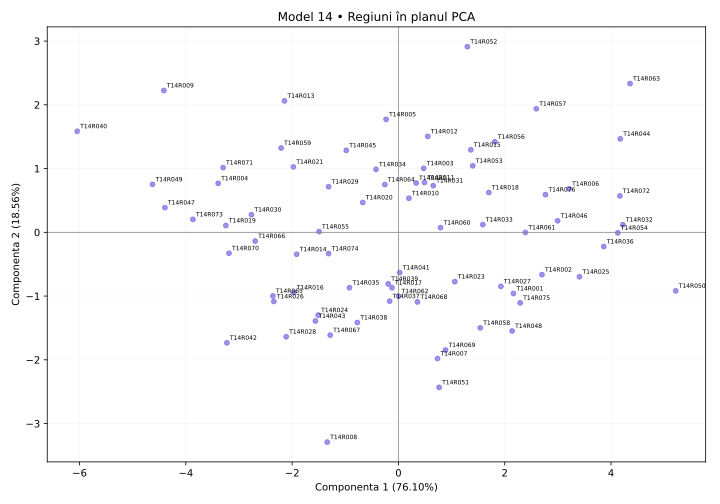

# Model 14 — Corelație negativă, contribuție mare

Variantă nouă după cerințele din fotografie și comenzile din „Cod test ACP.docx”. Date sintetice; outputuri didactice calculate în Python după definițiile funcțiilor, fără rulare R.

40 minute · 9p + 1p din oficiu. Barem orientativ.

**Capcana de urmărit:** Un r negativ mare în modul poate avea ctr mare. Contribuția nu este negativă; semnul aparține coordonatei.

- X1: Internet acasă
- X2: Internet zilnic
- X3: Internet banking
- X4: Cumpărături online
- X5: PIB pe locuitor (PPS)
- X6: Ocupare 20–64 ani
- X7: Șomaj 20–64 ani
- X8: Șomaj tineri

## 1. (1p) Analizați matricea de corelație pentru datele numerice inițiale. Formulați o concluzie privind aplicarea analizei componentelor principale.

```r
cor(scale(X,center=T,scale=T))
```

```text
    X1      X2      X3      X4      X5      X6      X7      X8
X1  1.000   0.931   0.745   0.847   0.868   0.632   -0.634  -0.532
X2  0.931   1.000   0.678   0.805   0.880   0.554   -0.582  -0.479
X3  0.745   0.678   1.000   0.911   0.481   0.911   -0.914  -0.877
X4  0.847   0.805   0.911   1.000   0.667   0.872   -0.864  -0.809
X5  0.868   0.880   0.481   0.667   1.000   0.347   -0.331  -0.223
X6  0.632   0.554   0.911   0.872   0.347   1.000   -0.910  -0.904
X7  -0.634  -0.582  -0.914  -0.864  -0.331  -0.910  1.000   0.942
X8  -0.532  -0.479  -0.877  -0.809  -0.223  -0.904  0.942   1.000
```

**Pe înțelesul tău:** cor(scale(X)) este matricea de corelație a indicatorilor. Standardizarea nu schimbă corelațiile Pearson între coloane. Ignor diagonala de 1, discut semnul și modulul a două valori și abia apoi justific utilitatea ACP. Nu spun că ACP este interzisă când corelațiile sunt mici.

**Răspuns-model:** X7–X8 au r = 0.942, iar X1–X2 au r = 0.931. Sunt 23 perechi cu |r| ≥ 0,50 din 28. Corelațiile indică informație comună și justifică explorarea prin ACP. Semnul arată sensul asocierii, nu cauzalitatea.

- 0.5p: Citezi două corelații și sensul lor.
- 0.5p: Legi informația comună de utilitatea ACP.

## 2. (2p) Folosiți două criterii pentru a decide numărul de componente păstrate în analiză.

```r
summary(acp)
plot(acp,type="l")
summary(acp2)  # secțiunea Eigenvalues
```

```text
                        Comp.1   Comp.2   Comp.3   Comp.4   Comp.5   Comp.6   Comp.7   Comp.8
Standard deviation      2.467    1.218    0.352    0.292    0.266    0.238    0.225    0.204
Proportion of Variance  0.76095  0.18555  0.01546  0.01062  0.00883  0.00707  0.00633  0.00519
Cumulative Proportion   0.76095  0.94650  0.96196  0.97259  0.98141  0.98848  0.99481  1.00000

Eigenvalues           Dim.1   Dim.2   Dim.3   Dim.4   Dim.5   Dim.6   Dim.7   Dim.8
Variance              6.088   1.484   0.124   0.085   0.071   0.057   0.051   0.041
% of var.             76.095  18.555  1.546   1.062   0.883   0.707   0.633   0.519
Cumulative % of var.  76.095  94.650  96.196  97.259  98.141  98.848  99.481  100.000
```

**Pe înțelesul tău:** Citește trei lucruri separat: Standard deviation = abaterea componentei; pătratul ei = valoarea proprie; Proportion/Cumulative sunt proporții și se înmulțesc cu 100 pentru procente. Scree plot arată valorile proprii; cotul este un reper grafic, nu un număr impus fără justificare. Graficul plot(acp) afișează implicit cel mult primele 10 axe; tabelul este complet. ncp=5 implicit din PCA() nu înlocuiește criteriile de selecție.

**Răspuns-model:** Ridic la pătrat Standard deviation: pentru PC1, 2.467² ≈ 6.088; valorile nerotunjite dau rezultatul exact. Kaiser păstrează 2 componente cu λ > 1, echivalent sdev > 1 în această ACP standardizată. Acestea explică 94.65%. La un prag ales de 80%, primul număr suficient este 2, cu 94.65%. Criteriile coincid. Proportion of Variance pentru PC1 este 0.76095, adică 76.10%.

- 1p: Aplici Kaiser și indici numărul corect.
- 1p: Precizezi pragul și primul număr care îl atinge; justifici alegerea.



## 3. (2p) Folosiți matricea factor pentru a interpreta a doua componentă principală.

```r
scoruri <- acp$scores
MF=cor(X,scoruri)
corrplot(MF,method="number")
```

```text
MF  Comp.1  Comp.2  Comp.3  Comp.4  Comp.5  Comp.6  Comp.7  Comp.8
X1  0.880   0.422   0.011   0.128   0.047   0.165   0.008   0.044
X2  0.837   0.490   0.173   0.019   0.109   -0.131  0.013   0.001
X3  0.945   -0.208  -0.064  0.175   -0.139  -0.084  0.039   -0.004
X4  0.976   0.010   -0.085  -0.102  -0.030  -0.031  -0.100  0.134
X5  0.668   0.716   -0.089  -0.123  -0.096  0.015   0.036   -0.087
X6  0.893   -0.363  -0.201  -0.010  0.159   -0.013  0.022   -0.059
X7  -0.901  0.375   -0.137  0.013   0.032   -0.044  0.132   0.097
X8  -0.844  0.488   -0.123  0.109   0.025   -0.044  -0.140  -0.035
```

**Pe înțelesul tău:** Aici matricea factor chiar este cor(X, scoruri), deci numerele sunt corelații. Nu o confunda cu acp$loadings, unde sunt vectorii proprii. Citesc doar Comp.2, aleg coeficienții mari în modul, verific și minusurile și construiesc numele pe indicatorii dominanți. Pentru sensul regiunilor din fviz_pca_ind folosesc coordonatele PCA de la cerința 4: între metode semnul unei axe poate fi inversat.

**Răspuns-model:** Pe Comp.2 sunt asocieri pozitive mai importante pentru PIB pe locuitor (PPS) (X5: 0.716), Internet zilnic (X2: 0.490), Șomaj tineri (X8: 0.488) și negative pentru Ocupare 20–64 ani (X6: -0.363). Componenta explică 18.56% din variația totală. O denumire descriptivă posibilă este „contrast între PIB pe locuitor (PPS) / Internet zilnic / Șomaj tineri”, cu sensurile precizate mai sus.  Numele descrie asocieri din setul de date; nu demonstrează cauzalitate.

- 1p: Identifici indicatorii dominanți și coeficienții lor pe PC2.
- 1p: Explici sensurile, propui un nume susținut și precizezi variația explicată.



## 4. (2p) Din outputul numeric privind variabilele interpretați coloanele Dim1, Dim2 (corelații) și ctr (contribuții) pentru primele două componente principale.

```r
acp2 <- PCA(X,scale.unit=T,graph=T)
summary(acp2)  # secțiunea Variables
```

```text
Variables
    Dim.1   ctr     cos2   Dim.2   ctr     cos2   Dim.3   ctr     cos2
X1  0.880   12.709  0.774  0.422   12.024  0.178  -0.011  0.099   0.000
X2  0.837   11.499  0.700  0.490   16.190  0.240  -0.173  24.302  0.030
X3  0.945   14.684  0.894  -0.208  2.918   0.043  0.064   3.300   0.004
X4  0.976   15.644  0.952  0.010   0.007   0.000  0.085   5.903   0.007
X5  0.668   7.341   0.447  0.716   34.490  0.512  0.089   6.364   0.008
X6  0.893   13.112  0.798  -0.363  8.899   0.132  0.201   32.535  0.040
X7  -0.901  13.322  0.811  0.375   9.452   0.140  0.137   15.192  0.019
X8  -0.844  11.690  0.712  0.488   16.020  0.238  0.123   12.306  0.015
```

**Pe înțelesul tău:** În fiecare grup de trei coloane citești: Dim = corelație, ctr = procent din construirea componentei, cos2 = cât de bine se vede variabila pe acea axă. Următorul grup este pentru componenta următoare. Nu aduni ctr de pe PC1 cu ctr de pe PC2 și nu tratezi ctr ca procent de reprezentare. Summary afișează implicit doar 10 elemente și 3 axe, deși analiza poate conține mai multe.

**Răspuns-model:** În Variables, Dim.1 și Dim.2 sunt corelații. Pentru X4, r cu PC1 este 0.976, iar cu PC2 este 0.010; semnul indică sensul, modulul intensitatea. ctr este contribuția la construirea axei: X4 are 15.64% pe PC1 și X5 are 34.49% pe PC2. Reperul mediu este 100/8 = 12.50%, calculat cu toate cele 8 variabile active. cos² pentru X4 pe PC1 este 0.952, adică 95.23% din variația sa reprezentată de această axă; în această ACP standardizată cos² = r². Contribuțiile tuturor variabilelor însumează 100% separat pe fiecare axă, înainte de rotunjire. Primele două axe au aceeași orientare în cele două outputuri din această variantă.

- 1p: Interpretezi numeric Dim1 și Dim2, cu semn și intensitate.
- 1p: Interpretezi contribuțiile pentru ambele axe, reperul mediu și diferența față de cos².

## 5. (2p) Reprezentați grafic regiunile într-un spațiu definit de primele două componente principale. Extrageți 2 concluzii.

```r
fviz_pca_ind(acp2)
# Tabelul de mai jos selectează extremele din acp2$ind; nu este lista implicită a primelor 10.
```

```text
Individuals — selecție pentru verificarea concluziilor
         Dist   Dim.1   ctr    cos2   Dim.2   ctr    cos2
T14R050  5.369  5.217   5.884  0.944  -0.918  0.747  0.029
T14R040  6.273  -6.045  7.898  0.929  1.585   2.227  0.064
T14R052  3.202  1.297   0.364  0.164  2.912   7.518  0.827
T14R008  3.583  -1.340  0.388  0.140  -3.291  9.600  0.844
```

**Pe înțelesul tău:** În Individuals, Dim este scorul unei regiuni, nu corelația unei variabile. Poate depăși ±1. ctr arată participarea regiunii la axă; cos² arată calitatea reprezentării, iar cos² pe plan = cos² pe PC1 + cos² pe PC2. Folosesc indicatorii din PCA pentru a numi direcțiile graficului. Două puncte apropiate sugerează profiluri asemănătoare în plan, fără a demonstra identitate în toate variabilele.

**Răspuns-model:** Graficul regiunilor folosește coordonatele din PCA, cu PC1 orizontală și PC2 verticală, și păstrează 94.65% din variație. Concluzia 1: T14R050 (PC1=5.217) și T14R040 (PC1=-6.045) au profiluri opuse pe PC1. Sensul pozitiv este asociat cu Cumpărături online (X4: 0.976), Internet banking (X3: 0.945), Ocupare 20–64 ani (X6: 0.893), iar cel negativ cu Șomaj 20–64 ani (X7: -0.901), Șomaj tineri (X8: -0.844). Concluzia 2: T14R052 (PC2=2.912) și T14R008 (PC2=-3.291) contrastează pe PC2, al cărei sens pozitiv este asociat cu PIB pe locuitor (PPS) (X5: 0.716), Internet zilnic (X2: 0.490), Șomaj tineri (X8: 0.488), iar cel negativ cu Ocupare 20–64 ani (X6: -0.363). cos² în plan pentru aceste ultime două regiuni este 0.991, respectiv 0.983; țin cont de calitatea reprezentării.

- 0.5p: Reprezinți regiunile pe cele două axe etichetate și menționezi informația păstrată.
- 0.75p: Formulezi prima concluzie concretă, legată de PC1.
- 0.75p: Formulezi a doua concluzie concretă, legată de PC2; respecți limitele planului.



Surse tehnice: [R princomp](https://stat.ethz.ch/R-manual/R-devel/library/stats/html/princomp.html), [summary.PCA](https://github.com/cran/FactoMineR/blob/master/R/summary.PCA.r), [svd.triplet](https://github.com/cran/FactoMineR/blob/master/R/svd.triplet.R).
