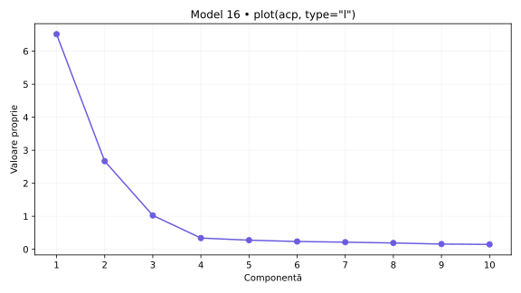
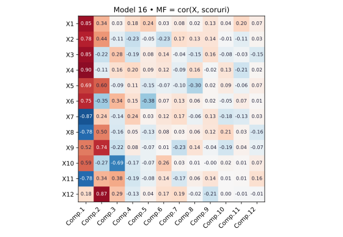
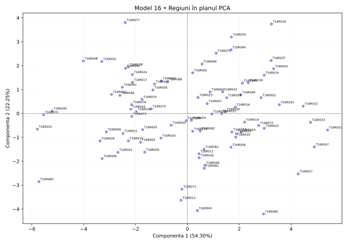

# Model 16 — Primele 10 variabile nu sunt toate

Variantă nouă după cerințele din fotografie și comenzile din „Cod test ACP.docx”. Date sintetice; outputuri didactice calculate în Python după definițiile funcțiilor, fără rulare R.

40 minute · 9p + 1p din oficiu. Barem orientativ.

**Capcana de urmărit:** summary(acp2) afișează implicit primele 10 elemente și 3 axe în secțiunile de coordonate. Primele 10 nu înseamnă cele mai importante; reperul contribuției este 100/p pentru toate variabilele active.

- X1: Internet acasă
- X2: Internet zilnic
- X3: Internet banking
- X4: Cumpărături online
- X5: PIB pe locuitor (PPS)
- X6: Ocupare 20–64 ani
- X7: Șomaj 20–64 ani
- X8: Șomaj tineri
- X9: Studii superioare
- X10: Formare adulți
- X11: NEET
- X12: Densitatea populației

## 1. (1p) Analizați matricea de corelație pentru datele numerice inițiale. Formulați o concluzie privind aplicarea analizei componentelor principale.

```r
cor(scale(X,center=T,scale=T))
```

```text
     X1      X2      X3      X4      X5      X6      X7      X8      X9      X10     X11     X12
X1   1.000   0.762   0.645   0.750   0.751   0.495   -0.609  -0.490  0.659   0.355   -0.560  0.428
X2   0.762   1.000   0.539   0.582   0.766   0.386   -0.584  -0.370  0.711   0.396   -0.478  0.481
X3   0.645   0.539   1.000   0.796   0.427   0.752   -0.824  -0.814  0.207   0.419   -0.595  0.049
X4   0.750   0.582   0.796   1.000   0.526   0.745   -0.783  -0.748  0.370   0.437   -0.677  0.092
X5   0.751   0.766   0.427   0.526   1.000   0.309   -0.435  -0.221  0.798   0.280   -0.378  0.568
X6   0.495   0.386   0.752   0.745   0.309   1.000   -0.733  -0.754  0.082   0.330   -0.584  -0.088
X7   -0.609  -0.584  -0.824  -0.783  -0.435  -0.733  1.000   0.806   -0.245  -0.486  0.659   0.014
X8   -0.490  -0.370  -0.814  -0.748  -0.221  -0.754  0.806   1.000   -0.011  -0.470  0.720   0.241
X9   0.659   0.711   0.207   0.370   0.798   0.082   -0.245  -0.011  1.000   0.231   -0.213  0.627
X10  0.355   0.396   0.419   0.437   0.280   0.330   -0.486  -0.470  0.231   1.000   -0.730  -0.263
X11  -0.560  -0.478  -0.595  -0.677  -0.378  -0.584  0.659   0.720   -0.213  -0.730  1.000   0.251
X12  0.428   0.481   0.049   0.092   0.568   -0.088  0.014   0.241   0.627   -0.263  0.251   1.000
```

**Pe înțelesul tău:** cor(scale(X)) este matricea de corelație a indicatorilor. Standardizarea nu schimbă corelațiile Pearson între coloane. Ignor diagonala de 1, discut semnul și modulul a două valori și abia apoi justific utilitatea ACP. Nu spun că ACP este interzisă când corelațiile sunt mici.

**Răspuns-model:** X3–X7 au r = -0.824, iar X3–X8 au r = -0.814. Sunt 32 perechi cu |r| ≥ 0,50 din 66. Corelațiile indică informație comună și justifică explorarea prin ACP. Semnul arată sensul asocierii, nu cauzalitatea.

- 0.5p: Citezi două corelații și sensul lor.
- 0.5p: Legi informația comună de utilitatea ACP.

## 2. (2p) Folosiți două criterii pentru a decide numărul de componente păstrate în analiză.

```r
summary(acp)
plot(acp,type="l")
summary(acp2)  # secțiunea Eigenvalues
```

```text
                        Comp.1   Comp.2   Comp.3   Comp.4   Comp.5   Comp.6   Comp.7   Comp.8   Comp.9   Comp.10  Comp.11  Comp.12
Standard deviation      2.553    1.634    1.013    0.583    0.525    0.486    0.464    0.437    0.398    0.385    0.358    0.313
Proportion of Variance  0.54295  0.22249  0.08545  0.02833  0.02296  0.01966  0.01791  0.01593  0.01318  0.01232  0.01066  0.00817
Cumulative Proportion   0.54295  0.76544  0.85089  0.87922  0.90218  0.92184  0.93974  0.95567  0.96885  0.98117  0.99183  1.00000

Eigenvalues           Dim.1   Dim.2   Dim.3   Dim.4   Dim.5   Dim.6   Dim.7   Dim.8   Dim.9   Dim.10  Dim.11  Dim.12
Variance              6.515   2.670   1.025   0.340   0.276   0.236   0.215   0.191   0.158   0.148   0.128   0.098
% of var.             54.295  22.249  8.545   2.833   2.296   1.966   1.791   1.593   1.318   1.232   1.066   0.817
Cumulative % of var.  54.295  76.544  85.089  87.922  90.218  92.184  93.974  95.567  96.885  98.117  99.183  100.000
```

**Pe înțelesul tău:** Citește trei lucruri separat: Standard deviation = abaterea componentei; pătratul ei = valoarea proprie; Proportion/Cumulative sunt proporții și se înmulțesc cu 100 pentru procente. Scree plot arată valorile proprii; cotul este un reper grafic, nu un număr impus fără justificare. Graficul plot(acp) afișează implicit cel mult primele 10 axe; tabelul este complet. ncp=5 implicit din PCA() nu înlocuiește criteriile de selecție.

**Răspuns-model:** Ridic la pătrat Standard deviation: pentru PC1, 2.553² ≈ 6.515; valorile nerotunjite dau rezultatul exact. Kaiser păstrează 3 componente cu λ > 1, echivalent sdev > 1 în această ACP standardizată. Acestea explică 85.09%. La un prag ales de 80%, primul număr suficient este 3, cu 85.09%. Criteriile coincid. Proportion of Variance pentru PC1 este 0.54295, adică 54.30%.

- 1p: Aplici Kaiser și indici numărul corect.
- 1p: Precizezi pragul și primul număr care îl atinge; justifici alegerea.



## 3. (2p) Folosiți matricea factor pentru a interpreta a doua componentă principală.

```r
scoruri <- acp$scores
MF=cor(X,scoruri)
corrplot(MF,method="number")
```

```text
MF   Comp.1  Comp.2  Comp.3  Comp.4  Comp.5  Comp.6  Comp.7  Comp.8  Comp.9  Comp.10  Comp.11  Comp.12
X1   0.849   0.337   0.033   0.176   0.245   0.033   0.079   0.024   0.132   0.045    0.204    0.071
X2   0.780   0.443   -0.106  -0.230  -0.047  -0.230  0.165   0.134   0.135   -0.015   -0.105   0.030
X3   0.855   -0.224  0.276   -0.186  0.084   0.143   -0.043  -0.146  0.160   -0.081   -0.033   -0.155
X4   0.897   -0.109  0.160   0.196   0.094   0.120   -0.091  0.161   -0.016  0.130    -0.211   0.017
X5   0.694   0.596   -0.091  0.107   -0.147  -0.072  -0.098  -0.304  0.017   0.088    -0.058   0.066
X6   0.751   -0.354  0.335   0.155   -0.376  0.066   0.131   0.057   0.021   -0.045   0.072    0.010
X7   -0.867  0.241   -0.143  0.239   0.035   0.121   0.167   -0.057  0.126   -0.176   -0.134   0.032
X8   -0.777  0.505   -0.158  0.048   -0.126  0.077   0.035   0.063   0.123   0.209    0.032    -0.163
X9   0.520   0.744   -0.220  0.084   -0.070  0.014   -0.227  0.136   -0.037  -0.192   0.044    -0.073
X10  0.586   -0.274  -0.687  -0.169  -0.070  0.263   0.031   0.006   -0.002  0.025    0.014    0.073
X11  -0.778  0.342   0.378   -0.187  -0.077  0.135   -0.168  0.061   0.135   0.007    0.010    0.158
X12  0.176   0.871   0.285   -0.131  0.041   0.171   0.186   -0.023  -0.212  0.004    -0.010   -0.012
```

**Pe înțelesul tău:** Aici matricea factor chiar este cor(X, scoruri), deci numerele sunt corelații. Nu o confunda cu acp$loadings, unde sunt vectorii proprii. Citesc doar Comp.2, aleg coeficienții mari în modul, verific și minusurile și construiesc numele pe indicatorii dominanți. Pentru sensul regiunilor din fviz_pca_ind folosesc coordonatele PCA de la cerința 4: între metode semnul unei axe poate fi inversat.

**Răspuns-model:** Pe Comp.2 sunt asocieri pozitive mai importante pentru Densitatea populației (X12: 0.871), Studii superioare (X9: 0.744), PIB pe locuitor (PPS) (X5: 0.596) și negative pentru Ocupare 20–64 ani (X6: -0.354). Componenta explică 22.25% din variația totală. O denumire descriptivă posibilă este „contrast între Densitatea populației / Studii superioare / PIB pe locuitor (PPS)”, cu sensurile precizate mai sus.  Numele descrie asocieri din setul de date; nu demonstrează cauzalitate.

- 1p: Identifici indicatorii dominanți și coeficienții lor pe PC2.
- 1p: Explici sensurile, propui un nume susținut și precizezi variația explicată.



## 4. (2p) Din outputul numeric privind variabilele interpretați coloanele Dim1, Dim2 (corelații) și ctr (contribuții) pentru primele două componente principale.

```r
acp2 <- PCA(X,scale.unit=T,graph=T)
summary(acp2)  # secțiunea Variables
```

```text
Variables (the 10 first)
     Dim.1   ctr     cos2   Dim.2   ctr     cos2   Dim.3   ctr     cos2
X1   0.849   11.060  0.721  0.337   4.244   0.113  0.033   0.109   0.001
X2   0.780   9.343   0.609  0.443   7.343   0.196  -0.106  1.104   0.011
X3   0.855   11.212  0.731  -0.224  1.888   0.050  0.276   7.454   0.076
X4   0.897   12.348  0.805  -0.109  0.446   0.012  0.160   2.510   0.026
X5   0.694   7.384   0.481  0.596   13.294  0.355  -0.091  0.810   0.008
X6   0.751   8.661   0.564  -0.354  4.699   0.125  0.335   10.968  0.112
X7   -0.867  11.530  0.751  0.241   2.182   0.058  -0.143  1.993   0.020
X8   -0.777  9.277   0.604  0.505   9.545   0.255  -0.158  2.434   0.025
X9   0.520   4.156   0.271  0.744   20.711  0.553  -0.220  4.726   0.048
X10  0.586   5.268   0.343  -0.274  2.821   0.075  -0.687  46.012  0.472
```

**Pe înțelesul tău:** În fiecare grup de trei coloane citești: Dim = corelație, ctr = procent din construirea componentei, cos2 = cât de bine se vede variabila pe acea axă. Următorul grup este pentru componenta următoare. Nu aduni ctr de pe PC1 cu ctr de pe PC2 și nu tratezi ctr ca procent de reprezentare. Summary afișează implicit doar 10 elemente și 3 axe, deși analiza poate conține mai multe.

**Răspuns-model:** În Variables, Dim.1 și Dim.2 sunt corelații. Pentru X4, r cu PC1 este 0.897, iar cu PC2 este -0.109; semnul indică sensul, modulul intensitatea. ctr este contribuția la construirea axei: X4 are 12.35% pe PC1 și X9 are 20.71% pe PC2. Reperul mediu este 100/12 = 8.33%, calculat cu toate cele 12 variabile active. cos² pentru X4 pe PC1 este 0.805, adică 80.45% din variația sa reprezentată de această axă; în această ACP standardizată cos² = r². Tabelul arată doar primele 10 variabile, deci contribuțiile rândurilor vizibile nu trebuie să însumeze 100%. Primele două axe au aceeași orientare în cele două outputuri din această variantă.

- 1p: Interpretezi numeric Dim1 și Dim2, cu semn și intensitate.
- 1p: Interpretezi contribuțiile pentru ambele axe, reperul mediu și diferența față de cos².

## 5. (2p) Reprezentați grafic regiunile într-un spațiu definit de primele două componente principale. Extrageți 2 concluzii.

```r
fviz_pca_ind(acp2)
# Tabelul de mai jos selectează extremele din acp2$ind; nu este lista implicită a primelor 10.
```

```text
Individuals — selecție pentru verificarea concluziilor
         Dist   Dim.1   ctr    cos2   Dim.2   ctr    cos2
T16R051  5.604  5.406   5.339  0.930  -0.690  0.213  0.015
T16R052  5.955  -5.785  6.115  0.944  -0.659  0.194  0.012
T16R077  4.682  -2.401  1.053  0.263  3.801   6.440  0.659
T16R080  5.231  2.938   1.577  0.315  -4.208  7.895  0.647
```

**Pe înțelesul tău:** În Individuals, Dim este scorul unei regiuni, nu corelația unei variabile. Poate depăși ±1. ctr arată participarea regiunii la axă; cos² arată calitatea reprezentării, iar cos² pe plan = cos² pe PC1 + cos² pe PC2. Folosesc indicatorii din PCA pentru a numi direcțiile graficului. Două puncte apropiate sugerează profiluri asemănătoare în plan, fără a demonstra identitate în toate variabilele.

**Răspuns-model:** Graficul regiunilor folosește coordonatele din PCA, cu PC1 orizontală și PC2 verticală, și păstrează 76.54% din variație. Concluzia 1: T16R051 (PC1=5.406) și T16R052 (PC1=-5.785) au profiluri opuse pe PC1. Sensul pozitiv este asociat cu Cumpărături online (X4: 0.897), Internet banking (X3: 0.855), Internet acasă (X1: 0.849), iar cel negativ cu Șomaj 20–64 ani (X7: -0.867), NEET (X11: -0.778), Șomaj tineri (X8: -0.777). Concluzia 2: T16R077 (PC2=3.801) și T16R080 (PC2=-4.208) contrastează pe PC2, al cărei sens pozitiv este asociat cu Densitatea populației (X12: 0.871), Studii superioare (X9: 0.744), PIB pe locuitor (PPS) (X5: 0.596), iar cel negativ cu Ocupare 20–64 ani (X6: -0.354). cos² în plan pentru aceste ultime două regiuni este 0.922, respectiv 0.962; țin cont de calitatea reprezentării.

- 0.5p: Reprezinți regiunile pe cele două axe etichetate și menționezi informația păstrată.
- 0.75p: Formulezi prima concluzie concretă, legată de PC1.
- 0.75p: Formulezi a doua concluzie concretă, legată de PC2; respecți limitele planului.



Surse tehnice: [R princomp](https://stat.ethz.ch/R-manual/R-devel/library/stats/html/princomp.html), [summary.PCA](https://github.com/cran/FactoMineR/blob/master/R/summary.PCA.r), [svd.triplet](https://github.com/cran/FactoMineR/blob/master/R/svd.triplet.R).
