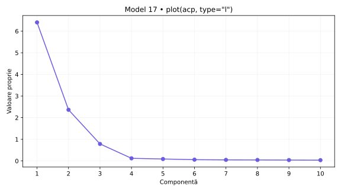
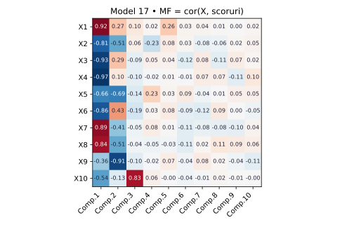
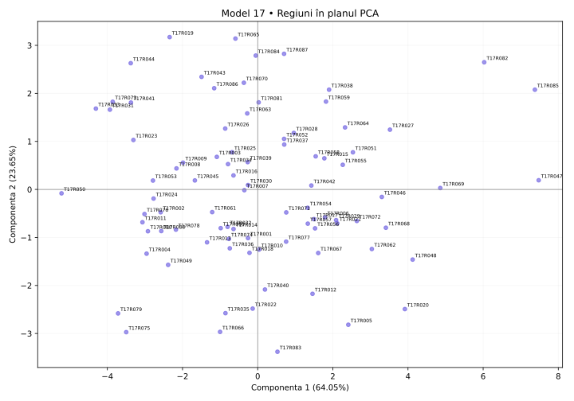

# Model 17 — Aceeași axă, semne diferite

Variantă nouă după cerințele din fotografie și comenzile din „Cod test ACP.docx”. Date sintetice; outputuri didactice calculate în Python după definițiile funcțiilor, fără rulare R.

40 minute · 9p + 1p din oficiu. Barem orientativ.

**Capcana de urmărit:** princomp și PCA pot orienta diferit aceeași axă. Compară semnele matricei factor cu coordonatele PCA înainte să numești sus/jos în grafic.

- X1: Internet acasă
- X2: Internet zilnic
- X3: Internet banking
- X4: Cumpărături online
- X5: PIB pe locuitor (PPS)
- X6: Ocupare 20–64 ani
- X7: Șomaj 20–64 ani
- X8: Șomaj tineri
- X9: Studii superioare
- X10: Formare adulți

## 1. (1p) Analizați matricea de corelație pentru datele numerice inițiale. Formulați o concluzie privind aplicarea analizei componentelor principale.

```r
cor(scale(X,center=T,scale=T))
```

```text
     X1      X2      X3      X4      X5      X6      X7      X8      X9      X10
X1   1.000   -0.867  -0.775  -0.868  -0.797  -0.673  0.698   0.617   -0.574  -0.445
X2   -0.867  1.000   0.595   0.730   0.845   0.463   -0.527  -0.416  0.751   0.538
X3   -0.775  0.595   1.000   0.936   0.437   0.935   -0.925  -0.914  0.089   0.395
X4   -0.868  0.730   0.936   1.000   0.581   0.889   -0.898  -0.856  0.269   0.432
X5   -0.797  0.845   0.437   0.581   1.000   0.303   -0.298  -0.215  0.866   0.346
X6   -0.673  0.463   0.935   0.889   0.303   1.000   -0.915  -0.921  -0.060  0.256
X7   0.698   -0.527  -0.925  -0.898  -0.298  -0.915  1.000   0.944   0.049   -0.456
X8   0.617   -0.416  -0.914  -0.856  -0.215  -0.921  0.944   1.000   0.162   -0.412
X9   -0.574  0.751   0.089   0.269   0.866   -0.060  0.049   0.162   1.000   0.230
X10  -0.445  0.538   0.395   0.432   0.346   0.256   -0.456  -0.412  0.230   1.000
```

**Pe înțelesul tău:** cor(scale(X)) este matricea de corelație a indicatorilor. Standardizarea nu schimbă corelațiile Pearson între coloane. Ignor diagonala de 1, discut semnul și modulul a două valori și abia apoi justific utilitatea ACP. Nu spun că ACP este interzisă când corelațiile sunt mici.

**Răspuns-model:** X7–X8 au r = 0.944, iar X3–X4 au r = 0.936. Sunt 26 perechi cu |r| ≥ 0,50 din 45. Corelațiile indică informație comună și justifică explorarea prin ACP. Semnul arată sensul asocierii, nu cauzalitatea.

- 0.5p: Citezi două corelații și sensul lor.
- 0.5p: Legi informația comună de utilitatea ACP.

## 2. (2p) Folosiți două criterii pentru a decide numărul de componente păstrate în analiză.

```r
summary(acp)
plot(acp,type="l")
summary(acp2)  # secțiunea Eigenvalues
```

```text
                        Comp.1   Comp.2   Comp.3   Comp.4   Comp.5   Comp.6   Comp.7   Comp.8   Comp.9   Comp.10
Standard deviation      2.531    1.538    0.887    0.348    0.300    0.245    0.222    0.215    0.202    0.191
Proportion of Variance  0.64049  0.23652  0.07860  0.01211  0.00900  0.00600  0.00494  0.00461  0.00408  0.00366
Cumulative Proportion   0.64049  0.87701  0.95560  0.96771  0.97671  0.98271  0.98765  0.99226  0.99634  1.00000

Eigenvalues           Dim.1   Dim.2   Dim.3   Dim.4   Dim.5   Dim.6   Dim.7   Dim.8   Dim.9   Dim.10
Variance              6.405   2.365   0.786   0.121   0.090   0.060   0.049   0.046   0.041   0.037
% of var.             64.049  23.652  7.860   1.211   0.900   0.600   0.494   0.461   0.408   0.366
Cumulative % of var.  64.049  87.701  95.560  96.771  97.671  98.271  98.765  99.226  99.634  100.000
```

**Pe înțelesul tău:** Citește trei lucruri separat: Standard deviation = abaterea componentei; pătratul ei = valoarea proprie; Proportion/Cumulative sunt proporții și se înmulțesc cu 100 pentru procente. Scree plot arată valorile proprii; cotul este un reper grafic, nu un număr impus fără justificare. Graficul plot(acp) afișează implicit cel mult primele 10 axe; tabelul este complet. ncp=5 implicit din PCA() nu înlocuiește criteriile de selecție.

**Răspuns-model:** Ridic la pătrat Standard deviation: pentru PC1, 2.531² ≈ 6.405; valorile nerotunjite dau rezultatul exact. Kaiser păstrează 2 componente cu λ > 1, echivalent sdev > 1 în această ACP standardizată. Acestea explică 87.70%. La un prag ales de 80%, primul număr suficient este 2, cu 87.70%. Criteriile coincid. Proportion of Variance pentru PC1 este 0.64049, adică 64.05%.

- 1p: Aplici Kaiser și indici numărul corect.
- 1p: Precizezi pragul și primul număr care îl atinge; justifici alegerea.



## 3. (2p) Folosiți matricea factor pentru a interpreta a doua componentă principală.

```r
scoruri <- acp$scores
MF=cor(X,scoruri)
corrplot(MF,method="number")
```

```text
MF   Comp.1  Comp.2  Comp.3  Comp.4  Comp.5  Comp.6  Comp.7  Comp.8  Comp.9  Comp.10
X1   0.918   0.273   0.105   0.023   0.261   0.034   0.035   0.010   0.005   0.025
X2   -0.813  -0.513  0.056   -0.230  0.079   0.027   -0.078  -0.056  0.022   0.047
X3   -0.931  0.287   -0.089  0.051   0.040   -0.124  0.082   -0.105  0.075   0.022
X4   -0.972  0.103   -0.096  -0.018  0.009   -0.012  0.074   0.070   -0.114  0.103
X5   -0.665  -0.688  -0.138  0.226   0.031   0.086   -0.038  0.006   0.047   0.050
X6   -0.857  0.433   -0.191  0.031   0.084   -0.088  -0.123  0.089   0.003   -0.049
X7   0.889   -0.406  -0.047  0.077   0.013   -0.114  -0.078  -0.081  -0.098  0.035
X8   0.837   -0.510  -0.037  -0.052  -0.027  -0.106  0.019   0.106   0.090   0.064
X9   -0.361  -0.911  -0.104  -0.019  0.073   -0.036  0.084   0.021   -0.040  -0.112
X10  -0.540  -0.133  0.827   0.061   -0.000  -0.043  -0.010  0.024   -0.005  -0.004
```

**Pe înțelesul tău:** Aici matricea factor chiar este cor(X, scoruri), deci numerele sunt corelații. Nu o confunda cu acp$loadings, unde sunt vectorii proprii. Citesc doar Comp.2, aleg coeficienții mari în modul, verific și minusurile și construiesc numele pe indicatorii dominanți. Pentru sensul regiunilor din fviz_pca_ind folosesc coordonatele PCA de la cerința 4: între metode semnul unei axe poate fi inversat.

**Răspuns-model:** Pe Comp.2 sunt asocieri pozitive mai importante pentru Ocupare 20–64 ani (X6: 0.433) și negative pentru Studii superioare (X9: -0.911), PIB pe locuitor (PPS) (X5: -0.688), Internet zilnic (X2: -0.513). Componenta explică 23.65% din variația totală. O denumire descriptivă posibilă este „contrast între Studii superioare / PIB pe locuitor (PPS) / Internet zilnic”, cu sensurile precizate mai sus.  Numele descrie asocieri din setul de date; nu demonstrează cauzalitate.

- 1p: Identifici indicatorii dominanți și coeficienții lor pe PC2.
- 1p: Explici sensurile, propui un nume susținut și precizezi variația explicată.



## 4. (2p) Din outputul numeric privind variabilele interpretați coloanele Dim1, Dim2 (corelații) și ctr (contribuții) pentru primele două componente principale.

```r
acp2 <- PCA(X,scale.unit=T,graph=T)
summary(acp2)  # secțiunea Variables
```

```text
Variables
     Dim.1   ctr     cos2   Dim.2   ctr     cos2   Dim.3   ctr     cos2
X1   -0.918  13.156  0.843  -0.273  3.162   0.075  0.105   1.401   0.011
X2   0.813   10.329  0.662  0.513   11.138  0.263  0.056   0.400   0.003
X3   0.931   13.526  0.866  -0.287  3.481   0.082  -0.089  1.012   0.008
X4   0.972   14.760  0.945  -0.103  0.452   0.011  -0.096  1.173   0.009
X5   0.665   6.904   0.442  0.688   20.013  0.473  -0.138  2.415   0.019
X6   0.857   11.467  0.734  -0.433  7.944   0.188  -0.191  4.638   0.036
X7   -0.889  12.339  0.790  0.406   6.969   0.165  -0.047  0.282   0.002
X8   -0.837  10.932  0.700  0.510   10.990  0.260  -0.037  0.179   0.001
X9   0.361   2.035   0.130  0.911   35.107  0.830  -0.104  1.384   0.011
X10  0.540   4.551   0.292  0.133   0.743   0.018  0.827   87.116  0.685
```

**Pe înțelesul tău:** În fiecare grup de trei coloane citești: Dim = corelație, ctr = procent din construirea componentei, cos2 = cât de bine se vede variabila pe acea axă. Următorul grup este pentru componenta următoare. Nu aduni ctr de pe PC1 cu ctr de pe PC2 și nu tratezi ctr ca procent de reprezentare. Summary afișează implicit doar 10 elemente și 3 axe, deși analiza poate conține mai multe.

**Răspuns-model:** În Variables, Dim.1 și Dim.2 sunt corelații. Pentru X4, r cu PC1 este 0.972, iar cu PC2 este -0.103; semnul indică sensul, modulul intensitatea. ctr este contribuția la construirea axei: X4 are 14.76% pe PC1 și X9 are 35.11% pe PC2. Reperul mediu este 100/10 = 10.00%, calculat cu toate cele 10 variabile active. cos² pentru X4 pe PC1 este 0.945, adică 94.54% din variația sa reprezentată de această axă; în această ACP standardizată cos² = r². Contribuțiile tuturor variabilelor însumează 100% separat pe fiecare axă, înainte de rotunjire. În acest exemplu PC1, PC2 are semn invers față de MF din princomp; sensul se inversează împreună cu axa, contribuțiile și cos² rămân aceleași.

- 1p: Interpretezi numeric Dim1 și Dim2, cu semn și intensitate.
- 1p: Interpretezi contribuțiile pentru ambele axe, reperul mediu și diferența față de cos².

## 5. (2p) Reprezentați grafic regiunile într-un spațiu definit de primele două componente principale. Extrageți 2 concluzii.

```r
fviz_pca_ind(acp2)
# Tabelul de mai jos selectează extremele din acp2$ind; nu este lista implicită a primelor 10.
```

```text
Individuals — selecție pentru verificarea concluziilor
         Dist   Dim.1   ctr    cos2   Dim.2   ctr    cos2
T17R047  7.523  7.478   9.922  0.988  0.191   0.018  0.001
T17R050  5.240  -5.220  4.835  0.992  -0.081  0.003  0.000
T17R019  4.030  -2.343  0.974  0.338  3.171   4.833  0.619
T17R083  3.630  0.526   0.049  0.021  -3.380  5.489  0.867
```

**Pe înțelesul tău:** În Individuals, Dim este scorul unei regiuni, nu corelația unei variabile. Poate depăși ±1. ctr arată participarea regiunii la axă; cos² arată calitatea reprezentării, iar cos² pe plan = cos² pe PC1 + cos² pe PC2. Folosesc indicatorii din PCA pentru a numi direcțiile graficului. Două puncte apropiate sugerează profiluri asemănătoare în plan, fără a demonstra identitate în toate variabilele.

**Răspuns-model:** Graficul regiunilor folosește coordonatele din PCA, cu PC1 orizontală și PC2 verticală, și păstrează 87.70% din variație. Concluzia 1: T17R047 (PC1=7.478) și T17R050 (PC1=-5.220) au profiluri opuse pe PC1. Sensul pozitiv este asociat cu Cumpărături online (X4: 0.972), Internet banking (X3: 0.931), Ocupare 20–64 ani (X6: 0.857), iar cel negativ cu Internet acasă (X1: -0.918), Șomaj 20–64 ani (X7: -0.889), Șomaj tineri (X8: -0.837). Concluzia 2: T17R019 (PC2=3.171) și T17R083 (PC2=-3.380) contrastează pe PC2, al cărei sens pozitiv este asociat cu Studii superioare (X9: 0.911), PIB pe locuitor (PPS) (X5: 0.688), Internet zilnic (X2: 0.513), iar cel negativ cu Ocupare 20–64 ani (X6: -0.433). cos² în plan pentru aceste ultime două regiuni este 0.957, respectiv 0.888; țin cont de calitatea reprezentării.

- 0.5p: Reprezinți regiunile pe cele două axe etichetate și menționezi informația păstrată.
- 0.75p: Formulezi prima concluzie concretă, legată de PC1.
- 0.75p: Formulezi a doua concluzie concretă, legată de PC2; respecți limitele planului.



Surse tehnice: [R princomp](https://stat.ethz.ch/R-manual/R-devel/library/stats/html/princomp.html), [summary.PCA](https://github.com/cran/FactoMineR/blob/master/R/summary.PCA.r), [svd.triplet](https://github.com/cran/FactoMineR/blob/master/R/svd.triplet.R).
