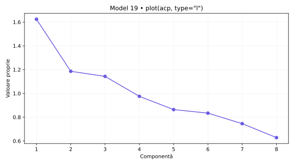
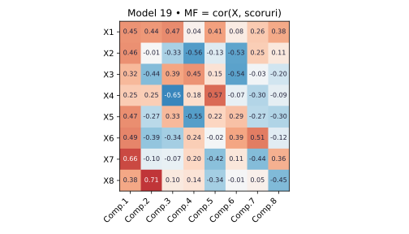
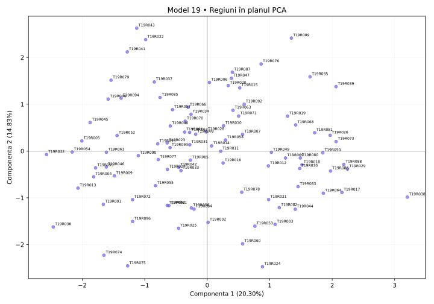

# Model 19 — Cât de utilă este reducerea dimensionalității?

Variantă nouă după cerințele din fotografie și comenzile din „Cod test ACP.docx”. Date sintetice; outputuri didactice calculate în Python după definițiile funcțiilor, fără rulare R.

40 minute · 9p + 1p din oficiu. Barem orientativ.

**Capcana de urmărit:** ACP poate fi calculată și când corelațiile sunt slabe. Dacă ai nevoie de multe componente pentru 80%, sinteza este mai puțin eficientă.

- X1: Internet acasă
- X2: Internet zilnic
- X3: Internet banking
- X4: Cumpărături online
- X5: PIB pe locuitor (PPS)
- X6: Ocupare 20–64 ani
- X7: Șomaj 20–64 ani
- X8: Șomaj tineri

## 1. (1p) Analizați matricea de corelație pentru datele numerice inițiale. Formulați o concluzie privind aplicarea analizei componentelor principale.

```r
cor(scale(X,center=T,scale=T))
```

```text
    X1     X2     X3      X4      X5      X6      X7     X8
X1  1.000  0.031  0.094   0.033   0.153   0.011   0.087  0.237
X2  0.031  1.000  0.009   0.108   0.138   0.109   0.140  0.080
X3  0.094  0.009  1.000   -0.053  0.088   0.102   0.143  -0.043
X4  0.033  0.108  -0.053  1.000   -0.048  0.112   0.080  0.067
X5  0.153  0.138  0.088   -0.048  1.000   0.099   0.155  -0.017
X6  0.011  0.109  0.102   0.112   0.099   1.000   0.224  -0.016
X7  0.087  0.140  0.143   0.080   0.155   0.224   1.000  0.164
X8  0.237  0.080  -0.043  0.067   -0.017  -0.016  0.164  1.000
```

**Pe înțelesul tău:** cor(scale(X)) este matricea de corelație a indicatorilor. Standardizarea nu schimbă corelațiile Pearson între coloane. Ignor diagonala de 1, discut semnul și modulul a două valori și abia apoi justific utilitatea ACP. Nu spun că ACP este interzisă când corelațiile sunt mici.

**Răspuns-model:** X1–X8 au r = 0.237, iar X6–X7 au r = 0.224. Sunt 0 perechi cu |r| ≥ 0,50 din 28. Corelațiile sunt în general slabe în acest exemplu; ACP este calculabilă, dar avantajul reducerii dimensionalității este limitat, nu îl afirm automat. Semnul arată sensul asocierii, nu cauzalitatea.

- 0.5p: Citezi două corelații și sensul lor.
- 0.5p: Legi informația comună de utilitatea ACP.

## 2. (2p) Folosiți două criterii pentru a decide numărul de componente păstrate în analiză.

```r
summary(acp)
plot(acp,type="l")
summary(acp2)  # secțiunea Eigenvalues
```

```text
                        Comp.1   Comp.2   Comp.3   Comp.4   Comp.5   Comp.6   Comp.7   Comp.8
Standard deviation      1.274    1.089    1.069    0.988    0.929    0.913    0.863    0.792
Proportion of Variance  0.20300  0.14825  0.14291  0.12191  0.10798  0.10426  0.09318  0.07850
Cumulative Proportion   0.20300  0.35125  0.49416  0.61607  0.72406  0.82832  0.92150  1.00000

Eigenvalues           Dim.1   Dim.2   Dim.3   Dim.4   Dim.5   Dim.6   Dim.7   Dim.8
Variance              1.624   1.186   1.143   0.975   0.864   0.834   0.745   0.628
% of var.             20.300  14.825  14.291  12.191  10.798  10.426  9.318   7.850
Cumulative % of var.  20.300  35.125  49.416  61.607  72.406  82.832  92.150  100.000
```

**Pe înțelesul tău:** Citește trei lucruri separat: Standard deviation = abaterea componentei; pătratul ei = valoarea proprie; Proportion/Cumulative sunt proporții și se înmulțesc cu 100 pentru procente. Scree plot arată valorile proprii; cotul este un reper grafic, nu un număr impus fără justificare. Graficul plot(acp) afișează implicit cel mult primele 10 axe; tabelul este complet. ncp=5 implicit din PCA() nu înlocuiește criteriile de selecție.

**Răspuns-model:** Ridic la pătrat Standard deviation: pentru PC1, 1.274² ≈ 1.624; valorile nerotunjite dau rezultatul exact. Kaiser păstrează 3 componente cu λ > 1, echivalent sdev > 1 în această ACP standardizată. Acestea explică 49.42%. La un prag ales de 80%, primul număr suficient este 6, cu 82.83%. Dacă vreau minimum 80% din informație, aleg 6; aplicând strict Kaiser, aleg 3. Proportion of Variance pentru PC1 este 0.20300, adică 20.30%.

- 1p: Aplici Kaiser și indici numărul corect.
- 1p: Precizezi pragul și primul număr care îl atinge; justifici alegerea.



## 3. (2p) Folosiți matricea factor pentru a interpreta a doua componentă principală.

```r
scoruri <- acp$scores
MF=cor(X,scoruri)
corrplot(MF,method="number")
```

```text
MF  Comp.1  Comp.2  Comp.3  Comp.4  Comp.5  Comp.6  Comp.7  Comp.8
X1  0.447   0.437   0.474   0.042   0.409   0.081   0.261   0.376
X2  0.458   -0.007  -0.326  -0.560  -0.132  -0.530  0.247   0.106
X3  0.323   -0.436  0.391   0.452   0.146   -0.537  -0.026  -0.196
X4  0.254   0.245   -0.651  0.176   0.565   -0.071  -0.296  -0.093
X5  0.469   -0.272  0.327   -0.553  0.218   0.292   -0.269  -0.297
X6  0.489   -0.393  -0.339  0.242   -0.017  0.394   0.513   -0.116
X7  0.664   -0.101  -0.073  0.204   -0.415  0.111   -0.436  0.358
X8  0.384   0.712   0.097   0.137   -0.343  -0.014  0.047   -0.445
```

**Pe înțelesul tău:** Aici matricea factor chiar este cor(X, scoruri), deci numerele sunt corelații. Nu o confunda cu acp$loadings, unde sunt vectorii proprii. Citesc doar Comp.2, aleg coeficienții mari în modul, verific și minusurile și construiesc numele pe indicatorii dominanți. Pentru sensul regiunilor din fviz_pca_ind folosesc coordonatele PCA de la cerința 4: între metode semnul unei axe poate fi inversat.

**Răspuns-model:** Pe Comp.2 sunt asocieri pozitive mai importante pentru Șomaj tineri (X8: 0.712), Internet acasă (X1: 0.437) și negative pentru Internet banking (X3: -0.436), Ocupare 20–64 ani (X6: -0.393). Componenta explică 14.83% din variația totală. O denumire descriptivă posibilă este „contrast între Șomaj tineri / Internet acasă / Internet banking”, cu sensurile precizate mai sus.  Numele descrie asocieri din setul de date; nu demonstrează cauzalitate.

- 1p: Identifici indicatorii dominanți și coeficienții lor pe PC2.
- 1p: Explici sensurile, propui un nume susținut și precizezi variația explicată.



## 4. (2p) Din outputul numeric privind variabilele interpretați coloanele Dim1, Dim2 (corelații) și ctr (contribuții) pentru primele două componente principale.

```r
acp2 <- PCA(X,scale.unit=T,graph=T)
summary(acp2)  # secțiunea Variables
```

```text
Variables
    Dim.1  ctr     cos2   Dim.2   ctr     cos2   Dim.3   ctr     cos2
X1  0.447  12.299  0.200  0.437   16.068  0.191  -0.474  19.614  0.224
X2  0.458  12.915  0.210  -0.007  0.004   0.000  0.326   9.288   0.106
X3  0.323  6.412   0.104  -0.436  16.034  0.190  -0.391  13.348  0.153
X4  0.254  3.970   0.064  0.245   5.067   0.060  0.651   37.024  0.423
X5  0.469  13.519  0.220  -0.272  6.227   0.074  -0.327  9.375   0.107
X6  0.489  14.700  0.239  -0.393  13.051  0.155  0.339   10.068  0.115
X7  0.664  27.114  0.440  -0.101  0.860   0.010  0.073   0.460   0.005
X8  0.384  9.071   0.147  0.712   42.690  0.506  -0.097  0.824   0.009
```

**Pe înțelesul tău:** În fiecare grup de trei coloane citești: Dim = corelație, ctr = procent din construirea componentei, cos2 = cât de bine se vede variabila pe acea axă. Următorul grup este pentru componenta următoare. Nu aduni ctr de pe PC1 cu ctr de pe PC2 și nu tratezi ctr ca procent de reprezentare. Summary afișează implicit doar 10 elemente și 3 axe, deși analiza poate conține mai multe.

**Răspuns-model:** În Variables, Dim.1 și Dim.2 sunt corelații. Pentru X7, r cu PC1 este 0.664, iar cu PC2 este -0.101; semnul indică sensul, modulul intensitatea. ctr este contribuția la construirea axei: X7 are 27.11% pe PC1 și X8 are 42.69% pe PC2. Reperul mediu este 100/8 = 12.50%, calculat cu toate cele 8 variabile active. cos² pentru X7 pe PC1 este 0.440, adică 44.03% din variația sa reprezentată de această axă; în această ACP standardizată cos² = r². Contribuțiile tuturor variabilelor însumează 100% separat pe fiecare axă, înainte de rotunjire. Primele două axe au aceeași orientare în cele două outputuri din această variantă.

- 1p: Interpretezi numeric Dim1 și Dim2, cu semn și intensitate.
- 1p: Interpretezi contribuțiile pentru ambele axe, reperul mediu și diferența față de cos².

## 5. (2p) Reprezentați grafic regiunile într-un spațiu definit de primele două componente principale. Extrageți 2 concluzii.

```r
fviz_pca_ind(acp2)
# Tabelul de mai jos selectează extremele din acp2$ind; nu este lista implicită a primelor 10.
```

```text
Individuals — selecție pentru verificarea concluziilor
         Dist   Dim.1   ctr    cos2   Dim.2   ctr    cos2
T19R038  3.824  3.202   6.577  0.701  -0.986  0.853  0.066
T19R032  4.088  -2.572  4.244  0.396  -0.076  0.005  0.000
T19R043  3.789  -1.128  0.816  0.089  2.625   6.053  0.480
T19R024  3.150  0.884   0.501  0.079  -2.472  5.365  0.616
```

**Pe înțelesul tău:** În Individuals, Dim este scorul unei regiuni, nu corelația unei variabile. Poate depăși ±1. ctr arată participarea regiunii la axă; cos² arată calitatea reprezentării, iar cos² pe plan = cos² pe PC1 + cos² pe PC2. Folosesc indicatorii din PCA pentru a numi direcțiile graficului. Două puncte apropiate sugerează profiluri asemănătoare în plan, fără a demonstra identitate în toate variabilele.

**Răspuns-model:** Graficul regiunilor folosește coordonatele din PCA, cu PC1 orizontală și PC2 verticală, și păstrează 35.13% din variație. Concluzia 1: T19R038 (PC1=3.202) și T19R032 (PC1=-2.572) au profiluri opuse pe PC1. Sensul pozitiv este asociat cu Șomaj 20–64 ani (X7: 0.664), Ocupare 20–64 ani (X6: 0.489), PIB pe locuitor (PPS) (X5: 0.469), iar cel negativ cu valori mici ale indicatorilor corelați pozitiv. Concluzia 2: T19R043 (PC2=2.625) și T19R024 (PC2=-2.472) contrastează pe PC2, al cărei sens pozitiv este asociat cu Șomaj tineri (X8: 0.712), Internet acasă (X1: 0.437), iar cel negativ cu Internet banking (X3: -0.436), Ocupare 20–64 ani (X6: -0.393). cos² în plan pentru aceste ultime două regiuni este 0.569, respectiv 0.694; țin cont de calitatea reprezentării. Planul pierde multă informație în acest exemplu; concluziile rămân limitate la cele două axe.

- 0.5p: Reprezinți regiunile pe cele două axe etichetate și menționezi informația păstrată.
- 0.75p: Formulezi prima concluzie concretă, legată de PC1.
- 0.75p: Formulezi a doua concluzie concretă, legată de PC2; respecți limitele planului.



Surse tehnice: [R princomp](https://stat.ethz.ch/R-manual/R-devel/library/stats/html/princomp.html), [summary.PCA](https://github.com/cran/FactoMineR/blob/master/R/summary.PCA.r), [svd.triplet](https://github.com/cran/FactoMineR/blob/master/R/svd.triplet.R).
